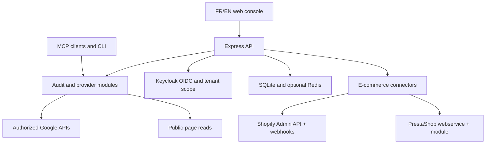
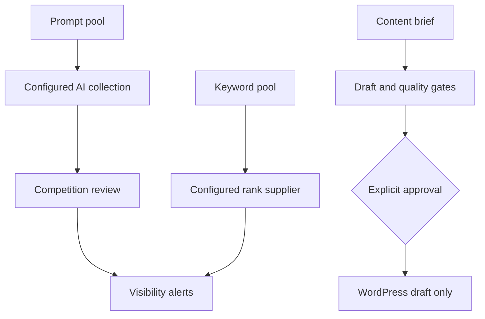

# GTM Growth

**Open-source SEO/GEO, analytics and commerce workspace**, available through a bilingual web console with a contextual data assistant, an MCP server and a CLI. An optional Eve integration supports natural-language replies in approved Slack channels. Connect Google Analytics 4, Google Tag Manager (web and server-side), Measurement Protocol, Search Console, PageSpeed Insights and CrUX; connect **Shopify and PrestaShop stores** to attribute orders — including orders coming from AI assistants — to their acquisition channel; turn measured evidence into reviewed actions.

**Website: [https://gtm.kayroslab.com/](https://gtm.kayroslab.com/)** · [Français](https://gtm.kayroslab.com/fr/) · [Console EN](https://gtm.kayroslab.com/console/?lang=en#c-public-read) · [Console FR](https://gtm.kayroslab.com/console/?lang=fr#c-public-read)

Start with a public page read without signup, explore customer questions, then connect authorized data and manage work in a tenant-scoped console. Grok, Claude, Codex and other MCP clients use the same tool modules. The canonical agent skill and package are named **gtm-growth**.

| Project | Current reference |
| --- | --- |
| **Documentation updated** | 14 November 2026; English-first documentation, French/English product interface |
| **Package / runtime** | `gtm-growth` 0.22.0 · Node.js ≥ 20 · TypeScript |
| **License** | Apache-2.0; self-hosted software remains free |
| **Data and costs** | Public checks and local SEO workflows need no paid data provider. Optional AI collectors and the Eve Slack agent use configured model credentials and may incur provider/hosting charges; guided console answers need no model key. |
| **Cloud offer** | Solo €39/month and Agency €149/month are indicative pilot hypotheses; Mollie checkout and subscription entitlements are not active |
| **Hosting** | OVH VPS with Docker Compose, Nginx and Keycloak; the address above is the primary product website |
| **Validation** | CI: typecheck, lint, Vitest, build, CLI/site smoke, production image, FR/EN browser QA and Node-RED runtime smoke |

## Current delivery status

The website journey redesign is live in production. The [OVH release completed on 14 November 2026 (UTC+8)](https://github.com/Geoking2104/GTM-Growth/actions/runs/43522090712) deployed [`83c8720`](https://github.com/Geoking2104/GTM-Growth/commit/83c8720a153a5224f38c74c688083ab992335c44), including [PR #43](https://github.com/Geoking2104/GTM-Growth/pull/43). [CI passed on the merged revision](https://github.com/Geoking2104/GTM-Growth/actions/runs/43521515234): 585 tests, typecheck, lint, build, production image, FR/EN browser checks and Node-RED runtime smoke.

Post-deployment checks confirmed `/health` returns 200 and the EN/FR homepages, landing styles/scripts, shared feature catalog and three console modules match the released files byte for byte. Live browser checks confirmed all 31 functions, commerce search, French navigation and a real public analysis of `gtm.kayroslab.com`, including three measured recommendations and the handoff into the free console with its URL retained.

Slack remains an optional, separately configured integration; this release does not activate it. The previous release's checks confirmed the protected assistant context returns 401 without sign-in and the unconfigured Slack bridge returns 503. Authenticated real-tenant analytics, payments, store pilots and live Slack/model replies were not exercised in this website release.

| Area | Included in the deployed core or optional integration source | Remaining conditions or scope |
| --- | --- | --- |
| **Free public read** | Single-page GEO v1 readiness, observed SEO evidence, ranked recommendations and outbound social-profile references | No measured search/AI visibility, inbound backlink coverage or public Playwright scan |
| **Customer journey** | Evidence-gated questions using actual Product/Service schema or product microdata; confirmed brand, product, category, buyer and need; up to two customer-selected comparable offers; source links and tracked-prompt handoff | Multi-page journey persistence, scheduled SEO Autopilot and commercial entitlements remain future work |
| **Contextual data assistant** | FR/EN entry points in public scan, onboarding and every console section; personal role, goal, audience, lifecycle stage and optional 28-day target; guided read-only metrics with source/period and missing-data states | Connected data needs authorized tenant sources; business preferences never grant permissions |
| **Slack / Eve** | Optional pinned integration and tenant-bound HMAC read bridge, exact workspace/channel/user bindings, five curated tools and tenant-preserving console links | Separate operator installation, model credentials, secrets, channel audience review and real Slack acceptance required; Slack is not activated by the OVH core deployment |
| **AI visibility accounts** | Named encrypted API accounts; explicit OpenAI, Claude, Mistral and Grok collectors alongside the Gemini panel; distinct navigation icons | A supported provider API account/key is required; consumer chat subscriptions do not supply API access |
| **Global and local SEO** | CSV/JSON registry, exact location grants, declared rank imports, 24 LOC rules, scoped actions/exports and SQLite audit history | Several controls need declared evidence; missing or stale evidence stays unknown |
| **GBP / Node-RED** | Operator-configured Google Business Profile reader, five durable job pollers, supervised phone/website changes with independent approval and API readback | Google project approval, manager OAuth, tenant credentials and worker configuration required; writes disabled by default |
| **FR/EN and SSO** | Localized navigation, language passed to Keycloak, optional login-title override synchronization | Business language and time zone stay separate from interface language |
| **GEO v2** | Category budgets, ownership-verification primitives and isolation architecture on `main`; foundation PR #28 merged | [PR #30](https://github.com/Geoking2104/GTM-Growth/pull/30) remains open: 42-control integration and expanded instrumentation are not in the deployed release; no live isolated Playwright worker |
| **Apply Mode** | Read-only CLI/console diff preview; encrypted approval/snapshot registry and HMAC audit primitives | Registry integration, production writers, independent verification and real rollback remain pending |
| **E-commerce connectors** | Shopify (GraphQL Admin API, custom app) and PrestaShop (webservice) connectors: sealed credentials, idempotent webhook ingestion, deterministic attribution, Commerce console tab, four read-only MCP tools, feed readiness; 23 dedicated tests | Live store pilots pending; PrestaShop real-time needs the companion PHP module (polling fallback works without it); App Store distribution is a later phase |
| **Cloud / Mollie** | Bilingual pilot offer displayed; self-hosted option remains free | Checkout disabled pending payment profile, terms, tax treatment, plan limits and subscription implementation |

## Contextual buyer questions (14 November 2026)

The former heading-based questions are removed. A featured heading such as “Bel Air”
is no longer treated as a brand or a complete product context. The public read extracts
actual Product/Service JSON-LD and product microdata, keeps brand identity separate,
and shows the source. Select a product and confirm its category, target buyer and
need before preparing questions. Change any of these and the previous questions clear.

Read a specific product page when the homepage has no usable catalog. For competition,
add at most two public product pages, select their identified products and explicitly
confirm comparability. No rival, price, market share or product advantage is invented.
Missing context, failed reads and unsupported stages remain empty with a next step.
These are constrained, source-grounded hypotheses, not measured queries or unrestricted
LLM copy. English and French share the same behavior. The authenticated read enforces
the selected tenant's domain, including redirects; rival reads use only public data.

Eve's new `get_customer_journey` tool uses the **same extraction and question builder**
through the signed tenant bridge. It reads context first, requests missing customer
choices and returns only grounded proposals. Eve remains a separately configured
optional service: adding this tool does not activate live Slack/model replies or a
console LLM session. No paid generation or automatic publishing is introduced.

## Google Business Profile dashboard and retail roadmap

The local console now includes a bilingual dashboard following the supplied reference layout: location selector, linked-listing count, review total, Google rating gauge, star distribution and daily interaction chart with month/metric filters. Reads use the authorised location's official Reviews and Performance APIs on demand. Missing values remain unavailable; the distribution is explicitly limited to the returned review sample (up to 50). Dashboard Google content is not persisted.

The public local-SEO section now explains **organise → measure → correct and verify**, with concrete outcomes and the prerequisites for Google data. See the [retail specification and acceptance criteria](docs/product/GBP-RETAIL-SPEC.md) for the implemented scope and the next delivery lots. Review replies, publishing campaigns, self-service OAuth and network reporting remain roadmap items. Server-side Google credentials, API approval and exact location mapping are still required; this change does not activate a customer connection.

This section describes the source implementation. Production deployment must be confirmed independently by the OVH release workflow; the earlier production verification above does not certify this dashboard release.

## How to read this README

**Data-agent capabilities (13 November 2026):** a
bilingual guided assistant now spans the public scan, onboarding and every
authenticated console section. An optional Eve service adds natural-language
Slack replies through tenant-bound metric reads. See the
[journey/value plan](docs/product/DATA-AGENT-JOURNEY.md) and
[Slack operator setup](integrations/eve-data-agent/README.md).

| You are… | Read | You will find |
| --- | --- | --- |
| **Marketing / growth / agency / decision-maker** | [Track 1 — Marketing](#track-1--marketing--what-gtm-growth-does-for-you) | Customer value, free-to-connected journey, commerce attribution, local SEO, pilot offer and product limits |
| **Developer / integrator / DevOps** | [Track 2 — Technical](#track-2--technical--how-it-works-and-how-to-run-it) | Architecture, installation, tool catalog, tenant isolation, operations, activation gates and deployment |

Shared reference: [Recent updates](#recent-updates--november-2026).

---

# Track 1 · Marketing — what GTM Growth does for you

## 1. From evidence to an action plan — now down to the order

GTM Growth brings public-page checks, authorized analytics and search data, customer-journey hypotheses, local-business operations **and connected storefronts** into one workspace. An agency can review several clients while keeping each tenant's domains, properties and records separate.

| Business question | What you receive | What the result means |
| --- | --- | --- |
| **Can crawlers understand my page?** | GEO v1 readiness score, observed checks and prioritized technical fixes | A technical rubric, not a probability of being cited by an AI assistant |
| **What should I fix first?** | Three leading fixes, with up to six observed recommendations shown at a time | Deterministic ordering by quick wins, blockers, customer intent, rubric impact or AI discoverability |
| **What might buyers ask?** | Five awareness stages with sourced questions after product and buyer-context confirmation; unsupported stages stay empty | Hypotheses for review, not observed queries, search volumes or proven demand |
| **Where does useful traffic come from?** | GA4 / Search Console reports after authorized connection; PageSpeed and CrUX where data exists | Provider results with evidence; disconnected examples are labelled as samples |
| **Did AI assistants actually sell?** | With a connected Shopify/PrestaShop store: revenue by channel, AI-assistant share, per-engine detail, per-order attribution with method and confidence | Correlation to a referrer or UTM, deterministically derived and always explained — never a causal claim |
| **Which product pages should I optimize first?** | Catalogue sync plus feed readiness (id, title, link, image, availability, price, brand, gtin) with missing-field counts | Prioritization input for catalogue-level GEO work |
| **Are my locations consistent?** | Location registry, 24 local controls, evidence coverage, declared rank comparisons and assigned actions | Declared evidence remains distinct from Google reads; unknowns do not become passes |
| **Does an AI engine mention my brand?** | Optional bounded AI collections, named API accounts and reviewable Competition datasets | Tenant keys required; automated mention detection remains provisional until reviewed |
| **What should my team do next?** | Role- and goal-aware console shortcuts, guided metric answers and optional natural-language Slack replies | Answers show source/period and missing evidence; Slack requires separate activation |
| **Can I prepare content and fixes?** | Generated assets, article briefs, quality-gated WordPress drafts and read-only Apply Mode previews | Drafts and previews require human review; Apply Mode cannot yet change a remote site |

Outbound profiles can be detected in page links and schema `sameAs`, including Instagram, X/Twitter, Reddit, Discord and TikTok. These references do not establish inbound backlinks.

## 2. The customer journey

The bilingual website now presents five stages: **diagnose → understand → prepare → measure → coordinate**. Four starting paths adapt the suggested sequence for a website owner, marketing team, agency or head-office/location network. A searchable, stage-filtered catalog explains **31 functions** with their benefit, output, prerequisites and a direct console link. Source setup, manual imports, preview-only capabilities and optional integrations are labelled explicitly.

Every customer console section uses the same product descriptions for its purpose, expected output and next action. A selected feature survives sign-in without selecting a customer or granting permissions. Historical examples and the roadmap remain available as expandable detail; planned Cloud offers lead to the contact form, not an inactive checkout. See [Website journey architecture](docs/product/WEBSITE-CUSTOMER-JOURNEY.md).

1. **Start free:** open [gtm.kayroslab.com](https://gtm.kayroslab.com/) or the [French site](https://gtm.kayroslab.com/fr/), then submit a public page in the console. No account or paid provider is required for this read.
2. **Inspect evidence:** review the GEO v1 score, observed SEO issues and the leading technical fixes. The public flow diagnoses one page; it does not run the GEO v2 crawler.
3. **Explore intent:** review the five stages—unaware, problem-aware, solution-aware, product-aware and most aware. Edit hypothetical questions, inspect tentative heading coverage and copy the action plan locally.
4. **Connect authorized data:** sign in through the FR/EN Keycloak flow, use your tenant's registered domains and connect the relevant Google properties. A tenant administrator can explicitly add selected journey questions to the prompt pool.
5. **Connect the store:** an administrator connects Shopify or PrestaShop in **Commerce**; the catalogue and orders sync, webhooks keep them current, and each order is attributed to a channel with its method displayed.
6. **Track and act:** review collected data, maintain local evidence, assign actions and prepare drafts. Adding a prompt does not trigger a paid AI run; scheduled checks and external writes require their own configuration and authority.

The **“AI recommends” / “L'IA recommande”** interface ranks measured failures with an explainable algorithm. It does not call an LLM for the free read or forecast traffic, revenue or citations. Search-engine and assistant logos indicate relevance, not endorsement or live API access.


The **Data assistant** adds a common entry point throughout this journey. Set your
business role, objective, audience, lifecycle stage and optional 28-day target;
the console recommends relevant actions while keeping every section accessible.
Guided questions read configured sources, Search Console clicks, GA4 sessions/key
events, reviewed AI mentions and operations status, with explicit source/period
and missing-data states. No model credential is required for these console answers.

Teams can optionally ask the **Eve Slack agent** natural-language questions in
approved channels and follow its answer back to the right console workspace.
Slack configuration and live acceptance are required; model/hosting fees may
apply. A user's business role never expands permissions, and a Slack channel
never aggregates different clients. [Scope, value and next increments](docs/product/DATA-AGENT-JOURNEY.md).


## 3. Commerce — from visibility to revenue

The e-commerce connectors close the biggest gap of GEO measurement: proving what a citation in ChatGPT, Perplexity or Copilot is worth in orders.

| Capability | What you get |
| --- | --- |
| **Store connection** | Shopify via custom app (domain `*.myshopify.com` + Admin API token) or PrestaShop via webservice key; scopes checked at connection with actionable errors |
| **Catalogue & orders** | Paginated backfill, then webhook-driven updates; out-of-order and replayed events never duplicate a row |
| **Attribution** | Every order carries channel (`organic`, `paid`, `direct`, `email`, `social`, `ai_assistant`, `referral`, `unknown`), engine (ChatGPT, Claude, Perplexity, Copilot, Gemini, Grok), method (UTM, referrer, GA4 join) and confidence |
| **Commerce tab** | Revenue by channel over 30 days, AI share, attributed share, latest orders with their explained attribution, feed readiness |
| **MCP tools** | `commerce_dashboard`, `commerce_orders`, `commerce_products`, `ecommerce_feed_readiness` — same data for agents |
| **Privacy** | No customer name, e-mail, phone or address is ever stored: a keyed-HMAC pseudonym replaces the customer id at ingestion; credentials are AES-256-GCM sealed per tenant |

What attribution does **not** claim: an order attributed to ChatGPT was not “caused” by ChatGPT — it correlates with a referrer or UTM, and the method is displayed everywhere so the report survives scrutiny. Masked referrers stay `unknown`; they are never silently reclassified.

## 4. Global and local SEO — head office, agencies and locations

## 3. Global and local SEO — head office, agencies and locations

The free business-type checklist adapts to physical, service-area and web-only businesses. It is a preparation plan rather than a measured Maps ranking.

In the authenticated workspace, head-office or agency administrators import a CSV/JSON location registry, preview accepted/rejected rows and confirm the import. They grant local users access to exact location IDs, keep country, business languages and time zone separate, and review scoped actions and exports.

| Workflow | Current behavior |
| --- | --- |
| **Registry and permissions** | Persistent tenant-scoped locations, exact user grants and audit history |
| **Local rank observations** | Declared imports with source/date/method; Maps, local-pack and organic surfaces remain separate; only comparable series are compared |
| **24 LOC controls** | Pass, fail, unknown or not-applicable with explicit evidence coverage; several inputs still require declared evidence |
| **Google Business Profile** | Profile/review reads after operator setup, API approval and listing-manager OAuth consent |
| **Supervised changes** | Only website URL and primary phone; separate administrator approval, explicit execution and API readback |
| **Automation** | Five optional Node-RED pollers process queued jobs; no bulk publishing, automatic review replies or autonomous content publication |

A verified API readback does not establish public Maps visibility. Performance collection, qualified local AI and automatic evidence collection for every control remain pending. See [Global/Local SEO](docs/product/GLOBAL-LOCAL-SEO.md) and [operations](docs/product/LOCAL-SEO-OPERATIONS.md).

## 5. The client console


AI visibility includes explicit Claude, Mistral and Grok API collectors alongside
OpenAI and the existing Gemini panel. Connect named API accounts through the
provider portal, save keys encrypted on the server and explicitly choose which
account funds each run. Missing credentials open setup instead of an inactive
button; model-list verification never generates an answer. Native ChatGPT OAuth
is not enabled: it needs a registered application and eligible API scopes.
Bounded calls, citations and saved-answer imports are described in
[AI visibility provider setup](docs/product/AI-VISIBILITY-PROVIDERS.md). Gemini
collection remains disabled pending safe Search Suggestions display. Every
left-navigation destination, including the account link, has a distinct icon.

Open [the English console](https://gtm.kayroslab.com/console/?lang=en#c-public-read) or [the French console](https://gtm.kayroslab.com/console/?lang=fr#c-public-read). Public reading is available before sign-in; connected workspaces use tenant-scoped SSO.

| Workspace | Main outcome / prerequisite |
| --- | --- |
| **Public read** | One-page evidence, technical recommendations and free journey exploration |
| **Overview / Audit / Generators** | Readiness, technical checks and assets to review |
| **Products & pages** | Real product/page thumbnails, completeness gauges, filters and table/card views; public metadata read or previewed administrator JSON import |
| **Commerce** | Connect Shopify/PrestaShop, sync catalogue and orders, revenue by channel with AI-assistant share, feed readiness |
| **Customer journey** | Selected questions added to the tenant prompt pool by an administrator |
| **Global and local SEO** | Location registry, evidence, controls, actions, approvals and exports |
| **Track / Keywords** | Authorized GA4, Search Console and configured Bing data; search opportunities |
| **Competition / Ops visibility** | Imported or configured provider collections, with human review of mentions |
| **Ops rankings** | Keyword history and AI-Overview signals from a configured supplier; no bundled SERP data feed |
| **Ops articles** | Brief, draft and quality gates; approved WordPress draft creation |
| **Ops alerts** | Rank-drop and lost-mention signals where collections are configured |
| **Act / GEO fixes** | Read-only before/after preview; no Apply Mode writer |
| **Reports** | Evidence-based exports and PDF reports; see the [sample report](site/reports/opendpe.html) |

## 6. Open source and the Cloud pilot

| Offer | Current position |
| --- | --- |
| **Self-hosted** | Free Apache-2.0 software; operators supply hosting and any optional provider accounts |
| **Cloud Solo** | Indicative pilot hypothesis: **€39/month** |
| **Cloud Agency** | Indicative pilot hypothesis: **€149/month** |

The Cloud offer is intended to package hosted connected data, history, multi-client work and configured operations. Prices and plan limits are not active subscription entitlements. **Mollie checkout remains disabled** until the payment profile, terms, tax treatment, amounts and limits are validated and the billing lifecycle is implemented. Optional BYOK AI calls may have separate provider costs.

## 7. Evidence, control and next steps

- **Measured, declared and inferred stay distinct.** Scores express technical readiness; unknown evidence is not a success. Historical examples and demo values are not current customer results.
- **Commerce attribution is explained, not causal.** Channel, engine, method and confidence are stored on every order; `unknown` stays `unknown`.
- **Writes require their own explicit controls.** WordPress receives drafts only. Creating a draft does not send an IndexNow notification; a published URL must be independently verified before a separate submission.
- **GEO v2 remains a separate pilot.** Exact-domain verification and owner consent for score publication are separate requirements. The 42-control integration is still under review in PR #30.
- **Local publication is narrowly scoped.** Google access and writes must be deliberately enabled; one administrator prepares a phone/website change and another approves it.
- **Self-hosting remains available.** The free public read and local planning do not require a commercial SEO data API.

[Try a free read](https://gtm.kayroslab.com/console/?lang=en#c-public-read), [start in French](https://gtm.kayroslab.com/console/?lang=fr#c-public-read), or connect an MCP client using Track 2. The site's contact form records a request; automatic emailing of a PDF is not configured.

---

# Track 2 · Technical — how it works and how to run it

## 1. Architecture

MCP clients connect through stdio or HTTPS `/mcp`; the CLI and web console reuse the audit and provider modules. The public website and console are served at **[https://gtm.kayroslab.com/](https://gtm.kayroslab.com/)**. The production application binds to `127.0.0.1:4300` behind Nginx.



Keycloak uses Postgres; tenant registries, local evidence, operations, commerce data and audit events use their respective stores. Optional Node-RED pollers access private tenant-scoped job routes. PDF reports use pdfkit. The Cloudflare Worker is an alternative public API deployment, not the full Node/Keycloak/SQLite console.

### E-commerce connector architecture

One normalized ingestion path serves both platforms: providers only map into canonical types (`src/ecommerce/types.ts`), so quota handling (Shopify), XML quirks (PrestaShop) and status mappings stay in their mappers and never leak into ingestion.

```text
Shopify webhooks (HMAC-SHA256)  ──┐
PrestaShop module (HMAC)        ──┼─► /webhooks/* ──► ingest.ts ──► store (tenant-scoped SQLite)
Backfill: GraphQL / webservice  ──┘        (idempotence,     │
                                            attribution)     ├─► Console /commerce/* routes
                                                              ├─► MCP commerce tools
                                                              └─► Feed readiness
```

- **Ingestion** is idempotent on `provider:event_id` and upserts by canonical order id — a replayed webhook or `orders/paid` arriving before `orders/create` never duplicates a row.
- **Attribution** (`src/ecommerce/attribute.ts`) is deterministic: explicit UTM first, then referrer hostname (AI-engine matcher table), then GA4 session join, else `unknown`/`direct`. Confidence is stored; masked referrers are never reclassified.
- **Privacy**: the customer id is replaced at the boundary by a keyed-HMAC pseudonym; no name, e-mail, phone or address column exists. Connector credentials and webhook secrets are AES-256-GCM sealed with an operator-provided 32-byte key (`ECOMMERCE_DATA_KEY_B64`, HKDF-derived per purpose, bound to tenant+store context).
- **Webhooks** verify HMAC-SHA256 over the raw body, respond 200 in under five seconds, and reject invalid signatures silently (200 + log) so the endpoint is not a probing oracle.
- **Shopify**: GraphQL Admin API (pinned `2026-01`), leaky-bucket cost watched before 429s, cursor pagination; v1 targets a merchant-installed custom app (no App Store review); OAuth structure ready for a later public app.
- **PrestaShop**: webservice `/api/` with `output_format=JSON`, Basic auth (key as user, empty password — never the key in the URL), `date_upd` incremental filters, one concurrent request per shop; real-time pushes come from a companion module (hooks `actionValidateOrder`, `actionOrderStatusPostUpdate`, …) or fall back to polling every 5–15 minutes.

## 2. Quick start

**Prerequisites:** Google Cloud project with the Analytics Data/Admin, Tag Manager and Search Console APIs enabled · a Service Account JSON key · the SA granted *Viewer* on GA4, *Read* on GTM, user access on Search Console · Node ≥ 20. Optional: `PAGESPEED_API_KEY` / `CRUX_API_KEY` / `GOOGLE_API_KEY`, Redis. For commerce: `ECOMMERCE_DATA_KEY_B64` (32 random bytes, base64) to seal store credentials.

```bash
git clone https://github.com/Geoking2104/GTM-Growth.git
cd GTM-Growth
npm ci
cp .env.example .env          # set GOOGLE_APPLICATION_CREDENTIALS
npm run build
npm run start:stdio           # or start:http → :3000/mcp + /sse + /webhooks/*
```

Scopes: `analytics.readonly[.edit]`, `tagmanager.readonly[.edit.containers]`, `webmasters[.readonly]`, `indexing` (gated).

Write controls are adapter-specific: Google mutation tools use their documented enablement/confirmation gates; `indexnow_submit` explicitly requires `confirm=true`. The authenticated WordPress route requires tenant-admin rights, configured credentials, `approved: true` and passing quality gates, and always creates a **draft** without IndexNow submission. Local GBP publication has its separate two-administrator approval and enablement gates described below. Read-only Apply Mode previews cannot enable a writer. Commerce connection and sync routes are tenant-admin only; MCP commerce tools are read-only and never expose credentials.

These service-account prerequisites apply to the connected Google analytics/tagging tools. Public-page reads do not need Google credentials. GBP requires separate listing-manager OAuth; do not reuse the analytics service-account JSON for it.

Reliability: zod validation on every tool, enriched Google errors (`[status | reason]`), gaxios retry/pagination, optional `MCP_API_TOKEN` bearer auth, stderr-only logging.

### Connecting a store

1. Generate the sealing key: `openssl rand -base64 32` → `ECOMMERCE_DATA_KEY_B64`.
2. **Shopify**: create a custom app in the merchant admin (scopes `read_products`, `read_orders` — `read_all_orders` needs Shopify approval for history beyond 60 days), install, copy the Admin API token.
3. **PrestaShop**: enable the webservice, create a key with rights on `products`, `orders`, `order_details`, `order_states`; serve the shop over HTTPS.
4. In the console: **Track → Commerce → Connect** (administrator). Scope problems surface as `insufficient_scopes` with the exact missing rights.
5. Run **Sync catalogue** then **Sync orders** (paginated, resumable); register the webhook endpoint `https://<server>/webhooks/shopify` (or `/webhooks/prestashop` for the module) with the store's webhook secret for real-time updates.

## 3. Connect your client

| Client | Best path | Guide |
|--------|-----------|-------|
| **Grok** | Custom Connector (HTTPS) or Grok Build (stdio) | [docs/GROK_SETUP.md](docs/GROK_SETUP.md) |
| **Claude** | `.mcp.json` + skill in `.claude/skills/` | [docs/CLAUDE_SETUP.md](docs/CLAUDE_SETUP.md) |
| **Codex** | MCP settings + skill in `.codex/skills/` | [docs/CODEX_SETUP.md](docs/CODEX_SETUP.md) |

```bash
./scripts/install-skill.sh both          # skill → .claude and .codex
grok mcp add --scope project gtm-growth -- node dist/index.js --transport stdio
```

CLI for validation workflows: `npm run cli -- geo-audit --url https://example.com` · `geo-report` · `audit-web` · `pagespeed` · full list in [docs/CLI.md](docs/CLI.md).

## 4. MCP tool catalog (condensed)

| Domain | Tools (selection) |
|--------|-------------------|
| **GA4** | `list_properties`, `get_traffic_overview`, `get_top_pages`, `get_acquisition`, `get_devices`, `run_report`, `run_realtime_report`, `analyze_ecommerce_data` |
| **GTM Web** | `audit_ga4_setup_v2`, `find_tags_by_trigger`, `find_tags_using_variable`, `detect_duplicate_tags`, `gtm_audit_installation`, `gtm_generate_snippet`, `validate_ecommerce_events`, `create_ga4_event_setup` (gated write) |
| **sGTM / MP** | `audit_sgtm_setup`, `compare_dual_tagging`, `cutover_checklist`, `verify_ga4_secrets`, `configure_measurement_protocol` |
| **Search Console** | `list_search_console_sites`, `get_search_overview`, `get_top_queries`, `get_query_page_pairs`, `get_search_trend`, `inspect_url(s)`, `submit_sitemap` (gated) |
| **Indexing** | `get_url_notification_metadata`, `publish_url_notification(s)` (gated) |
| **Performance** | `run_pagespeed[_batch]`, `query_crux[_batch]` |
| **GEO** | `geo_audit`, `geo_audit_sitemap`, `geo_citability`, `geo_crawler_access`, `geo_llms_drift`, `geo_content_risks`, `geo_positioning`, `geo_platform_readiness`, `geo_generate_llms_txt`, `geo_generate_schema`, `geo_generate_robots` |
| **GeoSuite** | `poppy_check`, `poppy_generate` (Personal Agent Protocol `/.well-known/poppy.json`), `geo_sitemap_build` |
| **IndexNow** | `indexnow_keygen`, `indexnow_verify`, `indexnow_submit` (gated), `indexnow_readiness`, `indexnow_explain` |
| **Commerce** | `commerce_dashboard` (revenue by channel + AI share, per-engine), `commerce_orders` (with attribution), `commerce_products`, `ecommerce_feed_readiness` — read-only, tenant-scoped |
| **Boards** | `analysis_board` — GEO + citability + platforms + IndexNow with a ranked action list (indexation blockers outrank copy fixes) |

Full agent-facing catalog: [`skills/gtm-growth/references/tools.md`](skills/gtm-growth/references/tools.md) · Rubric & limits: [docs/GEO.md](docs/GEO.md).

## 5. Standard workflows

- **Weekly briefing** — `list_properties` → `get_traffic_overview` → acquisition/pages/devices → events → ecommerce.
- **SEO & performance audit** — `get_top_search_pages` → `query_crux` → `run_pagespeed` → `inspect_url` → priority table.
- **GEO audit** — `geo_audit` (homepage) → `geo_audit_sitemap` (≤25 pages) → generate what is missing → re-audit and diff. Readiness only: the audit never queries ChatGPT/Claude/Perplexity to claim a citation — live checks are the Ops layer below, with client keys.
- **AI revenue review** — connect the store → `commerce_dashboard` → per-engine revenue → `commerce_orders` to audit individual attributions → feed readiness for the catalogue gaps.
- **Growth dashboard** — 28 days vs previous 28, cross-channel KPI scorecard, 10+ watch points, exactly 3 horizon-scoped priorities with measurement plans; estimates are ranges from stated assumptions, never invented forecasts.
- **IndexNow rollout** — keygen → publish key file → `indexnow_verify` (must pass) → `indexnow_submit` (`confirm=true`) → `analysis_board`.
- **GTM install check** — `gtm_audit_installation` → fix checks → `gtm_generate_snippet` if needed.

Example report shapes: [`skills/gtm-growth/references/examples.md`](skills/gtm-growth/references/examples.md) · server-side path: [docs/SERVER_SIDE_TRACKING_ARCHITECTURE.md](docs/SERVER_SIDE_TRACKING_ARCHITECTURE.md).

## 6. Console internals — multi-tenant on Keycloak

The data-agent routes (`/api/console/data-agent/context`, `/profile`, `/query`)
reuse OIDC and active-tenant checks. Profiles are scoped to tenant + issuer +
subject. The optional `/api/internal/data-agent/read` bridge validates raw-body
HMAC signatures, durable replay nonces and an operator-approved team/channel/user
binding before resolving the tenant. It exposes curated aggregates, with no SQL
or arbitrary MCP execution. The independent
[`integrations/eve-data-agent`](integrations/eve-data-agent/README.md) package pins
Eve dependencies on Node 26; the core OVH app retains its existing runtime.
Slack and API errors never become invented measurements or automatic writes.

**Keycloak 26.4** is the identity provider for all console clients, not just a login screen.

| Layer | Component |
|---|---|
| Identity & SSO | Keycloak 26.4 (production mode, Postgres 16) |
| Multi-tenancy | One Keycloak **Organization** per client in the shared `gtm-growth` realm; optional dedicated `tenant-<id>` realm (custom theme, own policies, distinct signing keys) |
| Federation | Per-client brokering: Google Workspace, Microsoft Entra ID, any OIDC/SAML 2.0 (auto-redirect by email domain) |
| Self-service | Account console: password reset, **TOTP MFA**, sessions |
| API | Express + internal JWT verification (`node:crypto`, JWKS per issuer), tenant resolution, data isolation |
| Provisioning | Keycloak Admin REST (service account `gtm-provisioner`): `npm run tenant:provision` or `POST /api/platform/tenants` |

**Organization mode** shares an issuer/JWKS while tenant membership and groups determine access. Dedicated realms provide a separate issuer when configured.

**The tenant travels in the token:** in Organization mode, an `organization` claim **and** a `/tenants/<id>/<role>` group must agree (a group without membership is ignored); in realm mode, the issuer `iss` is the tenant. Multi-tenant users pick the active tenant in the UI (`X-Tenant` header, verified against the token — not spoofable).

| Role | Granted by | Rights |
|---|---|---|
| `tenant-user` | group `/tenants/<id>/tenant-user` | console tools on **own** domains/properties, leads, reports, commerce reads |
| `tenant-admin` | group `/tenants/<id>/tenant-admin` | + tenant settings, user invites, Ops writes, store connection/sync/disconnect |
| `platform-admin` | realm role (hosting side) | Platform provisioning and supported tenant administration via `X-Tenant`; no implicit local SEO editorial/publication access |

**API-side isolation:** every request resolves to a tenant; any `url`/`inspectUrl` outside the tenant's domains → **403 before DNS resolution**; properties/containers outside the tenant → 403; leads and PDF reports are stored and served per tenant. Commerce data (stores, products, orders) is stored under the tenant id and every query is tenant-scoped; the webhook router resolves the tenant from the verified shop domain, never from client input. Covered by `tests/tenant-isolation.test.ts` and `tests/ecommerce.test.ts`.

**Onboarding a client** (prerequisites: DNS + Keycloak SMTP once — see `deploy/kayroslab-vps/README.md`):

```bash
npm run tenant:provision -- --id acme --name "Acme" \
  --email-domain acme.fr --domain acme.fr --property sc-domain:acme.fr \
  --admin direction@acme.fr
# SSO option: --idp microsoft --idp-tenant <id> --idp-client-id <app> --idp-client-secret-env ACME_ENTRA_SECRET
```

Provisioning creates the organization (or realm), role groups, console redirect URIs, the optional IdP link, the first admin (email invitation, 72 h), and the tenant registry entry. Without `OIDC_ISSUER` the console API stays **closed (503)**; public `/api/free-read`, `/api/lead`, `/health` are unaffected.

**Console routes** (all `POST /api/console/*`, zod-validated, tenant-scoped):

| Group | Tabs | Routes |
|---|---|---|
| Phase 1 | Sitemap · GEO · Performance | `sitemap/{map,audit,build}`, `geo/{citability,llms,robots,schema}`, `performance/{pagespeed,crux,weight}` |
| Phase 2 | Search · Keywords · Calculators · PDF | `search/{queries,trends,losing-pages,inspect}`, `keywords/opportunities`, `calc/{ctr,traffic-value,roi,budget}`, `report/pdf` |
| Phase 3 | Technical audit · Generators | `audit/{technical,serp-preview}`, `generate/{titles,meta,outline}` |
| Track | GSC · GA4 · Bing · Status | `search/performance`, `search/query-pages`, `ga4/{overview,ecommerce,technology,realtime}`, `bing/performance`, `tracking/status` |
| **Commerce** | Stores & revenue | `commerce/{connect,stores,disconnect}`, `commerce/sync/{products,orders}`, `commerce/{dashboard,orders,products,feed/readiness}` |
| Competition | AI answers | `ai-visibility/*`, `competition/*` (+ read-only per-tenant MCP at `/api/mcp/competition`) |
| Ops / Journey | Visibility · Rankings · Articles · Alerts · Customer journey | `visibility/*`, `rank/*`, `content/*`, `ops/*`; selected journey prompts reuse the existing tenant prompt pool |
| Global / Local SEO | Registry · Evidence · Controls · Jobs · Publication | `local-seo/*`; see the exact contracts in the operations guide |
| Apply Mode | GEO fix preview | `apply/preview` (`robots-ai`, dry-run only) |

Public webhook endpoints (no OIDC — authenticated by HMAC): `POST /webhooks/shopify`, `POST /webhooks/prestashop`.

Code: `src/console/` (API, auth, modules, `commerce.ts`, `ecommerce-webhooks.ts`) · `src/ecommerce/` (types, store, ingest, attribute, secrets, feed, providers) · `site/console/` (app-shell UI) · tests `tests/console-*.test.ts`, `tests/ecommerce.test.ts`.

### E-commerce connectors — details and limits

| Area | Behavior |
|---|--- |
| **Connection** | Admin-only; Shopify domain validated `*.myshopify.com`, token never returned to the browser; PrestaShop requires HTTPS (HTTP only with explicit `PRESTASHOP_ALLOW_HTTP=true` for local tests) |
| **Scopes** | Checked at connect: Shopify `read_products`/`read_orders` (GraphQL `shopifyAppInstallation.accessTokenScopes`); PrestaShop resource permissions on `products`, `orders`, `order_details` — missing rights surface as `insufficient_scopes` with an actionable message |
| **Backfill** | Cursor-paginated (`commerce/sync/products`, `commerce/sync/orders`), resumable via stored sync cursors; Shopify batch ≤ 250, PrestaShop ≤ 500 with `date_upd` filters |
| **Real time** | Shopify webhooks (`orders/*`, `products/*`, `refunds/create`, `app/uninstalled`, compliance topics logged); PrestaShop module pushes or 5–15 min polling |
| **Idempotence** | `webhook_events` table keyed `provider:event_id`; order upsert keyed by canonical id — replay-safe by construction and by test |
| **Money** | Shopify string amounts converted explicitly (`shopMoney`); PrestaShop stores both tax-inclusive and tax-exclusive totals, tax-inclusive used for revenue |
| **Limits** | Shopify `read_all_orders` (history > 60 days) requires Shopify approval — partial backfill is reported, never silently truncated; per-request timeout with exponential backoff |
| **Retention & erasure** | Compliance webhooks (`customers/redact`, `shop/redact`) logged for operator action; console erasure order planned; 13-month rolling orders / 25-month aggregates per the specification |

Specification: [docs/specs/ECOMMERCE-CONNECTORS-v1-2026-11-13.md](docs/specs/ECOMMERCE-CONNECTORS-v1-2026-11-13.md) (French, source of truth).

### Global/local SEO operations and activation gates

The authenticated module persists registry entries, grants, declared rank observations, evidence, actions, approvals, jobs and audit events in SQLite. Local users have no location access until explicitly granted; platform admins and machine identities have no implicit editorial/publication access. UI language never changes a location's business language or time zone.

- **24 deterministic controls:** `src/local-seo/controls.ts` emits `pass`, `fail`, `unknown` or `not-applicable`. Coverage excludes inapplicable controls; conformity can be null and summaries below 80% coverage are unreliable. A declared pass is not independent Google certification.
- **GBP reads:** require approved Google project access, Business Information/My Business API enablement, offline `business.manage` manager consent and per-tenant files under `GBP_CREDENTIALS_DIR`. There is no self-service OAuth callback. API enablement alone is insufficient; zero quota blocks synchronization.
- **GBP writes:** only `websiteUri` and `phoneNumbers.primaryPhone`. Require `LOCAL_SEO_PUBLISH_ENABLED=true`, tenant `writeEnabled=true`, an immutable diff/digest, an approval valid for 30 minutes from a different tenant administrator, explicit execution, drift checks and independent API readback. Timeouts after dispatch become uncertain and are reconciled read-only.
- **Durable jobs:** optional Node-RED core-node pollers handle WF-02/03/07/09/10: profile sync, review sync, control evaluation, publication reconciliation and control summary. Tenant-scoped hashed worker tokens are configured through `LOCAL_SEO_WORKERS_FILE`; polling processes queued jobs and does not itself schedule recurring collections. WF-08 publication stays a human console operation.
- **Pending:** performance collection, automatic evidence feeds for all controls, local AI qualification, bulk publication and public-visibility verification.

Contracts and qualification: [Global/Local SEO](docs/product/GLOBAL-LOCAL-SEO.md), [Local SEO operations](docs/product/LOCAL-SEO-OPERATIONS.md), [Node-RED setup](deploy/node-red/README.md). The local SEO integration introduces no paid-provider fallback.

### Customer journey and language handling

The public journey derives tentative heading matches from bounded title/description/H1/H2 signals already returned by `POST /api/free-read`; no extra crawl or paid engine call is added. Questions preserve inferred/user-provided provenance; selected target URLs must remain inside the authenticated tenant's scope. The admin action adds a prompt, not a visibility collection.

Console navigation and Keycloak sign-in preserve the chosen FR/EN locale. The optional deployment input `sync_login_titles` updates only login-heading overrides through the existing provisioner service account, verifies the saved values and does not restart SSO. See [Customer Journey integration](docs/product/CUSTOMER-JOURNEY-INTEGRATION.md) for the L1 scope and remaining L2 work; the deployment record above supersedes its original pre-release status.

### GEO v2 — ownership and instrumentation status

The approved category budgets are **14 / 14 / 14 / 10 / 18 / 10 / 8 / 12** for robots, llms.txt, JSON-LD, metadata, content, brand/entity, AI discovery and rendering. These v2 budgets must not be used to reinterpret historical v1 scores.

The merged [PR #28](https://github.com/Geoking2104/GTM-Growth/pull/28) supplies verified-domain guards and the pilot architecture. The SQLite registry hashes challenge tokens, consumes challenges atomically and scopes grants to a tenant and exact hostname. Verification uses DNS TXT at `_gtm-growth-verify.<hostname>` or an HTTPS file at `/.well-known/gtm-growth-verification.txt`; challenges expire after 30 minutes and grants after seven days. These primitives are not yet wired to a public verification API.

The open [PR #30](https://github.com/Geoking2104/GTM-Growth/pull/30) contains the proposed 42-control scoring integration, 17 HTTP/HTML collectors plus 18 conditional collectors, and verified offline rendering replay. These are **branch contents, not merged functionality**. Unresolved evidence must remain unknown; offline replay is not a live browser worker.

Live Playwright execution still requires a separate isolated job, network-level SSRF/DNS-rebinding protection, exact-host egress policy and validated resource limits. Score publication also requires explicit owner consent. See [the pilot architecture](docs/architecture/GEO-V2-PLAYWRIGHT-PILOT.md).

### Apply Mode — reviewed fixes (MVP foundation)

The **Apply Mode** scope extends the audit-to-action journey: select one bounded fix, inspect its before/after diff, preview, explicitly approve, snapshot, apply, independently verify and offer rollback. External writers will require exact-domain ownership, tenant-scoped Keycloak approval, a pre-write backup, drift checks and an append-only audit trail. The Apply Mode roadmap limits WordPress content to **draft-only** and GTM changes to a **draft workspace**, with no automatic publication; legacy GTM write/publish routes are not part of that workflow.

Two **read-only preview entry points** are implemented for AI crawler rules:

```bash
npm run cli -- geo-apply --url https://example.com --fix robots-ai --dry-run
npm run cli -- geo-apply --url https://example.com --fix robots-ai --diff
```

The authenticated console also exposes **Act → GEO fixes → Preview**, through `POST /api/console/apply/preview` (`url`, `fix: "robots-ai"`, `mode: "dry-run"`). This route derives the tenant from Keycloak, requires a registered HTTPS hostname, and never enables application. The CLI and console fetch public `robots.txt` with SSRF protections, generate a bounded diff and SHA-256 evidence, and flag manual conflicts. **Neither can write to a website**: CLI `--confirm` and `--apply` fail closed. The existing WordPress content route creates **drafts only** and no longer submits draft URLs to IndexNow.

**Phase 0.3 — approval and recovery foundation (library-only):** a Node/SQLite `ApplyRegistry` can persist encrypted previews and before-change snapshots (AES-256-GCM, tenant/proposal-bound authenticated context), an explicit approval bound to the reviewed diff digest and active exact-hostname verification grant, and a per-tenant HMAC-chained audit journal. Keycloak-derived reader/editor/approver/admin identities are mapped server-side; the approver/admin roles can approve only a current, conflict-free proposal. Approval validity is capped at five minutes; encrypted backups have a configurable 1–90-day retention period (30 days by default), with an explicit purge operation. Tests cover tampering, tenant isolation, drift, expiry and revocation. The storage key is operator-provided (32 random bytes); **there is no default key or production registry configuration**.

**Still deliberately disabled:** the registry is not connected to the console, REST/MCP approval routes or production adapters. Purging still needs a scheduled job; exclusive write-attempt locks, consumption of single-use approvals, independent post-write verification and real rollback need implementation and staging validation. No Apply Mode feature can publish WordPress content, edit files on a remote site or publish a GTM version. The existing unrelated GTM write routes are **not** governed by this new approval mechanism. See the [full owner specification](docs/specs/APPLY-MODE-v1-2026-11-09.md) and [Apply Mode architecture, safety gates and scope register](docs/architecture/APPLY-MODE-MVP.md).

## 7. Ops layer — live visibility, rankings, article pipeline

The Ops section connects configured collections to review, alerts and draft preparation. All routes are tenant-scoped, writes admin-only, and BYOK keys stored server-side. Optional providers may incur charges; the free journey and local SEO workflows do not call them.



| Area | Bounds & safety |
|---|---|
| **Prompt pool / runs** | 200 prompts, deduped; runs bounded (5 prompts × 2 lots per engine per run); unconfigured engines degrade with a clear message; every run lands as a reviewable Competition dataset |
| **Rank tracking** | 200 keywords; SERP supplier via `RANK_SUPPLIER_URL`+`RANK_SUPPLIER_TOKEN` (JSON API) or `RANK_SCRAPER_URL` (HTML profile); AI-Overview presence + tenant-citation detection on the same payload; drop alerts warn ≥ 3 positions, critical ≥ 10 |
| **Article pipeline** | Deterministic brief/outline (FR/EN); optional Ollama (`OLLAMA_URL`); WordPress creation requires `approved: true` + all gates passed and produces a **draft**. The route returns `published: false` and `indexnow: null`; it never announces a draft URL. |
| **Alerts & scheduler** | alert store with acknowledge; visibility-loss and rank-drop detection; per-tenant automation config; scheduler opt-in (`OPS_SCHEDULER_ENABLED`, default off — stdio/CI stay quiet) |

Env (all optional, documented in `.env.example`): `AI_VISIBILITY_{OPENAI,GEMINI}_KEY_<TENANT>` · `RANK_SUPPLIER_URL/TOKEN` or `RANK_SCRAPER_URL` · `WP_{SITE_URL,USERNAME,APP_PASSWORD}_<TENANT>` · `OLLAMA_URL/MODEL` · `OPS_SCHEDULER_ENABLED/MINUTES` · `ECOMMERCE_DATA_KEY_B64` · `ECOMMERCE_STORE_PATH` · `SHOPIFY_API_VERSION` · `PRESTASHOP_ALLOW_HTTP`.

Code: `src/console/{ops-store,visibility-runner,rank-tracking,content-ops,ops-routes,ops-scheduler}.ts` · UI `site/console/ops.js` · tests `tests/console-ops.test.ts`.

## 8. IndexNow — protocol notes

IndexNow is a push protocol: instead of waiting for crawlers, you tell **Bing, Yandex, Seznam and Naver** (not Google) that URLs changed. Four steps: generate a key (8–128 chars `[a-zA-Z0-9-]`) → publish `https://<host>/<key>.txt` → `POST` up to 10,000 URLs → read the status (`200/202` = received, **never** indexed; `403` = key file wrong; `422` = URLs off-host; `429` = throttled — each decoded with its fix).

| Tool | Role |
|---|---|
| `indexnow_keygen` | Key + file name/URL/content/headers, fully local |
| `indexnow_verify` | Fetches the key file, names the failure mode |
| `indexnow_submit` | Batch submission — gated by `confirm=true` |
| `indexnow_readiness` | 0–100 panel with evidence per check |
| `indexnow_explain` | Decodes any status without sending anything |

Operating rules: submit **changes**, not the archive; one batch per publish; never delete the key file; treat `200` as a receipt. Full sequences and weights: [docs/INDEXNOW.md](docs/INDEXNOW.md).

## 9. Public API & Worker

| Endpoint | Role |
|---|---|
| `POST /api/free-read` | Bounded public-page GEO v1/SEO evidence, page signals and social references with SSRF protection, caching and rate limits. GA4/GSC traffic rows are samples unless authorized data is connected; this endpoint does not grant access to a site's private analytics. |
| `POST /api/lead` | Contact capture (JSONL + optional `LEAD_WEBHOOK_URL`); no mail client — PDF emailing would need an SMTP/API provider, intentionally not configured |
| `POST /webhooks/shopify` · `POST /webhooks/prestashop` | Signed store events (HMAC-SHA256, raw body); idempotent ingestion into tenant-scoped commerce storage; invalid signatures answered 200 and logged |

Same shared code runs on Node or as a **Cloudflare Worker**: [docs/PUBLIC_API.md](docs/PUBLIC_API.md) · [docs/WORKER.md](docs/WORKER.md).

## 10. CI/CD

| Workflow | When | What |
|----------|------|------|
| [CI](.github/workflows/ci.yml) | push / PR to main or master | Typecheck, lint, Vitest, build, CLI/site smoke, Docker build, FR/EN browser QA/screenshots and Node-RED runtime smoke |
| [Validate](.github/workflows/validate.yml) | manual (optional weekly) | Live pipeline with configured service-account secret |
| [OVH release](.github/workflows/deploy-kayroslab-vps.yml) | Manual on main with `DEPLOY` | `production` environment; strict pinned ED25519 SSH verification; fast-forward source update and Compose deployment; optional login-title synchronization |
| [GitHub Pages](.github/workflows/pages.yml) / [Cloudflare Worker](.github/workflows/worker.yml) | Manual on main with `DEPLOY` | Alternative publication targets; neither changes the primary website address |

```bash
npm run typecheck
npm run lint
npm test
npm run build
```

The OVH workflow reads `VPS_SSH_USER` and `VPS_SSH_KEY` from secrets and validates the public ED25519 fingerprint pinned in source; the legacy fingerprint secret is no longer used. A documentation push runs CI but does not dispatch a production deployment. Latest confirmed application deployment: [12 November 2026](https://github.com/Geoking2104/GTM-Growth/actions/runs/43270543975).

## 11. Project layout

```text
.grok/config.toml              # Grok Build MCP
.mcp.json                      # Claude / Cursor / Codex local stdio
skills/gtm-growth/             # canonical agent skill (+ references/, agents/openai.yaml)
scripts/install-skill.sh       # skill → .claude / .codex
src/
  google/                      # data-api, gtm, search-console, indexing, pagespeed, crux
  geo/                         # GEO engine: audit/*, generate/*, citability, platforms, risks…
  ecommerce/                   # Shopify & PrestaShop connectors: types, store, ingest,
                               # attribution, sealed secrets, feed readiness, providers/
  console/                     # console API, Keycloak auth, competition, ops-*, commerce,
                               # ecommerce-webhooks
  local-seo/                   # registry, controls, GBP, durable jobs, publication
  apply/                       # read-only previews, encrypted registry and audit primitives
  indexnow/ geosuite/ freeread/ leads/ tenants/ report/ http/ worker/
site/                          # FR/EN landing and console app-shell served on the VPS
deploy/kayroslab-vps/          # Docker Compose, Keycloak realm/theme, Nginx
deploy/node-red/              # optional local SEO pollers
docs/                          # all guides (see index below)
```

## 12. Documentation index

| Doc | Content |
|-----|---------|
| [skills/gtm-growth/SKILL.md](skills/gtm-growth/SKILL.md) | **Shared agent skill** |
| [docs/CLAUDE_SETUP.md](docs/CLAUDE_SETUP.md) · [CODEX_SETUP.md](docs/CODEX_SETUP.md) · [GROK_SETUP.md](docs/GROK_SETUP.md) | Client setup |
| [skills/gtm-growth/references/setup.md](skills/gtm-growth/references/setup.md) | Connect — 3 options |
| [E-commerce connectors specification](docs/specs/ECOMMERCE-CONNECTORS-v1-2026-11-13.md) | Source-of-truth functional/technical spec (French): US, canonical model, Shopify/PrestaShop integration sheets, attribution rules, delivery plan |
| [docs/PRESENTATION.md](docs/PRESENTATION.md) | Background pitch; use this README for current delivery and offer status |
| [Free console value plan](docs/product/FREE-CONSOLE-VALUE-PLAN.md) | Public-read evidence, screenshots and experiments |
| [Customer Journey integration](docs/product/CUSTOMER-JOURNEY-INTEGRATION.md) | Five-stage journey, provenance, acceptance and future increments |
| [Global/Local SEO](docs/product/GLOBAL-LOCAL-SEO.md) · [Local SEO operations](docs/product/LOCAL-SEO-OPERATIONS.md) | Registry, permissions, LOC controls, GBP activation and publication gates |
| [Node-RED setup](deploy/node-red/README.md) | Optional worker runtime and workflow boundaries |
| [docs/DEPLOYMENT.md](docs/DEPLOYMENT.md) · [VPS_DEPLOY.md](docs/VPS_DEPLOY.md) | Docker / Fly / Railway · KayrosLab VPS |
| [docs/CLI.md](docs/CLI.md) | All CLI commands |
| [docs/GEO.md](docs/GEO.md) | GEO rubric, tools, limits |
| [docs/architecture/GEO-V2-PLAYWRIGHT-PILOT.md](docs/architecture/GEO-V2-PLAYWRIGHT-PILOT.md) | GEO v2 verified-domain pilot, SQLite ownership registry and Playwright isolation gates |
| [docs/architecture/APPLY-MODE-MVP.md](docs/architecture/APPLY-MODE-MVP.md) · [Apply Mode owner specification](docs/specs/APPLY-MODE-v1-2026-11-09.md) | Apply Mode roadmap, explicit approval/backup safety gates and implementation status |
| [docs/INDEXNOW.md](docs/INDEXNOW.md) | IndexNow sequences & weights |
| [docs/PUBLIC_API.md](docs/PUBLIC_API.md) · [WORKER.md](docs/WORKER.md) | Public API · Cloudflare Worker |
| [site/reports/opendpe.html](site/reports/opendpe.html) | Sample full audit (71/100) |
| [docs/GTM_INTEGRATION.md](docs/GTM_INTEGRATION.md) · [GTM_IMPLEMENTATION.md](docs/GTM_IMPLEMENTATION.md) | GTM ↔ GA4 specs · step-by-step install |
| [docs/PHASE3_WRITE.md](docs/PHASE3_WRITE.md) · [MEASUREMENT_PROTOCOL.md](docs/MEASUREMENT_PROTOCOL.md) | Gated writes · MP setup |
| [docs/SERVER_SIDE_TRACKING_ARCHITECTURE.md](docs/SERVER_SIDE_TRACKING_ARCHITECTURE.md) | sGTM architecture |
| [docs/CI_CD.md](docs/CI_CD.md) · [CACHING.md](docs/CACHING.md) | GitHub Actions · Redis |

---

## Recent updates — November 2026

| Date / reference | Update |
| --- | --- |

| **14 November — e-commerce connectors** | Shopify (GraphQL Admin API, custom app) and PrestaShop (webservice) connectors: canonical ingestion with idempotence and upsert, deterministic AI-aware attribution, AES-256-GCM sealed credentials, HMAC-verified webhook endpoints, Commerce console tab (FR/EN), feed readiness, four read-only MCP tools, 23 tests. Live pilots and the PrestaShop module follow; see the [specification](docs/specs/ECOMMERCE-CONNECTORS-v1-2026-11-13.md). |

| **13 November — [PR #42](https://github.com/Geoking2104/GTM-Growth/pull/42)** | Contextual FR/EN data assistant across the journey; saved personal goals/targets, shared curated metric reads and optional tenant-bound Eve Slack integration. Track 1 covers customer value; Track 2 and the operator runbook cover authorization, setup and costs. |
| **13 November — bilingual landing** | Shared English visual layout, complete original French homepage content translated into English, localized illustrations and identical forms; static generation and parity checks prevent language drift. See [landing maintenance](site/README.md). |
| **13 November — documentation** | Primary website changed to [gtm.kayroslab.com](https://gtm.kayroslab.com/); both tracks aligned with merged code, the successful OVH release and the remaining activation/development gates |
| **12 November — OVH / SSO** | Successful deployment of `5c83519`; FR/EN navigation/sign-in and optional login-title maintenance using the provisioner service account; corrected and pinned SSH host fingerprint |
| **12 November — [PR #36](https://github.com/Geoking2104/GTM-Growth/pull/36)** | Global/local registry, permissions, declared rank evidence, 24 LOC controls, operator-configured GBP reads, durable Node-RED jobs and independently approved phone/website changes |
| **11 November — [PR #35](https://github.com/Geoking2104/GTM-Growth/pull/35)** | Five-stage customer journey, editable hypotheses, heading evidence, copied plans and tenant-scoped tracked prompts |
| **11 November — [PR #34](https://github.com/Geoking2104/GTM-Growth/pull/34)** | Actionable free page read, evidence-led recommendations and explicit outbound social references |
| **10 November — [PR #33](https://github.com/Geoking2104/GTM-Growth/pull/33)** | Bilingual landing and console, visual QA and Cloud pilot pricing; Mollie checkout remains disabled |
| **9 November — [PR #31](https://github.com/Geoking2104/GTM-Growth/pull/31)** | Apply Mode read-only previews, encrypted approval/snapshot registry and HMAC journal; production writers remain disabled |
| **GEO v2 — separate status** | Foundation [PR #28](https://github.com/Geoking2104/GTM-Growth/pull/28) merged; 42-control/instrumentation [PR #30](https://github.com/Geoking2104/GTM-Growth/pull/30) still open as of this update; live isolated rendering remains pending |

## License

Apache-2.0

Built by [Geoking2104](https://github.com/Geoking2104) / **KayrosLab** for Grok, Claude, Codex and other MCP-capable agents.
