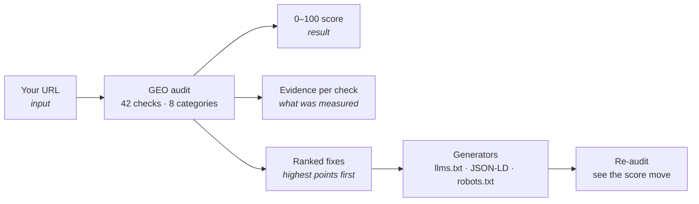
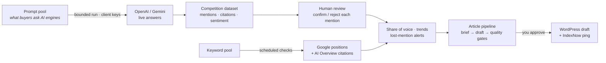
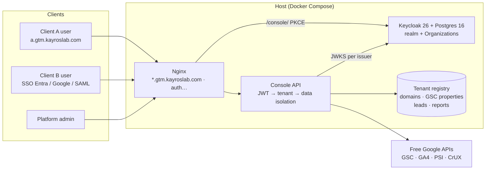
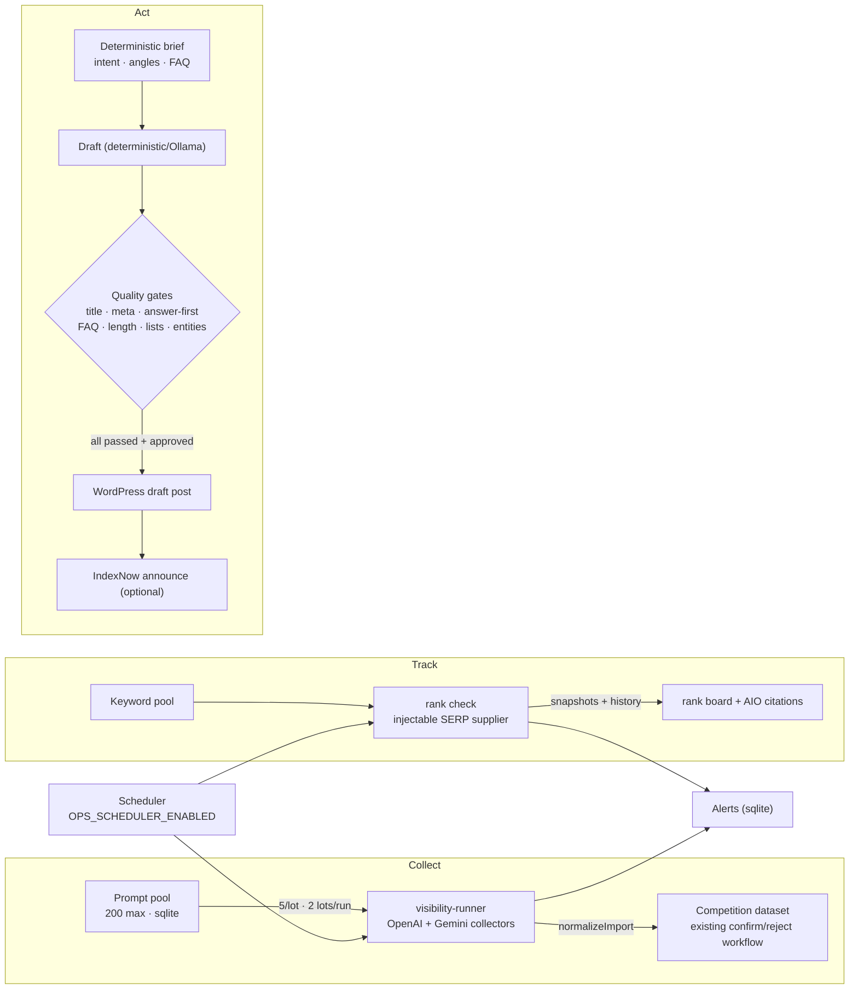

# GTM Growth

**Open-source MCP server** connecting **Google Analytics 4**, **Google Tag Manager** (web + **server-side**), **Measurement Protocol**, **Search Console**, the **Indexing API**, **PageSpeed Insights**, and **CrUX** to **Grok** (xAI), **Claude** (Anthropic), **Codex** (OpenAI), and any MCP-capable agent.

The agent reads live Google data, audits setups, crosses organic search with site speed, and (when explicitly enabled) submits sitemaps, notifies the Indexing API or announces changed URLs through **IndexNow** to Bing, Yandex, Seznam and Naver — via **MCP tools**, a **CLI**, or the **multi-tenant web console**. Skill, MCP server, and GitHub repo are all named **gtm-growth**.

| | |
|---|---|
| **MCP tools** | 99 (GA4 · GTM/sGTM · MP · Search Console · Indexing · PageSpeed · CrUX · GEO · IndexNow · GeoSuite) |
| **Tests** | Automated Vitest suite · typecheck + lint + build in CI |
| **License** | Apache-2.0 · Node ≥ 20 · read-only by default |
| **External APIs** | Free Google APIs only — no SerpApi, no DataForSEO, no commercial LLM |
| **Website** | <https://geoking2104.github.io/GTM-Growth/> — free URL read, then the full audit |

---

## Public console — evidence and actionable free recommendations

The unauthenticated `/console/?lang=en#c-public-read` and `?lang=fr` flow now accepts a **public page URL directly**. The read returns a bounded set of observed on-page SEO/GEO checks, a GEO **v1 page-readiness** score, technical evidence, explicitly outbound social-profile references, and up to twelve evidence-backed opportunities (with six presented at a time). The assistant button **“AI recommends” / “L’IA recommande”** ranks actual failures in three explainable modes: quick wins, potential rubric impact, and AI discoverability. Every option describes the expected technical effect and effort, links to the observed evidence, and offers a guided sign-in CTA.

- The public read is a **single-page diagnostic**; it is not the GEO v2 42-check crawler or a Google/Bing/ChatGPT visibility measurement. The ranking is a **deterministic algorithm**, not an LLM call or a prediction of traffic, citation or revenue. Recoverable GEO points are conditional rubric points, not promised search results.
- Google, Bing, ChatGPT, Gemini, Perplexity and Claude are represented by branded visual cues; the logos indicate relevance only, **not live engine API access or endorsement**.
- `POST /api/free-read` remains the server-side measurement source, with existing rate limits, anti-SSRF and caching. No public Playwright scan, site write, or score publication is introduced. Social profiles are discovered from the page's outbound links and schema `sameAs`; inbound backlinks cannot be inferred from these signals.
- Cloud Solo (€39/month) and Cloud Agency (€149/month) remain pilot hypotheses; the **self-hosted Apache-2.0 product stays free**. Connected data, multi-page analysis, history, automations and approved Apply Mode are differentiated cloud capabilities, not prerequisites for a one-page public read.

See [Free console: market comparison, screenshots and next experiments](docs/product/FREE-CONSOLE-VALUE-PLAN.md).

### Français — lecture gratuite et assistant de recommandations

La console publique propose la saisie d’une URL, des constats vérifiables et plusieurs pistes de correction classées par un algorithme explicable. **« L’IA recommande »** présente l’effet technique potentiel, l’effort et la preuve ; les corrections restent soumises à une validation humaine. Le score public actuel est **GEO v1, limité à la page lue** : ni position Google/Bing ni citation ChatGPT n’est prétendue mesurée.

---

## GEO Score v2 — verified-domain Playwright pilot (in development)

The **GEO v2 scoring rubric** allocates 100 points across eight categories: robots 14, llms.txt 14, JSON-LD 14, metadata 10, content 18, brand/entity 10, AI discovery 8, and crawler rendering 12. This is the **v2 pilot**, separate from the existing live v1 examples and public free-read flow documented below.

- **Domain verification:** the proposed owner-only pilot supports either a DNS TXT challenge at `_gtm-growth-verify.<hostname>` or a plain-text HTTPS file at `https://<hostname>/.well-known/gtm-growth-verification.txt`. A challenge lasts 30 minutes; a verified grant lasts seven days and must be renewed. Each exact hostname requires its own proof.
- **Multi-tenant registry:** the Node-only SQLite implementation stores hashed challenge tokens, tenant-scoped grants, atomic single-use verification and audit events. It is **not yet connected to public/API routes**.
- **Browser isolation:** Playwright is planned as a separate constrained VPS job (initial proposal: one browser, 1 vCPU, 1 GiB RAM, 45 seconds). The network-level anti-SSRF/egress gate is mandatory before a runnable worker or real outbound verification is enabled.
- **Privacy and release:** scores remain private unless the owner explicitly consents to publication. No production deployment, GitHub secret update, or service restart is part of this pilot PR.

See the [GEO v2 Playwright pilot architecture and security gates](docs/architecture/GEO-V2-PLAYWRIGHT-PILOT.md) and [draft PR #28](https://github.com/Geoking2104/GTM-Growth/pull/28). Implementation is staged; these safeguards are **not** claims about current public-site behavior.

### Français — résumé du pilote

Le Score GEO v2 est en préparation sur le VPS existant, avec audits Playwright limités aux **domaines dont le propriétaire a prouvé le contrôle** (DNS TXT ou fichier HTTPS). Le registre SQLite, les challenges à usage unique et leurs tests sont préparés, mais le moteur navigateur et ses protections réseau doivent encore être intégrés et validés. Les scores restent privés sans consentement explicite à leur publication. **Aucune mise en production n'est effectuée par cette PR.**

## Apply Mode — reviewed fixes, never autopilot (MVP foundation)

The new **Apply Mode** scope extends the audit-to-action journey: select one bounded fix, inspect its before/after diff, preview, explicitly approve, snapshot, apply, independently verify and offer rollback. External writers will require exact-domain ownership, tenant-scoped Keycloak approval, a pre-write backup, drift checks and an append-only audit trail. The Apply Mode roadmap limits WordPress content to **draft-only** and GTM changes to a **draft workspace**, with no automatic publication; legacy GTM write/publish routes are not part of that workflow.

Two **read-only preview entry points** are implemented for AI crawler rules:

```bash
npm run cli -- geo-apply --url https://example.com --fix robots-ai --dry-run
npm run cli -- geo-apply --url https://example.com --fix robots-ai --diff
```

The authenticated console also exposes **Act → GEO fixes → Preview**, through `POST /api/console/apply/preview` (`url`, `fix: "robots-ai"`, `mode: "dry-run"`). This route derives the tenant from Keycloak, requires a registered HTTPS hostname, and never enables application. The CLI and console fetch public `robots.txt` with SSRF protections, generate a bounded diff and SHA-256 evidence, and flag manual conflicts. **Neither can write to a website**: CLI `--confirm` and `--apply` fail closed. The existing WordPress content route creates **drafts only** and no longer submits draft URLs to IndexNow.

**Phase 0.3 — approval and recovery foundation (library-only):** a Node/SQLite `ApplyRegistry` can persist encrypted previews and before-change snapshots (AES-256-GCM, tenant/proposal-bound authenticated context), an explicit approval bound to the reviewed diff digest and active exact-hostname verification grant, and a per-tenant HMAC-chained audit journal. Keycloak-derived reader/editor/approver/admin identities are mapped server-side; the approver/admin roles can approve only a current, conflict-free proposal. Approval validity is capped at five minutes; encrypted backups have a configurable 1–90-day retention period (30 days by default), with an explicit purge operation. Tests cover tampering, tenant isolation, drift, expiry and revocation. The storage key is operator-provided (32 random bytes); **there is no default key or production registry configuration**.

**Still deliberately disabled:** the registry is not connected to the console, REST/MCP approval routes or production adapters. Purging still needs a scheduled job; exclusive write-attempt locks, consumption of single-use approvals, independent post-write verification and real rollback need implementation and staging validation. No Apply Mode feature can publish WordPress content, edit files on a remote site or publish a GTM version. The existing unrelated GTM write routes are **not** governed by this new approval mechanism. See the [full owner specification](docs/specs/APPLY-MODE-v1-2026-11-09.md) and [Apply Mode architecture, safety gates and scope register](docs/architecture/APPLY-MODE-MVP.md).

---

## How to read this README

This document has **two independent tracks**. Pick yours and ignore the other.

| You are… | Read | You will find |
|---|---|---|
| **Marketing / growth / agency / decision-maker** | **[Track 1 — Marketing](#track-1--marketing--what-gtm-growth-does-for-you)** | What it does for your business, illustrated audits (input → output → result), before/after numbers, the client console, safety guarantees, how to try it |
| **Developer / integrator / DevOps** | **[Track 2 — Technical](#track-2--technical--how-it-works-and-how-to-run-it)** | Architecture, install, client connections, the MCP tool catalog, workflows, console internals (Keycloak multi-tenant), the Ops layer, IndexNow deep dive, CI/CD |

Shared reference: [Recent updates](#recent-updates--november-2026) is at the end of this file.

---
---

# Track 1 · Marketing — what GTM Growth does for you

You do not need to know what MCP, JSON-LD or CrUX are to read this track. Everything here is about **your questions, your numbers, and what you receive**.

## 1. The problem it solves

When you ask an AI assistant about your traffic or your SEO, one of two things happens:

- it asks you to **paste exports and screenshots**, then re-formats them for you; or
- it **invents plausible numbers**.

GTM Growth replaces both with a connected toolbox: the assistant **calls Google directly**, cites only what the APIs return, and never guesses.

| A classic LLM | With GTM Growth |
|---|---|
| Works on pasted exports | Calls GA4, Search Console, PageSpeed, CrUX directly |
| Can invent numbers | Cites only tool results, with evidence |
| One source at a time | Crosses analytics + search + speed in one answer |
| Advice only | Can act — gated, confirmed writes only |
| Method changes every chat | Same reproducible audit every time |

## 2. What you get

| Capability | What it means for you |
|---|---|
| **AI-search readiness audit (GEO)** | A 0–100 score for "will AI engines cite my site", with the exact fix for every lost point |
| **Analytics & search truth** | Live GA4, Search Console and Bing numbers: clicks, queries, positions, devices, countries |
| **Speed reality check** | Lab scores (PageSpeed) **and** real-user Core Web Vitals (CrUX) side by side |
| **GEO generators** | Ready-to-publish `llms.txt`, rich structured data (JSON-LD), corrected `robots.txt` |
| **Fast indexing** | Announce changed URLs to Bing/Yandex/Seznam/Naver in one call (IndexNow) |
| **Client-ready PDF** | A 9-page report your client can read without you in the room |
| **Ops: live AI visibility** | Track the prompts buyers ask ChatGPT/Gemini, see when your brand is cited — and when a competitor is cited instead |
| **Ops: article pipeline** | From keyword to structured draft with mandatory quality gates, published to WordPress as a **draft** (you approve, never autopilot) |

## 3. How an audit works — illustrated

**Input:** one URL. **Output:** score, evidence, ranked fixes. No configuration, no form-filling.



### What a result looks like (real run)

`geo_audit` on `https://stripe.com` (2026-10-30) — **78/100 · good**, 29 of 42 checks passed, 12 prioritized fixes returned. Extract of the breakdown:

| Category | Points | Finding |
|---|---:|---|
| robots.txt | 15/18 | Citation bots allowed only through `User-agent: *` → partial credit |
| llms.txt | 16/18 | 8,032 words, 31 sections, 308 links; no `/llms-full.txt` |
| Schema JSON-LD | 10/16 | Rich WebSite + Organization; no FAQPage, no Article |
| AI discovery | 0/6 | `/.well-known/ai.txt`, `/ai/summary.json`… all 404 |

And the first fixes it returns, in priority order: explicit rules for the five citation bots (+3), FAQPage schema (+3), Article schema (+3), publish `llms-full.txt` (+2), RSS link (+2), `/ai/summary.json` (+2).

### Before / after (offline demo you can reproduce)

A normal day-one page — title, H1, one sentence, no robots.txt, no llms.txt, no structured data — audited, fixed with what the server generates, re-audited:

| Category | Before | After |
|---|---:|---:|
| robots.txt | 0 | **18** |
| llms.txt | 0 | **14** |
| Schema JSON-LD | 0 | **16** |
| Meta tags | 5 | **14** |
| Content | 2 | **12** |
| Brand & Entity | 2 | **10** |
| Signals | 0 | **6** |
| AI discovery | 0 | **6** |
| **Total** | **9/100** | **96/100** |

The rubric also tells you **when to stop**: the last 4 points require an llms.txt deeper than 1,000 words — everything else is on the table.

## 4. The Ops loop — illustrated

The newest part of the product closes the loop between *measurement* and *action*:



Nothing autopilots: every external write (publishing, IndexNow) requires an explicit approval, and every AI answer stays **reviewable** — automatic mention detection is a proposal, you confirm or reject it.

## 5. The client console — what each tab gives you

The console (`gtm.kayroslab.com/console/`, or `<client>.gtm.kayroslab.com`) is white-label per client, secured by SSO. Each tab is one question → one answer:

| You open… | You provide | You get |
|---|---|---|
| **Overview** | your domain | GEO score, platform readiness, priority plan |
| **Track · Search Console** | nothing (connected once) | clicks, impressions, CTR, position — with period-over-period change |
| **Track · GA4** | nothing | audience, acquisition, devices, realtime |
| **Keywords** | nothing | opportunity-scored queries from your real impressions |
| **Audit** | your domain | technical crawl: canonicals, titles, redirects, broken links |
| **Generators** | a keyword | titles, meta descriptions, article plans |
| **Report** | your domain | the 9-page PDF |
| **Ops · Live AI visibility** | prompts to track | brand mentions and citations per AI engine |
| **Ops · Rankings** | keywords to track | Google positions history + AI-Overview citations |
| **Ops · Articles** | a target keyword | gated draft ready for your review |
| **Ops · Alerts** | nothing | rank drops, lost mentions, pipeline events |

Multi-client agencies get strict isolation: client A can never see client B's domains, properties, leads or reports — enforced and tested.

## 6. What it will never do

- **No invented numbers.** Every point in every score carries the evidence that produced it.
- **No hidden writes.** Reads are open; anything that writes (sitemap submit, IndexNow, publishing) is disabled by default and needs explicit confirmation.
- **No autopublished content.** The article pipeline produces drafts with quality gates; a human approves before anything goes to your CMS.
- **No paid data APIs.** Google free APIs only; live AI checks use **your own** OpenAI/Gemini keys, stored server-side, never returned to the browser.
- **Your data stays yours.** Open source (Apache-2.0), self-hostable, per-tenant storage.

## 7. Try it

1. **Free instant read** — <https://geoking2104.github.io/GTM-Growth/> : paste a URL, get the GEO essentials.
2. **Ask your assistant** — connect the server to Grok, Claude or Codex and ask *"audit https://my-site.com for AI search"*.
3. **Full audit & engagement** — leave your email on the site; you get the complete audit and a guided GTM engagement.

---
---

# Track 2 · Technical — how it works and how to run it

## 1. Architecture

```text
     ┌─────────┐   ┌────────────┐   ┌─────────┐
     │  Grok   │   │   Claude   │   │  Codex  │
     │  (xAI)  │   │ (Anthropic)│   │ (OpenAI)│
     └────┬─────┘   └─────┬──────┘   └────┬─────┘
          └───────────────┬─────────────┘
                       │ MCP (stdio or HTTPS /mcp)
                       ▼
              ┌───────────────────┐
              │   gtm-growth      │
              │  Service Account  │
              └─────────┬─────────┘
     ┌─────────────────┼───────────────────┐
     ▼              ▼                     ▼
 GA4 Data/Admin  GTM Web + sGTM      Search Console
 + MP secrets    tags / clients      + Indexing API
                                     + PageSpeed / CrUX
```

The web console is a second surface over the same modules: Express + Keycloak OIDC (PKCE), per-tenant JWT resolution, sqlite/Redis stores, PDF reports via pdfkit.



## 2. Quick start

**Prerequisites:** Google Cloud project with the Analytics Data/Admin, Tag Manager and Search Console APIs enabled · a Service Account JSON key · the SA granted *Viewer* on GA4, *Read* on GTM, user access on Search Console · Node ≥ 20. Optional: `PAGESPEED_API_KEY` / `CRUX_API_KEY` / `GOOGLE_API_KEY`, Redis.

```bash
git clone https://github.com/Geoking2104/GTM-Growth.git
cd GTM-Growth && npm install
cp .env.example .env          # set GOOGLE_APPLICATION_CREDENTIALS
npm run build
npm run start:stdio           # or start:http → :3000/mcp + /sse
```

Scopes: `analytics.readonly[.edit]`, `tagmanager.readonly[.edit.containers]`, `webmasters[.readonly]`, `indexing` (gated).

Writes are **disabled by default** and double-gated (`*_WRITE_ENABLED=true` **and** `confirm=true` per call): GA4 secrets, GTM tag creation, sitemap submit, Indexing API, IndexNow submissions. Publishing to WordPress additionally requires `approved: true` and all quality gates passed.

Reliability: zod validation on every tool, enriched Google errors (`[status | reason]`), gaxios retry/pagination, optional `MCP_API_TOKEN` bearer auth, stderr-only logging.

## 3. Connect your client

| Client | Best path | Guide |
|--------|-----------|-------|
| **Grok** | Custom Connector (HTTPS) or Grok Build (stdio) | [docs/GROK_SETUP.md](docs/GROK_SETUP.md) |
| **Claude** | `.mcp.json` + skill in `.claude/skills/` | [docs/CLAUDE_SETUP.md](docs/CLAUDE_SETUP.md) |
| **Codex** | MCP settings + skill in `.codex/skills/` | [docs/CODEX_SETUP.md](docs/CODEX_SETUP.md) |

```bash
./scripts/install-skill.sh both          # skill → .claude and .codex
grok mcp add --scope project gtm-growth -- node dist/index.js --transport stdio
```

CLI for validation workflows: `npm run cli -- geo-audit --url https://example.com` · `geo-report` · `audit-web` · `pagespeed` · full list in [docs/CLI.md](docs/CLI.md).

## 4. MCP tool catalog (condensed)

| Domain | Tools (selection) |
|--------|-------------------|
| **GA4** | `list_properties`, `get_traffic_overview`, `get_top_pages`, `get_acquisition`, `get_devices`, `run_report`, `run_realtime_report`, `analyze_ecommerce_data` |
| **GTM Web** | `audit_ga4_setup_v2`, `find_tags_by_trigger`, `find_tags_using_variable`, `detect_duplicate_tags`, `gtm_audit_installation`, `gtm_generate_snippet`, `validate_ecommerce_events`, `create_ga4_event_setup` (gated write) |
| **sGTM / MP** | `audit_sgtm_setup`, `compare_dual_tagging`, `cutover_checklist`, `verify_ga4_secrets`, `configure_measurement_protocol` |
| **Search Console** | `list_search_console_sites`, `get_search_overview`, `get_top_queries`, `get_query_page_pairs`, `get_search_trend`, `inspect_url(s)`, `submit_sitemap` (gated) |
| **Indexing** | `get_url_notification_metadata`, `publish_url_notification(s)` (gated) |
| **Performance** | `run_pagespeed[_batch]`, `query_crux[_batch]` |
| **GEO** | `geo_audit`, `geo_audit_sitemap`, `geo_citability`, `geo_crawler_access`, `geo_llms_drift`, `geo_content_risks`, `geo_positioning`, `geo_platform_readiness`, `geo_generate_llms_txt`, `geo_generate_schema`, `geo_generate_robots` |
| **GeoSuite** | `poppy_check`, `poppy_generate` (Personal Agent Protocol `/.well-known/poppy.json`), `geo_sitemap_build` |
| **IndexNow** | `indexnow_keygen`, `indexnow_verify`, `indexnow_submit` (gated), `indexnow_readiness`, `indexnow_explain` |
| **Boards** | `analysis_board` — GEO + citability + platforms + IndexNow with a ranked action list (indexation blockers outrank copy fixes) |

Full agent-facing catalog: [`skills/gtm-growth/references/tools.md`](skills/gtm-growth/references/tools.md) · Rubric & limits: [docs/GEO.md](docs/GEO.md).

## 5. Standard workflows

- **Weekly briefing** — `list_properties` → `get_traffic_overview` → acquisition/pages/devices → events → ecommerce.
- **SEO & performance audit** — `get_top_search_pages` → `query_crux` → `run_pagespeed` → `inspect_url` → priority table.
- **GEO audit** — `geo_audit` (homepage) → `geo_audit_sitemap` (≤25 pages) → generate what is missing → re-audit and diff. Readiness only: the audit never queries ChatGPT/Claude/Perplexity to claim a citation — live checks are the Ops layer below, with client keys.
- **Growth dashboard** — 28 days vs previous 28, cross-channel KPI scorecard, 10+ watch points, exactly 3 horizon-scoped priorities with measurement plans; estimates are ranges from stated assumptions, never invented forecasts.
- **IndexNow rollout** — keygen → publish key file → `indexnow_verify` (must pass) → `indexnow_submit` (`confirm=true`) → `analysis_board`.
- **GTM install check** — `gtm_audit_installation` → fix checks → `gtm_generate_snippet` if needed.

Example report shapes: [`skills/gtm-growth/references/examples.md`](skills/gtm-growth/references/examples.md) · server-side path: [docs/SERVER_SIDE_TRACKING_ARCHITECTURE.md](docs/SERVER_SIDE_TRACKING_ARCHITECTURE.md).

## 6. Console internals — multi-tenant on Keycloak

**Keycloak 26.4** is the identity provider for all console clients, not just a login screen.

| Layer | Component |
|---|---|
| Identity & SSO | Keycloak 26.4 (production mode, Postgres 16) |
| Multi-tenancy | One Keycloak **Organization** per client in the shared `gtm-growth` realm; optional dedicated `tenant-<id>` realm (custom theme, own policies, distinct signing keys) |
| Federation | Per-client brokering: Google Workspace, Microsoft Entra ID, any OIDC/SAML 2.0 (auto-redirect by email domain) |
| Self-service | Account console: password reset, **TOTP MFA**, sessions |
| API | Express + internal JWT verification (`node:crypto`, JWKS per issuer), tenant resolution, data isolation |
| Provisioning | Keycloak Admin REST (service account `gtm-provisioner`): `npm run tenant:provision` or `POST /api/platform/tenants` |

**Why Organizations over realm-per-client:** one issuer/JWKS to trust and secure; email-domain discovery is native; adding a client takes seconds via the API; Keycloak degrades beyond a few hundred realms. Dedicated realms remain available per client on demand.

**The tenant travels in the token:** in Organization mode, an `organization` claim **and** a `/tenants/<id>/<role>` group must agree (a group without membership is ignored); in realm mode, the issuer `iss` is the tenant. Multi-tenant users pick the active tenant in the UI (`X-Tenant` header, verified against the token — not spoofable).

| Role | Granted by | Rights |
|---|---|---|
| `tenant-user` | group `/tenants/<id>/tenant-user` | console tools on **own** domains/properties, leads, reports |
| `tenant-admin` | group `/tenants/<id>/tenant-admin` | + tenant settings, user invites, Ops writes |
| `platform-admin` | realm role (hosting side) | all tenants via `X-Tenant`, provisioning API |

**API-side isolation:** every request resolves to a tenant; any `url`/`inspectUrl` outside the tenant's domains → **403 before DNS resolution**; properties/containers outside the tenant → 403; leads and PDF reports are stored and served per tenant. Covered by `tests/tenant-isolation.test.ts`.

**Onboarding a client** (prerequisites: DNS + Keycloak SMTP once — see `deploy/kayroslab-vps/README.md`):

```bash
npm run tenant:provision -- --id acme --name "Acme" \
  --email-domain acme.fr --domain acme.fr --property sc-domain:acme.fr \
  --admin direction@acme.fr
# SSO option: --idp microsoft --idp-tenant <id> --idp-client-id <app> --idp-client-secret-env ACME_ENTRA_SECRET
```

Provisioning creates the organization (or realm), role groups, console redirect URIs, the optional IdP link, the first admin (email invitation, 72 h), and the tenant registry entry. Without `OIDC_ISSUER` the console API stays **closed (503)**; public `/api/free-read`, `/api/lead`, `/health` are unaffected.

**Console routes** (all `POST /api/console/*`, zod-validated, tenant-scoped):

| Group | Tabs | Routes |
|---|---|---|
| Phase 1 | Sitemap · GEO · Performance | `sitemap/{map,audit,build}`, `geo/{citability,llms,robots,schema}`, `performance/{pagespeed,crux,weight}` |
| Phase 2 | Search · Keywords · Calculators · PDF | `search/{queries,trends,losing-pages,inspect}`, `keywords/opportunities`, `calc/{ctr,traffic-value,roi,budget}`, `report/pdf` |
| Phase 3 | Technical audit · Generators | `audit/{technical,serp-preview}`, `generate/{titles,meta,outline}` |
| Track | GSC · GA4 · Bing · Status | `search/performance`, `search/query-pages`, `ga4/{overview,ecommerce,technology,realtime}`, `bing/performance`, `tracking/status` |
| Competition | AI answers | `ai-visibility/*`, `competition/*` (+ read-only per-tenant MCP at `/api/mcp/competition`) |
| Ops | Visibility · Rankings · Articles · Alerts | `visibility/*`, `rank/*`, `content/*`, `ops/*` (see below) |

Code: `src/console/` (API, auth, modules) · `site/console/` (app-shell UI) · tests `tests/console-*.test.ts`.

## 7. Ops layer — live visibility, rankings, article pipeline

The Ops section (PR #24) closes the measurement→action loop. All routes tenant-scoped, writes admin-only, BYOK keys stored server-side.



| Area | Bounds & safety |
|---|---|
| **Prompt pool / runs** | 200 prompts, deduped; runs bounded (5 prompts × 2 lots per engine per run); unconfigured engines degrade with a clear message; every run lands as a reviewable Competition dataset |
| **Rank tracking** | 200 keywords; SERP supplier via `RANK_SUPPLIER_URL`+`RANK_SUPPLIER_TOKEN` (JSON API) or `RANK_SCRAPER_URL` (HTML profile); AI-Overview presence + tenant-citation detection on the same payload; drop alerts warn ≥ 3 positions, critical ≥ 10 |
| **Article pipeline** | deterministic brief/outline (FR/EN); Ollama optional (`OLLAMA_URL`); gates block publishing until fixed; WordPress publish requires `approved: true` + all gates passed, posts as WP **draft**; optional IndexNow announce composes the existing client |
| **Alerts & scheduler** | alert store with acknowledge; visibility-loss and rank-drop detection; per-tenant automation config; scheduler opt-in (`OPS_SCHEDULER_ENABLED`, default off — stdio/CI stay quiet) |

Env (all optional, documented in `.env.example`): `AI_VISIBILITY_{OPENAI,GEMINI}_KEY_<TENANT>` · `RANK_SUPPLIER_URL/TOKEN` or `RANK_SCRAPER_URL` · `WP_{SITE_URL,USERNAME,APP_PASSWORD}_<TENANT>` · `OLLAMA_URL/MODEL` · `OPS_SCHEDULER_ENABLED/MINUTES`.

Code: `src/console/{ops-store,visibility-runner,rank-tracking,content-ops,ops-routes,ops-scheduler}.ts` · UI `site/console/ops.js` · tests `tests/console-ops.test.ts`.

## 8. IndexNow — protocol notes

IndexNow is a push protocol: instead of waiting for crawlers, you tell **Bing, Yandex, Seznam and Naver** (not Google) that URLs changed. Four steps: generate a key (8–128 chars `[a-zA-Z0-9-]`) → publish `https://<host>/<key>.txt` → `POST` up to 10,000 URLs → read the status (`200/202` = received, **never** indexed; `403` = key file wrong; `422` = URLs off-host; `429` = throttled — each decoded with its fix).

| Tool | Role |
|---|---|
| `indexnow_keygen` | Key + file name/URL/content/headers, fully local |
| `indexnow_verify` | Fetches the key file, names the failure mode |
| `indexnow_submit` | Batch submission — gated by `confirm=true` |
| `indexnow_readiness` | 0–100 panel with evidence per check |
| `indexnow_explain` | Decodes any status without sending anything |

Operating rules: submit **changes**, not the archive; one batch per publish; never delete the key file; treat `200` as a receipt. Full sequences and weights: [docs/INDEXNOW.md](docs/INDEXNOW.md).

## 9. Public API & Worker

| Endpoint | Role |
|---|---|
| `POST /api/free-read` | GEO score + SEO tables + GA4/GSC blocks for any URL (same anti-SSRF guard as the console) |
| `POST /api/lead` | Contact capture (JSONL + optional `LEAD_WEBHOOK_URL`); no mail client — PDF emailing would need an SMTP/API provider, intentionally not configured |

Same shared code runs on Node or as a **Cloudflare Worker**: [docs/PUBLIC_API.md](docs/PUBLIC_API.md) · [docs/WORKER.md](docs/WORKER.md).

## 10. CI/CD

| Workflow | When | What |
|----------|------|------|
| **CI** | push / PR | typecheck + lint + test + build + CLI smoke |
| **Validate** | manual (optional weekly) | live pipeline with SA secret |

```bash
npm run lint && npm test && npm run typecheck
```

## 11. Project layout

```text
.grok/config.toml              # Grok Build MCP
.mcp.json                      # Claude / Cursor / Codex local stdio
skills/gtm-growth/             # canonical agent skill (+ references/, agents/openai.yaml)
scripts/install-skill.sh       # skill → .claude / .codex
src/
  google/                      # data-api, gtm, search-console, indexing, pagespeed, crux
  geo/                         # GEO engine: audit/*, generate/*, citability, platforms, risks…
  console/                     # console API, Keycloak auth, competition, ops-*
  indexnow/ geosuite/ freeread/ leads/ tenants/ report/ http/ worker/
site/                          # landing (GitHub Pages) + console app-shell
deploy/kayroslab-vps/          # Docker Compose, Keycloak realm, Nginx
docs/                          # all guides (see index below)
```

## 12. Documentation index

| Doc | Content |
|-----|---------|
| [skills/gtm-growth/SKILL.md](skills/gtm-growth/SKILL.md) | **Shared agent skill** |
| [docs/CLAUDE_SETUP.md](docs/CLAUDE_SETUP.md) · [CODEX_SETUP.md](docs/CODEX_SETUP.md) · [GROK_SETUP.md](docs/GROK_SETUP.md) | Client setup |
| [skills/gtm-growth/references/setup.md](skills/gtm-growth/references/setup.md) | Connect — 3 options |
| [docs/PRESENTATION.md](docs/PRESENTATION.md) | Pitch & marketing guide |
| [docs/DEPLOYMENT.md](docs/DEPLOYMENT.md) · [VPS_DEPLOY.md](docs/VPS_DEPLOY.md) | Docker / Fly / Railway · KayrosLab VPS |
| [docs/CLI.md](docs/CLI.md) | All CLI commands |
| [docs/GEO.md](docs/GEO.md) | GEO rubric, tools, limits |
| [docs/architecture/GEO-V2-PLAYWRIGHT-PILOT.md](docs/architecture/GEO-V2-PLAYWRIGHT-PILOT.md) | GEO v2 verified-domain pilot, SQLite ownership registry and Playwright isolation gates |
| [docs/architecture/APPLY-MODE-MVP.md](docs/architecture/APPLY-MODE-MVP.md) · [Apply Mode owner specification](docs/specs/APPLY-MODE-v1-2026-11-09.md) | Apply Mode roadmap, explicit approval/backup safety gates and implementation status |
| [docs/INDEXNOW.md](docs/INDEXNOW.md) | IndexNow sequences & weights |
| [docs/PUBLIC_API.md](docs/PUBLIC_API.md) · [WORKER.md](docs/WORKER.md) | Public API · Cloudflare Worker |
| [site/reports/opendpe.html](site/reports/opendpe.html) | Sample full audit (71/100) |
| [docs/GTM_INTEGRATION.md](docs/GTM_INTEGRATION.md) · [GTM_IMPLEMENTATION.md](docs/GTM_IMPLEMENTATION.md) | GTM ↔ GA4 specs · step-by-step install |
| [docs/PHASE3_WRITE.md](docs/PHASE3_WRITE.md) · [MEASUREMENT_PROTOCOL.md](docs/MEASUREMENT_PROTOCOL.md) | Gated writes · MP setup |
| [docs/SERVER_SIDE_TRACKING_ARCHITECTURE.md](docs/SERVER_SIDE_TRACKING_ARCHITECTURE.md) | sGTM architecture |
| [docs/CI_CD.md](docs/CI_CD.md) · [CACHING.md](docs/CACHING.md) | GitHub Actions · Redis |

---

## Recent updates — November 2026

| Update | Detail |
| --- | --- |
| **Apply Mode foundation (PR #31)** | Read-only `geo-apply` and authenticated console diff preview, plus library-only AES-GCM-encrypted approval/snapshot registry and tenant HMAC journal. No approval UI or production writers enabled. |
| **GEO v2 pilot (PR #28, draft)** | Verified-domain DNS TXT/HTTPS challenge flow; SQLite tenant-scoped single-use verification registry; Playwright isolation and SSRF gates documented. No live browser worker or production deployment yet. |
| **Console Ops** | New **Ops** section (PR #24): tracked prompt pool + bounded BYOK visibility runs (OpenAI/Gemini, client keys) feeding the existing Competition review workflow; arbitrary keyword rank tracking with history, AI-Overview citation detection and drop alerts; article pipeline with deterministic briefs and **mandatory quality gates**; WordPress draft creation (**no IndexNow notification until independently verified publication**); alert store and per-tenant scheduler (`OPS_SCHEDULER_ENABLED`, off by default). Tests: `tests/console-ops.test.ts`. |
| **Live AI-visibility collection** | `/ai-visibility/openai-run` (and Gemini status) with tenant-held keys; every collection creates a reviewable dataset; mention heuristics stay provisional until confirmed/rejected. |
| **Onboarding profiles** | Rich brand profile read from the homepage JSON-LD/meta during guided onboarding (PR #19). |
| **GTM container discovery** | Console inventory of GTM containers available to the service account (PR #23). |
| **Hosting (KayrosLab VPS)** | Docker Compose on OVH behind Nginx (`gtm.kayroslab.com`, wildcard `*.gtm.kayroslab.com`), Let's Encrypt with auto-renewal, PM2 startup, containers `restart: unless-stopped` — verified by a full VPS reboot. |
| **Lead form fix** | `POST /api/lead` 500 (`EACCES` on `/data/leads.jsonl`) fixed: the Dockerfile now creates `/data` with the right uid; requests persist (201 + id). Notifications via `LEAD_WEBHOOK_URL`; automatic PDF emailing still requires a mail provider (not configured by design). |
| **Visual sitemap** | The free read renders the sitemap architecture (SlickMap-style tree, sections, depth, `lastmod`). |
| **Sample report** | 11-page example PDF (opendpe.net) with console guide and marketing plans. |
| **Keycloak multi-tenant console** | Client console with Organizations, SSO brokering (Entra/Google/SAML), TOTP MFA, per-tenant isolation, live-data tabs. |

---

## License

Apache-2.0

---

Built by [Geoking2104](https://github.com/Geoking2104) / **KayrosLab** for Grok, Claude, and Codex.
