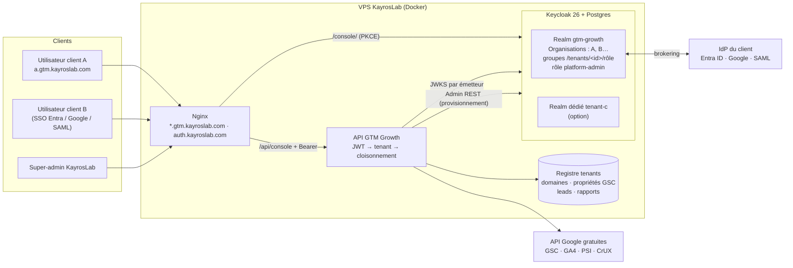

# GTM Growth

**Open-source MCP server** connecting **Google Analytics 4**, **Google Tag Manager** (web + **server-side**), **Measurement Protocol**, **Search Console**, the **Indexing API**, **PageSpeed Insights**, and **CrUX** to **Grok** (xAI), **Claude** (Anthropic), **Codex** (OpenAI), and any MCP-capable agent.

The agent reads live Google data, audits setups, crosses organic search with site speed, and (when explicitly enabled) submits sitemaps, notifies the Indexing API or announces changed URLs through **IndexNow** to Bing, Yandex, Seznam and Naver — via **MCP tools** or a **CLI**. Skill, MCP server, and GitHub repo are all named **gtm-growth**.

**93 MCP tools** · 187 tests · Apache-2.0 · read-only by default.

**Website:** https://geoking2104.github.io/GTM-Growth/ — a free URL read, then the full audit and assisted GTM engagement.

| Client | How to connect | Skill install |
|--------|----------------|---------------|
| **Grok** (xAI) | [grok.com/connectors](https://grok.com/connectors) or Grok Build | Agensi zip of `skills/gtm-growth/` |
| **Claude** (Anthropic) | Claude Code MCP / `.mcp.json` | `.claude/skills/gtm-growth/` — [docs/CLAUDE_SETUP.md](docs/CLAUDE_SETUP.md) |
| **Codex** (OpenAI) | Codex MCP settings | `.codex/skills/gtm-growth/` — [docs/CODEX_SETUP.md](docs/CODEX_SETUP.md) |

> Compatible with **Grok**, **Claude Code**, **Codex**, Cursor (`.mcp.json`), and self-hosted deployments.  
> **Apache-2.0** license · Node ≥ 20

---

## Console GTM Growth — Keycloak multi-tenant et outils en direct (FR)

La console (`https://gtm.kayroslab.com/console/` et `https://<client>.gtm.kayroslab.com/console/`) n'affiche plus de données d'exemple : chaque onglet appelle l'API `/api/console/*`, branchée sur les modules existants du serveur. Tout est **open source / interne** : aucune API payante (SerpApi, DataForSEO, LLM commercial…). Les seules API externes sont les API Google gratuites (Search Console, GA4, PageSpeed, CrUX).

### Keycloak, brique centrale de la stack

**Keycloak 26** (open source, CNCF) n'est pas un simple login de la console. C'est le **fournisseur d'identité de tous les clients de GTM Growth** :

| Couche | Composant |
| --- | --- |
| Identité et SSO | **Keycloak 26.4** (`quay.io/keycloak/keycloak`, mode production, Postgres 16), `https://auth.kayroslab.com` |
| Multi-tenant | **Organisations Keycloak** (une par client) dans le realm partagé `gtm-growth` ; **realm dédié** `tenant-<id>` en option |
| Fédération | Brokering par client : Google Workspace, Microsoft Entra ID, tout OIDC ou SAML 2.0 (redirection automatique selon le domaine e-mail) |
| Libre-service | Console de compte Keycloak : mot de passe oublié, changement de mot de passe, **MFA TOTP**, sessions |
| API | Express + vérification JWT interne (`node:crypto`, JWKS par émetteur), résolution du tenant, cloisonnement des données |
| Provisionnement | API Admin REST Keycloak (compte de service `gtm-provisioner`) : script `npm run tenant:provision` et API `POST /api/platform/tenants` |
| Thème | `deploy/kayroslab-vps/keycloak/themes/gtm-growth` (connexion FR, e-mails) ; logo et couleur du client dans la console |



### Modèle multi-tenant : pourquoi les Organisations (et le realm dédié en option)

- **Par défaut : une Organisation Keycloak par client** dans le realm `gtm-growth`. Un seul émetteur et un seul JWKS, donc moins de configuration et une seule mise à jour de sécurité. La découverte par domaine e-mail est native (`login_hint` et redirection vers l'IdP du client). Les IdP sont rattachés à l'organisation. L'ajout d'un client se fait en quelques secondes par l'API, sans redémarrage. C'est le modèle recommandé par Keycloak pour le B2B SaaS depuis la version 26.
- **En option : un realm dédié `tenant-<id>`** pour un client qui exige un thème de connexion entièrement personnalisé, sa propre politique de mot de passe ou de session, ou une isolation complète (clés de signature distinctes). Son émetteur est ajouté au registre et l'API lui fait confiance automatiquement.
- On n'a pas retenu **un realm par client dans tous les cas** : Keycloak se dégrade au-delà de quelques centaines de realms, et chaque realm multiplie la configuration (clients, thèmes, SMTP, IdP).

**Le tenant est porté par le jeton** :
- en mode Organisation, par la revendication `organization` (mapper *Organization Membership*) **et** un groupe `/tenants/<id>/tenant-admin|tenant-user`. Les deux doivent concorder, et un groupe sans appartenance à l'organisation est ignoré ;
- en mode realm dédié, par l'**émetteur** `iss`.

Un utilisateur membre de plusieurs clients choisit le sien dans la console, qui envoie l'en-tête `X-Tenant`. Cet en-tête est vérifié contre le jeton et ne peut pas être usurpé.

**Rôles**

| Rôle | Où | Droits |
| --- | --- | --- |
| `tenant-user` | groupe `/tenants/<id>/tenant-user` (ou rôle du realm dédié) | outils de la console sur **ses** domaines et propriétés GSC, **ses** leads et rapports |
| `tenant-admin` | groupe `/tenants/<id>/tenant-admin` | en plus : `PUT /api/console/tenant/settings` (domaines, propriétés, logo, couleur) et `POST /api/console/tenant/users` (invitation) |
| `platform-admin` | rôle du realm `gtm-growth` (KayrosLab) | tous les tenants via `X-Tenant`, `GET/POST /api/platform/tenants` |

**Cloisonnement côté API** : chaque requête est rattachée à un tenant. Toute `url` ou `inspectUrl` hors des domaines du tenant reçoit **403**, avant même la résolution DNS. Toute `property` Search Console hors de ses propriétés reçoit **403**, et la propriété par défaut est la première du tenant. `/leads` ne renvoie que les leads dont le site appartient au tenant. Les rapports PDF sont rangés dans `data/reports/<tenant>/` et ne sont lisibles que par ce tenant. Les tests `tests/tenant-isolation.test.ts` couvrent ces cas.

### Connexion à la console

1. **Découverte du client** (`GET /api/tenants/discover`, public, limité à 20 requêtes/min/IP, ne renvoie que le nom, l'émetteur et l'habillage) :
   - par **sous-domaine** `acme.gtm.kayroslab.com` ;
   - par **chemin** `?tenant=acme` ;
   - par **domaine e-mail** saisi sur l'écran de connexion.
2. **Connexion Keycloak** avec le scope `organization:<id>` et le `login_hint`. Keycloak affiche l'habillage `gtm-growth` et, si le client a un IdP, redirige directement vers son SSO (Entra, Google, SAML).
3. **Mon compte** (lien dans l'en-tête, console de compte `…/account/`) : changement de mot de passe, **TOTP** (FreeOTP, Google ou Microsoft Authenticator) et sessions. « Mot de passe oublié ? » est actif sur la page de connexion.

### Ajouter un client (onboarding)

Prérequis une fois pour toutes : voir « Mise en service » ci-dessous (DNS, SMTP Keycloak, compte de service).

```bash
# Sur le VPS (variables KEYCLOAK_* et OIDC_ISSUER chargées depuis .env.local)
npm run tenant:provision -- --id acme --name "Acme" \
  --email-domain acme.fr --domain acme.fr --property sc-domain:acme.fr \
  --admin direction@acme.fr
# Option SSO Microsoft Entra (le secret est lu dans une variable, jamais en argument) :
#   --idp microsoft --idp-tenant <tenant-id-entra> --idp-client-id <app-id> --idp-client-secret-env ACME_ENTRA_SECRET
# Option realm dédié : --mode realm
```

L'API équivalente, réservée au `platform-admin`, est `POST /api/platform/tenants` avec `{ id, name, emailDomains, domains, gscProperties, admin: { email }, identityProvider? , mode? }`.

Le provisionnement :
1. crée l'**organisation** (ou le realm) avec ses domaines e-mail ;
2. crée les groupes `tenant-admin` et `tenant-user` ;
3. ajoute `https://acme.gtm.kayroslab.com/console/*` aux redirections du client `gtm-console` ;
4. ajoute l'**IdP** éventuel et le lie à l'organisation ;
5. crée le premier admin et lui envoie un **e-mail d'invitation** (vérification de l'e-mail, mot de passe, TOTP ; lien valable 72 h) ;
6. enregistre le tenant (`TENANTS_PATH`).

Ensuite, côté client :
- accorder au compte de service Google l'accès **Lecture** à ses propriétés Search Console ;
- le tenant-admin invite ses collègues depuis l'API `tenant/users`.

### Configuration

| Élément | Valeur |
| --- | --- |
| Realm | `gtm-growth` (import : `deploy/kayroslab-vps/keycloak/realm-gtm-growth.json`). Organisations activées, OTP, réinitialisation du mot de passe, thème `gtm-growth`, mappers `groups` et `organization` |
| Client navigateur | `gtm-console` : client **public**, *Authorization Code + PKCE (S256)*, aucun secret côté navigateur |
| Client de provisionnement | `gtm-provisioner` : confidentiel, compte de service. **Secret à générer dans la console d'administration** ; rôles `realm-management` : `manage-realm`, `manage-users`, `manage-clients`, `manage-identity-providers`. Pour le mode realm dédié, utiliser un client équivalent du realm `master` (`KEYCLOAK_ADMIN_REALM=master`) avec le droit de créer des realms |
| Variables API | `OIDC_ISSUER`, `OIDC_CLIENT_ID`, `OIDC_JWKS_URL`, `KEYCLOAK_INTERNAL_URL`, `OIDC_EXTRA_ISSUERS`, `TENANTS_PATH`, `REPORTS_PATH`, `CONSOLE_DOMAIN`, `KEYCLOAK_ADMIN_REALM`, `KEYCLOAK_ADMIN_CLIENT_ID`, `KEYCLOAK_ADMIN_CLIENT_SECRET` |

Sans `OIDC_ISSUER`, l'API console répond **503** : elle reste fermée par défaut. Les routes publiques `/api/free-read`, `/api/lead` et `/health` sont inchangées.

**Mise en service (une fois)** — voir aussi `deploy/kayroslab-vps/README.md` :

1. DNS IONOS :
   - **A** `auth.kayroslab.com` → `51.210.9.71` ;
   - **A joker** `*.gtm.kayroslab.com` → `51.210.9.71`.
2. Certificats :
   - `certbot --nginx -d auth.kayroslab.com` ;
   - pour le joker `*.gtm.kayroslab.com`, un certificat **DNS-01** (plugin open source `certbot-dns-ionos` ou défi DNS manuel).
3. Secrets dans `.env.local` (`openssl rand -base64 32`) : `KC_DB_PASSWORD`, `KC_BOOTSTRAP_ADMIN_PASSWORD`, plus `KEYCLOAK_ADMIN_CLIENT_SECRET` après génération dans Keycloak.
4. `bash deploy/kayroslab-vps/deploy.sh`, puis installation des vhosts Nginx (`nginx-auth-kayroslab.conf` et `nginx-gtm-growth.conf`, qui couvre maintenant `*.gtm.kayroslab.com`).
5. Admin Keycloak (`https://auth.kayroslab.com/admin/`, à restreindre par IP) :
   - **SMTP** du realm (*Realm settings → Email*), indispensable pour les invitations et la réinitialisation ;
   - secret de `gtm-provisioner` et rôles de son compte de service ;
   - créer le compte KayrosLab avec le rôle `platform-admin`.

### Onglets et routes

| Phase | Onglet | Ce qu'il fait | Route(s) `POST /api/console/…` |
| --- | --- | --- | --- |
| 1 | **Sitemap** | Carte visuelle (rendu SlickMap), audit GEO page par page, génération de `sitemap.xml` par crawl | `sitemap/map`, `sitemap/audit`, `sitemap/build` |
| 1 | **GEO** | Citabilité IA, `llms.txt` (validation, génération depuis le sitemap, dérive), robots IA + `robots.txt` corrigé, données structurées | `geo/citability`, `geo/llms`, `geo/robots`, `geo/schema` |
| 1 | **Performance** | PageSpeed (mobile/desktop), Core Web Vitals CrUX (origine ou URL), poids de page mesuré par ressource | `performance/pagespeed`, `performance/crux`, `performance/weight` |
| 2 | **Search** | Requêtes, tendances quotidiennes, pages qui perdent des clics (période vs précédente), inspection d'URL | `search/queries`, `search/trends`, `search/losing-pages`, `search/inspect` |
| 2 | **Mots-clés** | Score d'opportunité 0–100 (positions 4–15, écart de CTR, top 3 à CTR faible) et clusters de requêtes (similarité de tokens + page commune) depuis les paires requête/page GSC | `keywords/opportunities` |
| 2 | **Calculateurs** | CTR par position, valeur du trafic organique (CPC saisi), ROI SEO, budget SEO | `calc/ctr`, `calc/traffic-value`, `calc/roi`, `calc/budget` |
| 2 | **Rapport PDF** | Rapport GEO complet (audit, plateformes IA, citabilité) téléchargé depuis la console | `report/pdf` |
| 3 | **Audit technique** | Crawler interne (même hôte, 200 pages max) : canonical, title/meta (longueur, doublons), H1/hiérarchie Hn, noindex, redirections et chaînes, liens cassés internes/externes ; aperçu SERP avec troncature en pixels | `audit/technical`, `audit/serp-preview` |
| 3 | **Générateurs** | Titles, meta descriptions, plans d'article : modèles déterministes FR, ou modèle open source via **Ollama** auto-hébergé (optionnel, profil compose `llm`) | `generate/titles`, `generate/meta`, `generate/outline` |

Champs communs : `url` (domaine ou page, passé par le même garde-fou anti-SSRF que la lecture gratuite) et `property` (propriété Search Console, ex. `sc-domain:kayroslab.com`) pour les onglets Search et Mots-clés. Le compte de service Google doit avoir accès à la propriété (Search Console → Paramètres → Utilisateurs).

Code : `src/console/` (API, auth, modules), `site/console/` (interface), tests `tests/console-*.test.ts`.

## Mises à jour récentes — novembre 2026 (FR)

| Mise à jour | Détail |
| --- | --- |
| **Hébergement sur le VPS KayrosLab** | L'application tourne en Docker Compose (`deploy/kayroslab-vps/`) sur le VPS OVH `51.210.9.71`, port privé `127.0.0.1:4300`, derrière Nginx. Le site statique est servi depuis `/opt/gtm-growth/site`, `/api/*` et `/health` sont relayés vers le conteneur. |
| **DNS** | Enregistrement **A** `gtm.kayroslab.com` → `51.210.9.71` créé chez **IONOS** (TTL 3600), aucun autre enregistrement modifié. |
| **HTTPS** | Certificat **Let's Encrypt** obtenu via `certbot --nginx -d gtm.kayroslab.com --redirect` : redirection HTTP→HTTPS, renouvellement automatique (timer certbot), expiration actuelle le **2 février 2027**. |
| **Redémarrage automatique** | Démarrage PM2 activé pour root (`pm2 startup systemd -u root` → service `pm2-root`) : `kayros-api`, `directus` et `opendpe-app-dev` reviennent seuls après un reboot, comme `opendpe-backend` (`pm2-opendpe`). Les conteneurs GTM Growth sont en `restart: unless-stopped`. Vérifié par un redémarrage complet du VPS. |
| **Correctif formulaire « rapport complet »** | `POST /api/lead` renvoyait **500** (`EACCES: permission denied, open '/data/leads.jsonl'`) : le volume `/data` appartenait à root alors que le conteneur tourne en utilisateur `mcp` (uid 1001). Le `Dockerfile` crée désormais `/data` avec les bons droits ; le volume existant a été corrigé. Les demandes sont enregistrées dans `/data/leads.jsonl` (201 + id). |
| **Sitemap visuel** | La lecture gratuite affiche l'architecture déclarée dans le sitemap (arbre façon SlickMap, sections, profondeur, `lastmod`). |
| **Rapport exemple 11 pages** | Rapport PDF d'exemple (opendpe.net) avec guide de la console et plans marketing. |
| **Console d'analyse** | Console « app-shell » claire (onglets GEO, IndexNow, plateformes IA…), version FR du site. |
| **Console en direct + Keycloak multi-tenant** | Console `/console/` pour les clients de GTM Growth : Keycloak (Organisations, SSO Entra/Google/SAML, MFA), cloisonnement par client, 9 onglets branchés sur les vraies données (phases 1 à 3) — voir la section ci-dessus. |

> ℹ️ Le formulaire **enregistre** la demande ; il n'envoie pas encore de PDF par e-mail automatiquement. Pour être notifié de chaque demande, renseigner `LEAD_WEBHOOK_URL` (Slack/Discord/n8n…) dans `deploy/kayroslab-vps/.env.local`. Un envoi automatique du PDF nécessiterait un fournisseur e-mail (SMTP ou API) non configuré à ce jour.

---

## What's new

| Addition | What it gives you |
| --- | --- |
| **IndexNow & Bing** | Generate a key, publish `<key>.txt`, announce up to 10 000 changed URLs in one POST, verify the key file, and score readiness 0–100 outside the GEO rubric — [docs/INDEXNOW.md](docs/INDEXNOW.md) |
| **Analysis board** | One payload merging GEO, citability, platform readiness and IndexNow, with a ranked plan where an indexation blocker outranks a copy fix — `analysis_board` |
| **Enriched free read** | The free read now returns SEO tables, a GA4 report and a Search Console report, measured on your HTML, `robots.txt` and sitemap — [docs/GEO.md](docs/GEO.md) |
| **Public API + lead capture** | `POST /api/free-read` and `POST /api/lead`, on Node or as a **Cloudflare Worker**; the site form posts in-page, no mail client — [docs/PUBLIC_API.md](docs/PUBLIC_API.md), [docs/WORKER.md](docs/WORKER.md) |
| **Client-ready PDF** | Nine pages: cover, dashboard (trajectory, radar, category bars, citability, band ladder), summary, categories, platforms, entity graph, citability, plan, limits — `geo-report` |

---

## Why use it (vs a classic LLM)

| Classic LLM | GTM Growth |
|-------------|---------------|
| Works on pasted exports and screenshots | Calls Google APIs directly |
| Can invent numbers | Cites only tool results |
| One source at a time, manual | Crosses GA4, Search Console, PageSpeed, CrUX |
| Advice only | Can act (gated writes) |
| Method changes every chat | Reproducible workflows (skill + agents) |

### For marketers

1. **Real numbers** — traffic, queries, Core Web Vitals come from the APIs.
2. **Less friction** — no export → paste → reformat loop.
3. **Cross-source insight** — pages that rank well but convert poorly, or rank well and load slowly.
4. **Detailed growth dashboards** — period-over-period KPI scorecards, at least 10 evidence-backed watch points, and exactly 3 priorities for short, medium, and long term.
5. **Safe by default** — reads are open; writes need flags + `confirm=true`.

The agent-facing method lives in [`skills/gtm-growth/`](skills/gtm-growth/) (same skill for Agensi, Claude, and Codex).

---

## What you can do

| Domain | Capabilities |
|--------|----------------|
| **GA4** | Reports, realtime, traffic, acquisition, devices, events, ecommerce analysis |
| **GTM Web** | Tags, triggers, variables, GA4 audit v2, ecommerce schema validation |
| **sGTM** | List server containers, clients, MP client audit, dual-tagging, cutover, health |
| **Measurement Protocol** | List/verify secrets, suggest config, create secrets (write), direct + sGTM modes |
| **Search Console** | Sites, sitemaps, Search Analytics (queries, pages, devices, countries), URL inspection |
| **Indexing API** | Notify Google of URL updates/deletes (gated); read notification metadata |
| **PageSpeed & CrUX** | Lighthouse lab scores and real-user Core Web Vitals |
| **Growth dashboards** | Cross-channel KPI summaries, data-confidence checks, 10+ watch points, and 3 horizon-based priorities with implementation and measurement plans |
| **GEO / AEO** | 0–100 AI-search-readiness audit across robots.txt, llms.txt, schema, meta, content, brand, signals and AI discovery; llms.txt / JSON-LD / robots.txt generators; client-ready PDF report |
| **Public API** | `POST /api/free-read` (GEO score + SEO tables + GA4/GSC blocks) and `POST /api/lead` (contact request, no mail client) — Node server or Cloudflare Worker, same shared code — see `docs/PUBLIC_API.md` and `docs/WORKER.md` |
| **IndexNow / Bing** | key generation, key-file verification, batched submission (≤ 10 000 URLs, gated by `confirm=true`) and a 0–100 readiness panel — plus an `analysis_board` that ranks IndexNow blockers above GEO fixes |
| **GeoSuite toolkit (MIT)** | `poppy_check` / `poppy_generate` for `/.well-known/poppy.json` (Personal Agent Protocol draft 0.3, with the OAuth discovery chain) and `geo_sitemap_build` for a site that ships without a sitemap — ported from the GeoSuite toolkit |
| **GeoSuite toolkit (MIT)** | The two checks this repo lacked are now native: `poppy_check` / `poppy_generate` for `/.well-known/poppy.json` (Personal Agent Protocol draft 0.3, with the OAuth discovery chain) and `geo_sitemap_build` to crawl a site that ships without a sitemap |
| **Custom events** | Discover, analyze, suggest GTM config; Phase 3 write (trigger + tag) |
| **Ops** | CLI per step, Redis cache, Docker, GitHub Actions CI + live validation |

---

## IndexNow & Bing — what it is, and what this repo does with it

**IndexNow** is a push protocol: instead of waiting for a crawler to notice a
change, you tell the participating engines that a URL was added, updated or
deleted. Submitted URLs are shared between members — **Bing, Yandex, Seznam and
Naver**. **Google does not participate**, so IndexNow complements Search Console,
it does not replace it.

### The protocol in four steps

| Step | What you do | Rule |
| --- | --- | --- |
| 1. Key | Generate a key | 8–128 characters of `a–z A–Z 0–9 -` |
| 2. Key file | Publish `https://<host>/<key>.txt` | UTF-8, containing exactly the key |
| 3. Submit | `POST /indexnow` with `{host, key, keyLocation?, urlList}` | up to 10 000 URLs per request |
| 4. Verify | Read the response | `200` / `202` = received, **never** indexed |

The key file is the whole security model: it is the only proof that whoever
submits URLs controls the host. Responses are unambiguous — `400` malformed body,
`403` key not found or the file does not contain the key, `422` URLs not on the
host, `429` too many submissions — and this repository translates each one into a
meaning **and the fix**.

### What ships here

| Surface | What it does |
| --- | --- |
| `indexnow_keygen` | 32-hex key plus file name, URL, content, headers and the four steps |
| `indexnow_verify` | Fetches the key file and names the failure: 404, empty file, HTML served instead of the key |
| `indexnow_submit` | Posts the batch — **gated by `confirm=true`**, because it writes to a third party |
| `indexnow_readiness` | 0–100 panel: key grammar 10, key file 35, file matches 10, Bing verification 10, Bingbot allowed 15, sitemap 10, HTTPS 10 |
| `indexnow_explain` | Decodes any status code without sending anything |
| `analysis_board` | Ranks IndexNow blockers **above** GEO points, because a blocked crawler makes every other indexation fix worthless |

CLI equivalents: `indexnow-keygen`, `indexnow-verify` (exits `1` on a bad key
file, so it drops into CI), `indexnow-submit`, `indexnow-explain`,
`analysis-board`.

The website has a **browser-side key generator** — key, file name, `.txt`
download and the exact `curl` — that never sends anything anywhere:
<https://geoking2104.github.io/GTM-Growth/#indexnow>.

### Operating rules

- Publish **changes**, not the archive: URLs added, updated or deleted since you
  wired IndexNow. A full sitemap dump burns crawl quota for nothing.
- One batch per publish, not one request per page.
- Never delete the key file — every later submission returns `403`.
- A `200` is a receipt. It never means the page ranks, and the tool says so in
  every response.

Sequence diagrams, weights and security notes: [docs/INDEXNOW.md](docs/INDEXNOW.md).

---

## Architecture (high level)

```text
     ┌─────────┐   ┌────────────┐   ┌─────────┐
     │  Grok   │   │   Claude   │   │  Codex  │
     │  (xAI)  │   │ (Anthropic)│   │ (OpenAI)│
     └────┬─────┘   └─────┬──────┘   └────┬─────┘
          └───────────────┬─────────────┘
                       │ MCP (stdio or HTTPS /mcp)
                       ▼
              ┌───────────────────┐
              │   gtm-growth   │
              │  Service Account  │
              └─────────┬─────────┘
     ┌─────────────────┼───────────────────┐
     ▼              ▼              ▼
 GA4 Data/Admin  GTM Web + sGTM  Search Console
 + MP secrets    tags / clients  + Indexing API
                                 + PageSpeed / CrUX
```

---

## Connect — pick your client

| Client | Best path | Guide |
|--------|-----------|-------|
| **Grok** | Custom Connector (HTTPS) or Grok Build (stdio) | [docs/GROK_SETUP.md](docs/GROK_SETUP.md) |
| **Claude** | `.mcp.json` (this repo) + skill in `.claude/skills/` | [docs/CLAUDE_SETUP.md](docs/CLAUDE_SETUP.md) |
| **Codex** | MCP settings + skill in `.codex/skills/` | [docs/CODEX_SETUP.md](docs/CODEX_SETUP.md) |

Install the skill for Claude and Codex:

```bash
./scripts/install-skill.sh both          # copy into .claude and .codex
./scripts/install-skill.sh claude --link # symlink
./scripts/install-skill.sh codex --user  # user-wide
```

Recommended for a marketing team: deploy the server once (HTTPS), invite the Service Account to GA4 / GTM / Search Console, add optional PageSpeed and CrUX keys, then connect the client of your choice.

Step-by-step: [`skills/gtm-growth/references/setup.md`](skills/gtm-growth/references/setup.md)

---

## 1. Prerequisites

1. **Google Cloud project** with APIs enabled:
   - Google Analytics Data API
   - Google Analytics Admin API
   - Tag Manager API
   - Search Console API (for SEO tools)
2. **Service Account** JSON key
3. Grant the SA email:
   - GA4 property: **Viewer** (or Editor if you create MP secrets)
   - GTM accounts: **Read** (or **Edit** for Phase 3 tag creation)
   - Search Console property: user with access (write if submitting sitemaps)
4. Optional API keys for performance tools (`PAGESPEED_API_KEY`, `CRUX_API_KEY`, or `GOOGLE_API_KEY`)
5. Node.js **≥ 20**

### Scopes used

```text
analytics.readonly
analytics.edit                    # MP secret creation
tagmanager.readonly
tagmanager.edit.containers        # Phase 3 GTM writes
webmasters.readonly               # Search Console read
webmasters                        # sitemap submit (gated)
indexing                          # Indexing API (gated)
```

Writes are gated by `confirm=true`, optional `dryRun`, and env flags (all **disabled by default**):

```bash
GA4_WRITE_ENABLED=true
GTM_WRITE_ENABLED=true
SEARCH_CONSOLE_WRITE_ENABLED=true
INDEXING_WRITE_ENABLED=true
```

### Reliability & safety features

- **Input validation (zod):** every tool validates its arguments. Invalid arguments are rejected before any Google API call.
- **Enriched errors:** Google failures surface `status` + `reason` (e.g. `[status 403 | permissionDenied]`).
- **Retry & pagination:** gaxios retries on 429/5xx; `run_report` paginates past GA4's row cap.
- **HTTP auth:** set `MCP_API_TOKEN` on any remote deployment; clients send `Authorization: Bearer <token>`.
- **Logging:** `LOG_LEVEL` (`debug` | `info` | `warn` | `error`). Logs stay on stderr so STDIO keeps stdout for MCP.

---

## 2. Install & configure

```bash
git clone https://github.com/Geoking2104/GTM-Growth.git
cd GTM-Growth
npm install
cp .env.example .env
```

Edit `.env`:

```bash
# Auth (pick one)
GOOGLE_APPLICATION_CREDENTIALS=/absolute/path/to/sa.json
# or
GOOGLE_CREDENTIALS_JSON='{"type":"service_account",...}'

# Optional defaults
GA4_PROPERTY_ID=123456789

# Transport
TRANSPORT=stdio          # or http
PORT=3000

# Optional performance keys
PAGESPEED_API_KEY=
CRUX_API_KEY=
# or GOOGLE_API_KEY=

# Optional Redis
REDIS_URL=redis://localhost:6379

# Optional HTTP auth (recommended for any remote/public deployment).
# MCP_API_TOKEN=change-me-to-a-long-random-string

LOG_LEVEL=info

# Safety: writes DISABLED by default.
GA4_WRITE_ENABLED=false
GTM_WRITE_ENABLED=false
SEARCH_CONSOLE_WRITE_ENABLED=false
INDEXING_WRITE_ENABLED=false
```

Build:

```bash
npm run build
```

---

## 3. Client packaging

| File | Role |
|------|------|
| `.grok/config.toml` | Grok Build MCP server (`gtm-growth`) |
| `.mcp.json` | Claude Code / Cursor / Codex local stdio |
| `skills/gtm-growth/` | Canonical skill (Agensi, Claude, Codex) |
| `skills/gtm-growth/agents/openai.yaml` | Codex display metadata |
| `skills/ga-to-grok/` | Redirect to gtm-growth |
| `scripts/install-skill.sh` | Copies the skill into `.claude` and `.codex` |
| `docs/CLAUDE_SETUP.md` | Anthropic Claude Code |
| `docs/CODEX_SETUP.md` | OpenAI Codex |
| `docs/GROK_SETUP.md` | Grok connectors + Build |

### Grok

```bash
grok mcp add --scope project gtm-growth -- node dist/index.js --transport stdio
# or remote
grok mcp add --transport http gtm-growth https://your-host.example.com/mcp
```

Or [grok.com/connectors](https://grok.com/connectors) → New Connector → Custom → `https://your-server.com/mcp`.

### Claude (Anthropic)

```bash
./scripts/install-skill.sh claude
# MCP: this repo's .mcp.json after npm run build
```

Guide: [docs/CLAUDE_SETUP.md](docs/CLAUDE_SETUP.md)

### Codex (OpenAI)

```bash
./scripts/install-skill.sh codex
```

Guide: [docs/CODEX_SETUP.md](docs/CODEX_SETUP.md)

---

## 4. Run the MCP server

```bash
npm run start:stdio          # local
npm run start:http           # http://localhost:3000/mcp  and  /sse
docker compose up -d         # see docs/DEPLOYMENT.md
```

---

## 5. Skill for Agensi, Claude, and Codex

Canonical skill: `skills/gtm-growth/` (`SKILL.md` + `references/`).

| Agent | Install path | Guide |
|-------|----------------|-------|
| Agensi / Grok | zip of `gtm-growth/` | below |
| Claude Code | `.claude/skills/gtm-growth/` or `~/.claude/skills/gtm-growth/` | [docs/CLAUDE_SETUP.md](docs/CLAUDE_SETUP.md) |
| Codex | `.codex/skills/gtm-growth/` or `~/.codex/skills/gtm-growth/` | [docs/CODEX_SETUP.md](docs/CODEX_SETUP.md) |

The skill does not replace MCP. Connect the server (stdio or HTTPS) or the agent will refuse to invent numbers.

Agensi zip:

```text
gtm-growth/
  SKILL.md
  VERSION.txt
  references/
```

---

## 6. CLI — full validation workflow

```bash
npm run cli -- help
npm run cli -- list-properties
npm run cli -- list-search-sites
npm run cli -- pagespeed --url https://example.com/
npm run cli -- audit-web --account WEB --container WEB --property 123
npm run cli -- geo-report --url https://example.com --out ./report.pdf
```

Full reference: [docs/CLI.md](docs/CLI.md)

---

## 7. Main MCP tools

### GA4

| Tool | Description |
|------|-------------|
| `list_properties` / `get_property_details` | Discovery |
| `get_traffic_overview` | Users, sessions, bounce rate… |
| `get_top_pages` / `get_acquisition` / `get_devices` | Breakdowns |
| `get_events_summary` / `run_report` / `run_realtime_report` | Events & reports |
| `analyze_ecommerce_data` | Funnel, revenue, AOV, data quality |

### GTM Web / sGTM / MP

| Tool | Description |
|------|-------------|
| `audit_ga4_setup_v2` | Full audit + optional live GA4 |
| `find_tags_by_trigger` / `find_tags_using_variable` | Reverse lookup: tags a trigger fires or blocks; tags using a variable |
| `detect_duplicate_tags` / `get_built_in_variables` | Duplicate GA4 tags; enabled built-in variables |
| `gtm_audit_installation` / `gtm_generate_snippet` | Page-level installation audit (head loader, noscript, dataLayer order, consent, duplicate containers); snippet generator |
| `validate_ecommerce_events` | Official ecommerce schema |
| `create_ga4_event_setup` | Phase 3 write (confirm required) |
| `audit_sgtm_setup` / `compare_dual_tagging` / `cutover_checklist` | Server-side path |
| `verify_ga4_secrets` / `configure_measurement_protocol` | Secrets & setup |

### Search Console

| Tool | Description |
|------|-------------|
| `list_search_console_sites` / `get_search_console_site` | Properties |
| `list_sitemaps` / `get_sitemap` / `submit_sitemap` | Sitemaps (submit is gated) |
| `get_search_overview` / `get_top_queries` / `get_top_search_pages` | Performance |
| `get_query_page_pairs` / `get_search_by_device` / `get_search_by_country` / `get_search_trend` | Breakdowns |
| `inspect_url` / `inspect_urls` | Index status |

### Indexing API

| Tool | Description |
|------|-------------|
| `get_url_notification_metadata` | Last notify status |
| `publish_url_notification` / `publish_url_notifications` | URL_UPDATED / URL_DELETED (gated) |

### PageSpeed & CrUX

| Tool | Description |
|------|-------------|
| `run_pagespeed` / `run_pagespeed_batch` | Lighthouse lab scores |
| `query_crux` / `query_crux_batch` | Real-user Core Web Vitals |

### GEO — AI search readiness

| Tool | Description |
|------|-------------|
| `geo_audit` | Score one URL 0–100 across 8 categories, with evidence per check and prioritized fixes |
| `geo_audit_sitemap` | Sample the sitemap (≤25 pages): site average, weakest pages, checks failing across the site |
| `geo_generate_llms_txt` | Generate `/llms.txt` from the sitemap |
| `geo_generate_schema` | Generate rich JSON-LD (website, organization, faq, article, product, localbusiness) |
| `geo_generate_robots` | Append-only robots.txt fix; blocked bots are reported, never overridden |
| `geo_citability` | Second 0–100 score over 12 content methods, each with evidence |
| `geo_crawler_access` | Per-bot matrix grouped by training / search / user tier |
| `geo_llms_drift` | llms.txt vs sitemap: stale links, missing pages, link validity |
| `geo_content_risks` | Hidden text, LLM instructions, invisible Unicode, CTA overload, thin copy |
| `geo_positioning` | On-page vocabulary overlap against 1–5 competitor URLs |
| `geo_platform_readiness` | Per-engine readiness (Google AIO, ChatGPT, Perplexity, Gemini, Copilot) with each engine's main gap |

All GEO tools are read-only. Rubric, bands and limits: [docs/GEO.md](docs/GEO.md).

### Poppy & sitemap

| Tool | Description |
|------|-------------|
| `poppy_check` | Read `/.well-known/poppy.json` like a personal agent: version, domain match, channels, OAuth chain |
| `poppy_generate` | Build a valid file plus the two OAuth documents it needs |
| `geo_sitemap_build` | Crawl a site from its homepage and emit a sitemap.xml, robots.txt respected |

### IndexNow & Bing

| Tool | Description |
|------|-------------|
| `indexnow_keygen` | Generate the key and everything needed to publish it — local, no request |
| `indexnow_verify` | Check the published key file: status, content found, and the fix |
| `indexnow_submit` | Announce 1–10 000 URLs (`confirm=true` required); returns the documented status with its meaning |
| `indexnow_readiness` | 0–100 readiness panel with evidence per check |
| `indexnow_explain` | Decode 200 / 202 / 400 / 403 / 422 / 429 |
| `analysis_board` | GEO + citability + platforms + IndexNow, with a ranked action list |

IndexNow writes to a third party, so it is gated exactly like the GTM and
Indexing writes: nothing leaves the process without `confirm=true`.

Full catalog for agents: [`skills/gtm-growth/references/tools.md`](skills/gtm-growth/references/tools.md)

---

## 8. Standard workflows

### Weekly analytics briefing

`list_properties` → `get_traffic_overview` → acquisition / pages / devices → events → ecommerce if relevant.

### SEO & performance audit

`list_search_console_sites` → `get_top_search_pages` → `query_crux` → `run_pagespeed` → optional `inspect_url` → priority table + 3–5 actions.

### Detailed growth dashboard

For a full cross-channel audit, the skill compares the last 28 complete days with the previous 28 days by default. It combines GA4, Search Console, CrUX/PageSpeed, and tracking-quality evidence when those sources are available. The report includes an executive readout, KPI scorecard, channel/page/funnel breakdowns, at least 10 distinct watch points, and exactly 3 priorities: short term (0–30 days), medium term (1–3 months), and long term (3–12 months).

Each priority includes implementation steps, an owner/role, dependencies, a success metric, and an expected effect. Impact estimates are ranges or scenarios based on explicit data and assumptions (for example, eligible sessions × tested conversion-rate change × average order value). If the inputs are missing, the report gives a measurable target and explains what data or experiment is needed; it does not invent a revenue forecast. The connected assistant performs the LLM synthesis over MCP results; the server does not make a separate LLM API call.

### GEO / AI search readiness audit

`geo_audit` (homepage) → `geo_audit_sitemap` (≤10 pages) → generate only what is missing (`geo_generate_llms_txt`, `geo_generate_schema`, `geo_generate_robots`) → re-run `geo_audit` and compare the breakdown. Readiness only: the server never queries ChatGPT, Claude or Perplexity, so it cannot claim an engine cites the site.

Follow-ups: `geo_citability` (would this passage be quoted), `geo_crawler_access` (which bot is shut out), `geo_llms_drift` (did llms.txt go stale), `geo_content_risks` (hidden text, prompt-like copy), `geo_positioning` (how you differ from named competitors).

### IndexNow rollout

`indexnow_keygen` (host) → publish the `.txt` at the site root → `indexnow_verify`
(it must pass before anything else) → `indexnow_submit` with the URLs changed
today and `confirm=true` → `analysis_board` to confirm the IndexNow panel moved
and to see which GEO fix now ranks first. A `403` means the key file is wrong,
not that the URLs are: re-run verification rather than resubmitting.

### Example GEO report

Real `geo_audit` output for `https://stripe.com` (run 2026-10-30, redirected to `/en-fr`). The tool returns the full JSON — score, breakdown, all 42 checks with their evidence, and 12 recommendations; this is how an agent reports it:

**78/100 · good** — 29 of 42 checks pass, 1 partial, 12 fail.

| Category | Points | Max | Finding |
|---|---:|---:|---|
| robots.txt | 15 | 18 | File present; the five citation bots are allowed only through `User-agent: *` → partial credit |
| llms.txt | 16 | 18 | 8,032 words, 31 H2 sections, 308 links; no `/llms-full.txt` |
| Schema JSON-LD | 10 | 16 | WebSite + Organization at 5.5 attributes per object (rich); no FAQPage, no Article |
| Meta tags | 14 | 14 | Title 54 chars, description 148, canonical, full Open Graph |
| Content | 12 | 12 | 1,890 words, 5 H2 / 25 H3, 5 lists, figures in the first 30% |
| Brand & Entity | 8 | 10 | 3/4 Knowledge Graph pillars; schema and meta descriptions disagree; no dated articles |
| Signals | 3 | 6 | `lang="en-FR"`; no RSS link; no `dateModified` |
| AI discovery | 0 | 6 | `/.well-known/ai.txt`, `/ai/summary.json`, `/ai/faq.json`, `/ai/service.json` all 404 |

**Prioritized fixes** — returned in this order (priority first, then points recovered):

| # | Priority | Check | +Pts | Action |
|---|---|---|---:|---|
| 1 | high | `robots.citation_bots` | 3 | Add explicit `User-agent` rules for OAI-SearchBot, Claude-SearchBot, PerplexityBot, Googlebot, Applebot instead of relying on `*` |
| 2 | medium | `schema.faq` | 3 | Mark up the site FAQ as FAQPage |
| 3 | medium | `schema.article` | 3 | Add Article/BlogPosting with author and `dateModified` |
| 4 | medium | `llms.full` | 2 | Publish `/llms-full.txt` and link it from `llms.txt` |
| 5 | low | `signals.rss` | 2 | Link the RSS feed in `<head>` |
| 6 | low | `ai_discovery.summary` | 2 | Publish `/ai/summary.json` with name and description |

No blockers: no `noindex`, no `noai`. One zero-point finding is still reported — 25 of 29 images lack alt text. `geo_audit_sitemap --max-urls 2` on the same site averaged 68/100 across the homepage (78) and `/legal` (57).

### Before / after

The same audit on a fixture site — a normal day-one page (title, H1, one sentence), no robots.txt, no llms.txt, no structured data — and then after applying what this server generates (robots.txt, llms.txt, JSON-LD) plus the editorial fixes the audit asks for (meta tags, an answer with figures in the first 30%, H2/H3, a list, an FAQ). Reproduce offline with `npm run build && npm run demo:geo`:

| Category | Before | After | Max |
|---|---:|---:|---:|
| robots.txt | 0 | 18 | 18 |
| llms.txt | 0 | 14 | 18 |
| Schema JSON-LD | 0 | 16 | 16 |
| Meta tags | 5 | 14 | 14 |
| Content | 2 | 12 | 12 |
| Brand & Entity | 2 | 10 | 10 |
| Signals | 0 | 6 | 6 |
| AI discovery | 0 | 6 | 6 |
| **Total** | **9** | **96** | **100** |

Bands: critical → excellent. The 4 points still missing are llms.txt depth: a file under 1,000 words cannot earn `llms.depth` and `llms.depth_high`. Nothing else is left on the table, which is the point — the rubric tells you when to stop.

### GTM installation check

`gtm_audit_installation` on the page (staging then production) → fix any failing check → `gtm_generate_snippet` when the snippet itself is missing or malformed. Page-level checks are container-id presence, loader in `<head>`, `<noscript>` fallback, dataLayer order, single container, and consent default. Container contents stay with `audit_ga4_setup_v2`.

### Server-side tracking / cutover

See [docs/SERVER_SIDE_TRACKING_ARCHITECTURE.md](docs/SERVER_SIDE_TRACKING_ARCHITECTURE.md).

Example report shapes: [`skills/gtm-growth/references/examples.md`](skills/gtm-growth/references/examples.md)

---

## 9. CI/CD

| Workflow | When | What |
|----------|------|------|
| **CI** | push / PR | typecheck + lint + test + build + CLI smoke |
| **Validate** | manual (+ optional weekly cron) | live pipeline with SA secret |

```bash
npm run lint
npm test
npm run typecheck
```

→ [docs/CI_CD.md](docs/CI_CD.md)

---

## 10. Documentation index

| Doc | Content |
|-----|---------|
| **[skills/gtm-growth/SKILL.md](skills/gtm-growth/SKILL.md)** | **Shared agent skill** |
| **[docs/CLAUDE_SETUP.md](docs/CLAUDE_SETUP.md)** | **Anthropic Claude Code** |
| **[docs/CODEX_SETUP.md](docs/CODEX_SETUP.md)** | **OpenAI Codex** |
| **[docs/GROK_SETUP.md](docs/GROK_SETUP.md)** | **Grok connectors + Build** |
| [skills/gtm-growth/references/setup.md](skills/gtm-growth/references/setup.md) | Connect — 3 solutions |
| [PRESENTATION.md](docs/PRESENTATION.md) | Pitch & marketing guide |
| [GROK_BUILD.md](docs/GROK_BUILD.md) | Grok Build packaging |
| [DEPLOYMENT.md](docs/DEPLOYMENT.md) | Docker / Fly / Railway |
| [CLI.md](docs/CLI.md) | All CLI commands |
| [GEO.md](docs/GEO.md) | GEO rubric, tools, limits |
| [Sample report](site/reports/opendpe.html) | Full audit of opendpe.net: 71/100, platform readiness, fix plan |
| [site/README.md](site/README.md) | Landing site: publish, lead capture, local preview |
| [CI_CD.md](docs/CI_CD.md) | GitHub Actions |
| [GTM_INTEGRATION.md](docs/GTM_INTEGRATION.md) | GTM ↔ GA4 specs |
| [GTM_IMPLEMENTATION.md](docs/GTM_IMPLEMENTATION.md) | Install GTM on a site, step by step, with the tool that verifies each step |
| [PHASE3_WRITE.md](docs/PHASE3_WRITE.md) | Controlled GTM writes |
| [MEASUREMENT_PROTOCOL.md](docs/MEASUREMENT_PROTOCOL.md) | MP setup |
| [SERVER_SIDE_TRACKING_ARCHITECTURE.md](docs/SERVER_SIDE_TRACKING_ARCHITECTURE.md) | sGTM architecture |
| [CACHING.md](docs/CACHING.md) | Redis |

---

## 11. Project layout

```text
.grok/config.toml              # Grok Build MCP (server name: gtm-growth)
.mcp.json                      # Claude / Cursor / Codex local stdio
skills/gtm-growth/          # canonical skill
  agents/openai.yaml           # Codex appearance metadata
skills/ga-to-grok/             # redirect to gtm-growth
scripts/install-skill.sh       # copies skill into .claude / .codex
src/
  google/                      # data-api, gtm, search-console, indexing, pagespeed, crux
  geo/                         # GEO engine: html, robots, sitemap, audit/*, score, generate/*
  tools/                       # tool definitions + zod schemas
site/                          # static landing page deployed with GitHub Pages
  auth/ cache/ utils/
docs/
  CLAUDE_SETUP.md
  CODEX_SETUP.md
  GROK_SETUP.md
```

---

## License

Apache-2.0

---

Built by [Geoking2104](https://github.com/Geoking2104) / **KayrosLab** for Grok, Claude, and Codex.
