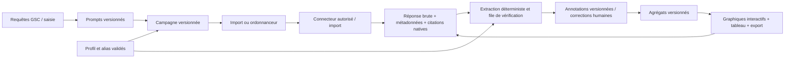

# Cahier des charges — Visibilité de marque dans les réponses IA

**GTM Growth · Version de travail 1.0 · 5 novembre 2026**  
**Statut :** spécification proposée pour validation produit et technique.  
**Périmètre :** suivi de prompts, marques et concurrents, indicateurs historiques, sentiment, citations, collecte et exploitation.  
**Complément interactif :** [prototype des visualisations et des définitions](./visibilite-ia-prototype.html). Les données du prototype sont fictives et ne constituent ni des résultats clients ni une preuve de performance.

## 1. Objectif et décisions de cadrage

Permettre à un client de comprendre, sur un ensemble de questions et d'exécutions documentées, quand une marque est mentionnée ou citée dans des réponses de systèmes d'IA, comment elle est présentée, et comment elle se compare aux concurrents sélectionnés. L'utilisateur doit pouvoir passer de chaque indicateur agrégé à la réponse source et au passage pertinent.

**Garde-fous :**

- L'audit GEO existant évalue la préparation d'une page. Il n'est ni une mesure de mentions ni une prédiction de citation ; conserver ces mesures séparées à l'écran et dans les API.
- Le jeu de prompts, les moteurs, les dates, la langue, le pays et le mode de collecte définissent le périmètre. Il n'est pas représentatif de toute la recherche ni de tous les utilisateurs.
- Aucun fournisseur payant ni appel LLM serveur obligatoire en V1. L'import vérifié et l'analyse déterministe constituent le socle ; les connecteurs payants et classificateurs restent désactivés sans activation explicite, clé propre et budget.
- Un modèle via API n'est pas nécessairement identique à l'interface grand public du même fournisseur. Ne jamais afficher « Google AI Overview », ChatGPT ou autre service comme mesuré sans source autorisée et contrat prouvant cette correspondance.
- Les captures, exemples ou jeux synthétiques portent toujours la mention « exemple fictif » ; zéro, indisponible, non mesuré et échec sont quatre états différents.
- Les utilisateurs sont isolés par tenant. Les droits et la conservation sont contrôlés côté serveur, pas par les seuls filtres de l'interface.

### Références vérifiées

Ubersuggest présente une vue marque, prompts, concurrents et sentiment à partir de réponses collectées ; sa [documentation sur les citations](https://help.ubersuggest.com/hc/en-us/articles/55257456026011-Understanding-the-Citation-Tab-in-AI-Search-Visibility) distingue mention et citation. La [documentation Gemini Grounding](https://ai.google.dev/gemini-api/docs/google-search) décrit les annotations et conditions d'affichage applicables. Les spécifications effectives et tarifs de chaque fournisseur sont à revalider lors de l'implémentation. La [documentation Gemini sur la conservation](https://ai.google.dev/gemini-api/docs/zdr) décrit notamment une conservation spécifique pour le grounding : ne pas promettre une conservation nulle côté fournisseur.

## 2. Utilisateurs, rôle et parcours

| Profil | Décision à prendre | Droits proposés |
|---|---|---|
| Administrateur client | Définir marque, concurrents, sources et budget | Configurer et lancer ; gérer les membres selon le rôle existant |
| Analyste client | Comprendre une variation et prioriser des actions | Consulter, filtrer, exporter et annoter ; édition selon permission explicite |
| Agence | Comparer plusieurs clients | Une vue par tenant autorisé ; aucun accès additionnel par simple choix « agence » |
| Administrateur plateforme | Exploiter la collecte | Superviser files et dépenses ; accès aux données clients seulement suivant les règles existantes et journalisation |

1. Sélectionner un espace, créer ou choisir le profil de marque et ses variantes.
2. Importer des requêtes GSC réellement observées ou saisir des questions ; les requêtes GSC ne sont pas présentées comme des questions réellement posées aux IA.
3. Choisir source, langue, pays, fréquence et éventuellement concurrents ; prévisualiser périmètre, coût et limites.
4. Importer une réponse ou exécuter un lot, puis contrôler les données, mentions et citations.
5. Comparer dans le temps, ouvrir une réponse, valider ou corriger une annotation ; exporter une vue sourcée.

## 3. Architecture et contrat des données

### 3.1 Entités minimales

Toutes les entités portent `tenant_id`, identifiant opaque, dates UTC et contrôle de version ; les accès sont vérifiés sur chaque jointure.

| Entité | Champs nécessaires | Règles |
|---|---|---|
| `brand` | nom, domaines, type propre/concurrent, statut | Unicité par tenant ; suppression logique et historique d'audit |
| `brand_alias` | texte, forme normalisée, langue, statut, origine | Validation humaine, variantes ambiguës non utilisées automatiquement |
| `prompt` / `prompt_version` | texte, langue, pays demandé, thème, provenance GSC/manuelle, statut, version | Un changement de texte crée une version ; aucune réécriture silencieuse |
| `campaign_version` | ensemble de versions de prompts et marques, source, modèle, outil web, langue/pays, fréquence | Instantané immuable ; une modification modifie le périmètre |
| `run` | source, mode import/API, heure UTC, statut, version, référence d'idempotence, coût estimé/réel si connu | Une tentative échouée n'est pas une réponse négative ; retries et tentatives distincts |
| `response` | texte, identifiant fournisseur, horodatage, langue/pays déclarés, modèle/configuration, statut, origine et version de campagne | Texte et métadonnées provenant du fournisseur ou importés ; conserver la provenance et la qualité |
| `mention` | response, marque, positions/extraits, méthode, confiance, état de validation | Maximum une présence par couple réponse/marque pour les KPI de présence |
| `sentiment_annotation` | response, marque, positif/neutre/négatif/mixte/indéterminé, preuve, méthode, version, validation | L'absence de mention ne reçoit pas de sentiment |
| `citation` | réponse, URL brute/canonique, titre, plage liée, provenance, nature native/importée | Mention ≠ lien ; pas de citation inventée par lecture HTML |
| `measurement_snapshot` | périmètre, version de calcul, numérateurs, dénominateurs, couverture et date | Calcul reproductible ; révision signalée si annotation corrigée |
| `budget_event` / `audit_event` | acteur, opération, coût/devis, état, date | Sans clés ni texte sensible dans les logs ; audit non modifiable par l'utilisateur |

### 3.2 Stockage et transitions

La persistance historique requiert une base transactionnelle durable et des migrations : le registre JSON de tenants existant n'est pas un stockage d'événements concurrents. Proposition : PostgreSQL sur l'infrastructure Node/OVH, avec contraintes et index incluant `tenant_id` ; stockage objet privé optionnel pour grands contenus, sans URL publiques. Une décision d'architecture doit confirmer sauvegardes, chiffrement, reprise et capacité avant développement.

États `run` : `draft → queued → running → succeeded | partial | failed | cancelled` ; une exécution partielle n'est agrégée que pour ses réponses réussies et décompte ses échecs dans la couverture. En cas de retry, clé d'idempotence `(tenant, campaign_version, prompt_version, source, scheduled_slot, sample_index)` ; réponses conservées une seule fois par tentative réussie. L'import manuel utilise un identifiant d'import et un contrôle de doublons explicite ; ne pas remplacer le texte source.

### 3.3 Périmètre commun des graphiques

Filtres partagés : tenant autorisé, marque, période, source/modèle, type de source, version de campagne, langue, pays, thème et statut de validation. Dates en UTC, fuseau affiché ; 7/28/90 jours et intervalle personnalisé. Comparaison de périodes de même longueur sur un périmètre compatible. Les filtres sont reflétés dans l'URL sans informations sensibles, préservés au retour, et validés côté serveur. Afficher date de dernière collecte, nombre de réponses réussies / attendues, nombre de prompts et avertissements sur la comparabilité. Les changements de configuration créent une rupture visible ; la comparaison reste désactivée si le périmètre est incompatible, sauf mode exploratoire clairement signalé.

## 4. Spécifications fonctionnelles et visuelles

Les six modules ci-dessous imposent chacun des visualisations interactives riches, accessibles et exploitables ; elles utilisent des données réelles ou un exemple **explicitement identifié**. Les aperçus de ce cahier sont schématiques et ne remplacent pas les données de production.

### 4.1 Suivi des prompts

**Fonctions :** créer, éditer/versionner, archiver et importer des prompts ; regroupement par thème ; marquer provenance GSC, manuel ou import ; paramètres langue, pays, source et fréquence. Montrer un échantillon de réponses, leur statut, l'historique des exécutions et le coût estimé avant lancement. Les requêtes GSC sont des signaux de recherche Google, pas des prompts IA observés.

**Visualisations :** matrice interactive prompts × moteurs avec couleur et symbole représentant présence, absence ou donnée non disponible ; cellule ouvrant le détail des exécutions. Courbe par prompt avec sélection de séries, dates, effectifs et marqueurs d'échec. Ligne de temps des versions et ruptures de configuration. Tris, filtres, recherche, pagination, sélection multiple et export avec mêmes filtres ; navigation clavier et tableau équivalent.

**Acceptation :** édition du texte crée une version ; import GSC conserve sa provenance ; un échec n'apparaît jamais comme une absence de marque ; clic ou clavier sur une cellule ouvre les réponses correspondantes ; archiver n'efface pas l'historique ; absence de données indique comment démarrer.

### 4.2 Détection des marques et concurrents

**Fonctions :** configurer marque propre, 0–10 concurrents initiaux proposés (limite produit à confirmer), domaines et alias ; validation/ignorance des suggestions ; détection déterministe à partir d'alias normalisés Unicode et frontières de mots, en évitant les sous-chaînes et alias ambigus. Les correspondances douteuses sont « à vérifier », pas automatiquement positives. Chaque occurrence pointe vers une plage de texte. Correction humaine historisée ; recalcul de l'agrégat affecté avec version du détecteur.

**Visualisations :** classement horizontal des marques, avec valeur, nombre de réponses, comparaison antérieure compatible et tri ; matrice marques × prompts et filtre moteur. Ouvrir la réponse avec passages surlignés, alias détecté et validation/correction. Marque propre distinguée par libellé et motif, jamais par couleur seule. Montrer l'effet d'une modification d'alias sans réécrire silencieusement le passé.

**Acceptation :** « Apple » dans « pineapple » n'est pas une mention ; un alias ambigu nécessite validation ; 3 occurrences dans une réponse = 1 présence de marque ; deux marques dans la même réponse comptent chacune une présence ; aucun concurrent inventé si aucune preuve ; historique et isolement tenant vérifiés.

### 4.3 Indicateurs et historique

**Grain canonique :** une réponse réussie et éligible à une version de campagne, pour un prompt/version, une source/modèle et un instant. Une réponse partielle, filtrée ou échouée n'entre pas dans le dénominateur ; sa présence dans la couverture reste visible. Les réponses importées sans horodatage/source requis restent non agrégées jusqu'à correction. Une réponse réessayée n'est pas comptée deux fois.

| Indicateur | Définition V1 et limite |
|---|---|
| Visibilité marque | `100 × nombre de réponses éligibles avec ≥ 1 mention validée de la marque / nombre de réponses éligibles`. Un dénominateur nul produit `—`, pas 0 %. |
| Part de voix — présence | Pour chaque marque : `100 × nombre de couples (réponse éligible, marque du panel) avec présence validée / nombre total de ces couples pour toutes les marques du panel`. Chaque marque compte au plus une fois par réponse ; le panel est nommé et versionné. Si dénominateur nul : `—`. |
| Taux de citation | `100 × réponses éligibles contenant ≥ 1 citation native ou importée validée vers un domaine de la marque / réponses éligibles`. Une simple mention ne vaut pas citation ; une source sans métadonnée exploitable est indisponible, non « aucune citation ». |
| Couverture | `réponses réussies et éligibles / exécutions attendues` ; afficher séparément les échecs, annulations, importations et exclusions. |

**Exemple de contrôle :** 10 réponses éligibles, marque A présente dans 4, B dans 3 et C dans 1 ; visibilité A = 40 %, part de voix A = 4 / (4 + 3 + 1) = 50 %. Une même réponse peut contenir A et B. Ce choix n'est pas forcément la formule d'Ubersuggest ; afficher « part de voix — présence, panel sélectionné » et la méthode.

**Visualisations :** courbes temporelles par marque avec zoom sur période, sélection de séries, survol *et* sélection clavier/tactile affichant numérateur/dénominateur ; barres de comparaison au même instant ; tableau téléchargeable ; sélecteur absolu / évolution en points de pourcentage. Montrer dates manquantes en rupture de ligne, jamais reliées à zéro. Marqueurs de changements de version ; avertissement si faible échantillon. Pas de seuil statistique ni intervalle inventé ; rapporter le nombre d'observations et réserver les intervalles à une méthode d'échantillonnage validée.

**Acceptation :** exemple ci-dessus reproduit ; valeurs bornées 0–100 ; absence de données affiche `—` ; filtres et export donnent les mêmes numérateurs ; évolution en points, pas en pourcentage relatif ; incompatibilité de cohortes signalée et non fusionnée.

### 4.4 Sentiment et vérification

**Fonctions :** classer une mention de marque par réponse, au choix humain ou moteur optionnel ; conserver extrait, justification, méthode, modèle et version. Classes positif, neutre, négatif, mixte et indéterminé. Pour plusieurs passages contradictoires, marquer mixte ; pas de classification par défaut en cas d'incertitude. Liste de vérification et modification manuelle auditée.

**Visualisations :** barres empilées normalisées par moteur/période avec effectif, incluant mixte et indéterminé ; évolution temporelle par classe ; thèmes reliés aux passages factuels, sans attribuer de cause ; clic sur un segment ouvre les réponses filtrées. Labels visibles, contraste et motifs ; option tableau/export.

**Acceptation :** absence de mention exclue ; indéterminé conservé dans le dénominateur des annotations affichées et non transformé en neutre ; correction explicite modifie la version des agrégats ; aucun résumé génératif non identifié comme tel ; qualité du classificateur évaluée sur corpus étiqueté avant activation, sans cible arbitraire inventée.

### 4.5 Citations et sources

**Fonctions :** enregistrer les références fournies par le connecteur ou jointes à un import, avec URL originale, URL normalisée, titre et segment lié ; distinguer source propre, concurrente, tierce et non classée. L'absence de métadonnées natives est « non disponible » ; les règles de normalisation ne doivent pas visiter les URL automatiquement. Ouvrir les liens dans un nouvel onglet avec protections usuelles ; respect des conditions fournisseur et attribution.

**Visualisations :** classement interactif domaines/pages, barres par source, tendance du taux de citation, répartition des catégories, matrice moteur × domaines et accès aux réponses sources. Filtres par marque, moteur et période ; vue tableau pour URL longues et export ; pas de graphe de relations décoratif.

**Acceptation :** mention sans URL ≠ citation ; URL répétée n'augmente pas le nombre de réponses citées ; URL sans protocole autorisé rejetée ; `www`, paramètres et redirections ne sont normalisés que selon règles documentées ; une URL et sa provenance restent consultables.

### 4.6 Collecte, budgets et opérations

**Fonctions :** adaptateur commun `capabilities()`, `estimate()`, `run()`, `normalize()` ; import JSON/CSV avec prévisualisation, validation, exemple téléchargeable et signalement de provenance manuelle. Connecteurs API optionnels par tenant avec secret côté serveur, vérification de capacité et dates de disponibilité. Ordonnanceur persistant avec file, concurrence bornée, retries exponentiels, timeout, idempotence, annulation, budget maximum et interruption en cas de dépassement. Estimation avant activation et coût réel si fourni ; aucun coût = « inconnu », jamais 0.

**Visualisations :** tableau de bord opérationnel par source : lignes de collecte réussie/échouée, jauge budget connu, distribution des latences, calendrier des derniers lots, tableau des erreurs ; clic sur un point ouvre les exécutions correspondantes. L'état « non configuré / expiré / en retard / erreur / budget atteint » est explicitement lisible. Un utilisateur ne voit que ses jobs ; la plateforme ne voit que les agrégats nécessaires à son rôle.

**Acceptation :** sans clé ou opt-in explicite, aucun appel payant ; faux connecteur et horloge injectée pour tester limites/retries ; panne isolée d'un moteur ; redémarrage sans doublon ; secrets absents des API et journaux ; affichage budget et couverture exact ; import sans pays prouvé est étiqueté « non fourni » et non géolocalisé par supposition.

## 5. Conception des visualisations interactives

| Vue | Question | Encodage | Interaction et lecture alternative |
|---|---|---|---|
| Vue d'ensemble | Évolution et couverture ? | Courbes temporelles, barres et effectifs | Filtrer, comparer, cliquer, zoomer ; tableau et CSV |
| Prompts | Quelles questions gagnent/perdent ? | Matrice prompts × moteurs | Tri, recherche, sélection cellule, réponse et version |
| Marques | Quelles marques sont présentes ensemble ? | Classement horizontal et matrice | Sélection marques, panel, lecture des passages |
| Sentiment | Quelle tonalité et quelles preuves ? | Barres empilées avec motifs et séries temporelles | Sélection de classe, extrait et correction |
| Citations | Quelles sources sont citées ? | Barres domaines et tableau de liens | Drill-down domaine → page → réponse, filtre |
| Collecte | La mesure est-elle fiable et maîtrisée ? | Timeline des états et graphiques de coûts/latences | Filtre source, zoom, détail d'un job |

Contrat commun : palette contrastée et cohérente, signes et libellés en plus des couleurs ; valeurs critiques visibles sans survol ; navigation clavier et lecteurs d'écran ; tableau de données accessible avec intitulés, unités, dates et description textuelle ; graphiques utilisables tactilement, sans dépendre du hover. Sur mobile : cartes empilées, filtre repliable, zoom par commandes et tableaux à défilement signalé. Respect de `prefers-reduced-motion` ; aucune animation ne simule des données. Une image statique exportée est accompagnée du périmètre et des valeurs ; export CSV neutralise les formules de tableur. Ne jamais intégrer une capture externe comme données client.

**Contrat technique :** SVG/DOM pour séries et barres légères, réutilisation des composants de la console sans ajouter de framework par défaut ; pagination/agrégation serveur si la densité dépasse une limite à mesurer ; dimensions adaptatives via conteneur, pas d'échelle tronquée trompeuse. Définir un budget de performance après mesure sur l'environnement cible ; ne pas annoncer une valeur SLA non mesurée.

## 6. API, sécurité et conformité

API protégée sous `/api/console/ai-visibility/*`, scoping `X-Tenant` soumis à `resolveTenant` et vérification du rôle à chaque requête. Contrats et exemples JSON à finaliser en OpenAPI avant implémentation : `GET/POST prompts`, `GET/PUT brands`, `POST imports/preview`, `POST imports/commit`, `POST runs`, `GET runs/:id`, `GET responses/:id`, `PUT annotations/:id`, `GET metrics` et `GET exports`. Aucun secret, clé fournisseur, prompt non autorisé ou tenant d'un autre client dans une réponse. Écritures protégées contre CSRF selon le mode d'authentification ; validation serveur, limitation de débit, journalisation et absence de contenu sensible dans les logs.

Les URL citées sont des données non fiables : schémas HTTP(S) uniquement, rendu en texte et liens sécurisés ; aucun fetch automatique. Si une future fonctionnalité visite les URLs, utiliser un contrôle SSRF avec validation DNS et redirections, limites de taille et délais. Les fournisseurs et le contenu importé sont des données non fiables : l'IA ou le texte de réponse n'exécute jamais d'instruction.

**Cycle de vie :** le souhait exprimé est un an à partir de la création, avec renouvellement explicite ; le dépôt ne met pas encore en œuvre ce processus. Avant publication, définir précisément les périmètres compte/demandes/réponses/annotations, la preuve et la date de renouvellement, les obligations légales et sauvegardes, les alertes et le processus d'effacement vérifiable dans Keycloak, base, fichiers, exports et fournisseurs. Ne pas annoncer une suppression automatique tant que toute la chaîne n'est pas testée et opérationnelle. Définir bases légales, rôles responsable/sous-traitant, destinataires, transferts, registre et procédures d'accès/effacement ; information et choix sur les traitements optionnels. Une réponse à un exercice de droits ne doit pas dépendre du modèle IA.

## 7. Qualité, observabilité et critères transversaux

- Tests unitaires pour calculs de numérateurs, doublons, chevauchements, absence de données, sentiment mixte, alias et versions ; fixtures d'import reproductibles et faux connecteurs.
- Tests d'intégration : tenant A ne peut ni lire, modifier, exporter ou déduire les données de B ; permissions admin/utilisateur ; CSRF et rate limits ; erreurs fournisseurs et doublons de jobs ; secrets non exposés.
- Tests de données : concordance graphique/tableau/API/export, périmètres identiques, dates, états manquants, changement de modèle/panel et comparaisons incompatibles.
- Tests visuels et accessibilité : desktop/mobile, clavier, lecteur d'écran, contrastes, zoom, étiquettes et données identiques sans hover ; langues FR/EN ; états vides, partiels, erreur et hors ligne.
- Tests d'exploitation : redémarrage de workers, reprise de file, quota dépassé, rotatation de clé, isolation des connecteurs et contrôle des dépenses ; pas de test payant sans budget autorisé.
- Validation métier sur un jeu connu : réponses et annotations contrôlées par un humain ; taux de faux positifs/faux négatifs et désaccords présentés avant lancement. Les cibles numériques seront fixées après une mesure pilote.
- Observabilité : métriques opérationnelles agrégées, délais, erreurs et coûts, alertes actionnables ; horodatage, méthode et version sur chaque résultat ; traces excluant réponses brutes et secrets par défaut.

## 8. Découpage de livraison proposé

| Lot | Livrable | Critère de sortie |
|---|---|---|
| P0 · Fondations | Modèle tenant, permissions, import manuel, prompts versionnés, réponses et matrice | Import auditable et tests d'isolation au vert ; aucun appel externe payant |
| P1 · Marques et métriques | Marques/alias, détection validable, visibilité, part de voix et graphiques | Exemples de calcul reproductibles, drill-down complet et export cohérent |
| P2 · Citations et sentiment | Citations natives/importées, annotations manuelles, graphiques et contrôle qualité | Réponses et preuves accessibles ; états inconnus et corrections traités |
| P3 · Collecte automatisée | Connecteur explicitement choisi, file, budget, observabilité, récupération | Tests de panne/idempotence et validation d'un budget pilote |
| P4 · Industrialisation | Gouvernance, rétention réellement appliquée, performance, exploitation, pilote | Effacement testé de bout en bout, contrôles juridiques et opérationnels documentés |

Aucune durée d'exécution ou date de livraison n'est fixée sans estimation d'équipe, disponibilité des accès et mesure d'un pilote.

## 9. Décisions produit et points restant à valider

1. **Collecte : import et connecteurs.** L'import constitue le socle immédiatement exploitable ; les connecteurs doivent être activés par client, après configuration et avant le premier appel facturable. L’implémentation actuelle accepte un import JSON par lot et prépare OpenAI ; Gemini est désactivé en attendant l’affichage conforme des suggestions Google. La planification et l’import CSV restent à réaliser.
2. **Coûts : compte et facture du client.** Chaque client utilise ses propres identifiants et supporte ses frais ; aucun secret ne doit transiter par le navigateur ou être partagé entre tenants. Avant activation : plafond par client, estimation, preuve de consentement à la dépense et arrêt en cas de quota. Une clé serveur commune ne satisfait pas cette règle.
3. **Sources et libellés proposés :** import manuel : « réponse importée », avec source déclarée, sans preuve automatique d'origine ; API Gemini + Google Search : « API Gemini avec Google Search », si activé, avec citations fournies et conditions d'affichage ; API OpenAI + recherche web : « API OpenAI avec recherche web », si activé. Ces API ne doivent pas être présentées comme des mesures des interfaces Gemini, ChatGPT ou Google AI Overviews. Les moteurs ou interfaces sans accès officiel adapté restent « non disponibles ». Le connecteur OpenAI est préparé mais n’a pas été testé avec une clé réelle ; Gemini est bloqué tant que ses suggestions obligatoires ne sont pas affichées de manière sûre. Références : [Gemini grounding](https://ai.google.dev/gemini-api/docs/google-search), [OpenAI web search](https://platform.openai.com/docs/guides/tools-web-search).
4. **Échantillon : maximum réalisable**, compte tenu du budget client explicitement accepté, des quotas, du consentement, des droits des fournisseurs et du temps disponible. L'interface montre le nombre prévu, exécuté, réussi, exclu et la couverture par moteur ; aucune garantie de représentativité. La limite actuelle de 1 000 réponses par import et 4 Mo par requête est une limite technique explicite, non un objectif statistique. Les lots séparés ne sont pas encore agrégés.
5. **Sentiment automatique souhaité.** Cible : sentiment lié à la marque et aux passages, classes positif/neutre/négatif/mixte/indéterminé, scores par classe, version et correction humaine, inspirés des approches documentées par [Amazon Comprehend](https://docs.aws.amazon.com/comprehend/latest/dg/how-targeted-sentiment.html) et [Microsoft Azure](https://learn.microsoft.com/en-us/azure/ai-services/language-service/sentiment-opinion-mining/overview). Microsoft annonce le retrait de Sentiment Analysis et Opinion Mining d’Azure Language le 31 mars 2029 : ne pas en faire une dépendance de long terme. La prise en charge des langues doit être vérifiée pour chaque moteur ; le sentiment ciblé d'Amazon est notamment documenté pour l'anglais. Aucun fournisseur ne définit un seuil universel ; mesurer par langue, classe et secteur sur un corpus annoté, avec matrice de confusion, précision/rappel et abstention. L'heuristique actuelle est expérimentale, sans score calibré ni validation de niveau leader, et ne doit pas être présentée comme une classification fiable.
6. **Conservation et droits — proposition à valider avant exploitation :** un an depuis la création, renouvellement explicite horodaté et suppression à l'échéance si non renouvelé ; inventaire des données et responsables (comptes Keycloak, réponses, imports, profils, rapports, journaux, sauvegardes, fournisseurs) ; préavis, procédure de renouvellement, durée et preuve de traitement des demandes ; exceptions légales documentées séparément ; politique de sauvegarde et purge fournisseur, sous-traitants et transferts ; journal d'effacement sans contenu personnel et test de restauration après purge. La suppression à un an n'est pas actuellement automatisée. Vérifier aussi les obligations légales de conservation et la qualité de responsable de traitement avant immatriculation de KayrosLab SASU.

### État d'implémentation du premier incrément

La console « Visibilité IA » permet de prévisualiser et importer des réponses JSON dans un jeu rattaché au tenant ; elle montre des présences, une part de voix par présence, une tendance et les réponses sources. Les noms de marques et alias sont figés par import. Le sentiment est une heuristique de démonstration non validée ; les réponses sans signal sont indéterminées. Un administrateur peut confirmer ou rejeter une mention et corriger sa tonalité ; la correction est journalisée. Les jeux de données sont stockés dans SQLite, sur le volume local, avec transactions et verrouillage entre processus d'un même serveur. Les anciens fichiers JSON sont importés à la première consultation de chaque tenant et conservés. Ce stockage ne fournit ni planification ni rétention RGPD automatisée ; les exports, la validation du classificateur, la finalisation des connecteurs, le plafonnement monétaire, la collecte planifiée et les procédures d’effacement restent nécessaires avant recette complète. Ne pas déployer cet incrément comme solution conforme ou classificateur validé.

## 10. Critères de recette produit

Le lot complet est accepté lorsque : (1) un client autorisé importe ou collecte un jeu attribué et versionné ; (2) une réponse permet de retrouver le prompt, la marque, la preuve et les citations ; (3) chaque métrique s'explique par son calcul et son effectif ; (4) les six vues interactives fonctionnent au clavier et sur mobile avec alternatives tabulaires ; (5) aucune erreur n'est comptée comme absence ; (6) un changement de périmètre est signalé ; (7) les exports respectent l'isolation et les filtres ; (8) budgets et secrets sont protégés ; (9) la conservation et les droits sont effectivement opérables ; (10) le produit distingue visiblement une évaluation GEO d'une observation de réponse IA.

## 11. Configuration de l’incrément local — non prêt pour la production

- Pour un tenant `acme`, la clé OpenAI propre au client peut être fournie au processus sous `AI_VISIBILITY_OPENAI_KEY_ACME` ; remplacer les tirets du tenant par des underscores, en majuscules. Ne jamais enregistrer cette valeur dans le dépôt ou l’interface ; utiliser un mécanisme de secrets adapté et séparer les comptes clients.
- L’interface indique si une clé est configurée sans la révéler, demande une confirmation du risque de facturation et limite chaque lancement à cinq prompts. Le modèle préparé est `gpt-4.1-mini` avec `web_search` ; un plafond monétaire et un calcul fiable du coût ne sont pas encore disponibles. Les échecs peuvent être facturés par le fournisseur. Sans clé, aucun appel réel n’a été effectué pendant le développement.
- Les citations OpenAI sont présentées en liens dans le texte lorsque leurs annotations sont exploitables ; des annotations invalides ou chevauchantes entraînent l’exclusion de la réponse concernée. Aucun équivalent de l’interface ChatGPT n’est revendiqué.
- La collecte Gemini + Google Search est bloquée côté serveur, même avec une clé : Google demande dans certains cas d’afficher ses suggestions avec la réponse, ce qui doit être rendu compatible avec la politique CSP et l’isolation de contenu. Référence : [Google Search Suggestions](https://docs.cloud.google.com/gemini-enterprise-agent-platform/models/grounding/grounding-with-google-search).
- L’import JSON fonctionne ; les jeux sont enregistrés dans SQLite avec des transactions compatibles avec plusieurs processus sur un même hôte et disque local. Le registre de tenants reste distinct. Aucune purge à un an ni synchronisation des sauvegardes n’est implémentée. Ne pas utiliser cet incrément pour des données réelles avant traitement des exigences de rétention et d’exploitation.
