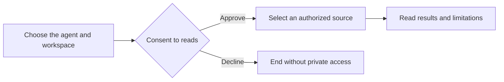
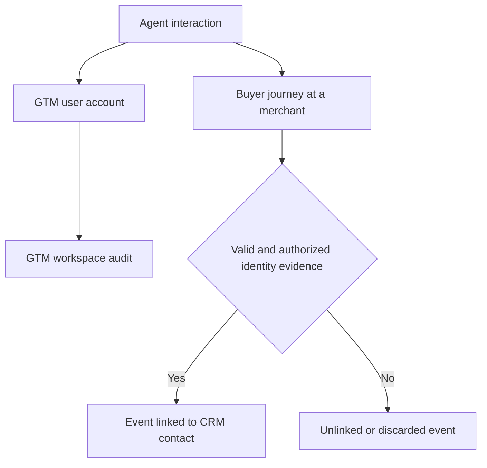
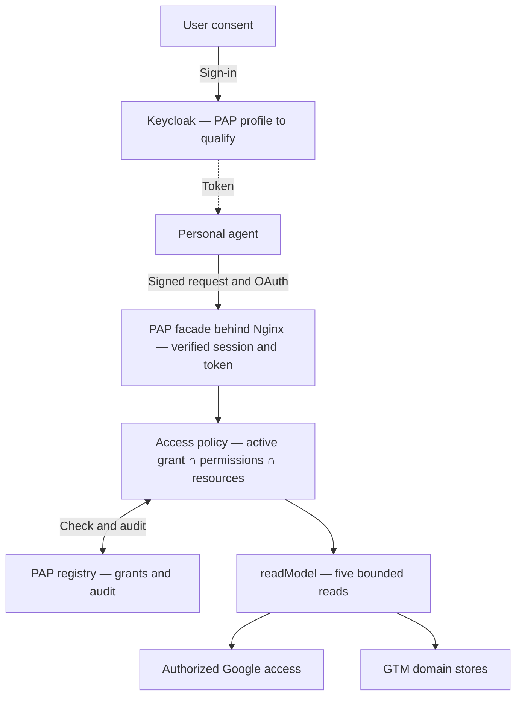

# Integrating Personal Agent Protocol into GTM Growth

Functional and Technical Specification

Document version 1.0 • 15 November 2026

Audience: product leadership, marketing, development, operations, and customer workspace administrators.

## Purpose and proposed decision

Enable customers to access the authorized data in their GTM Growth workspace through a compatible personal agent, with explicit consent, sourced responses, and revocable access. The initial pilot reuses the existing data agent's five bounded read models. It does not trigger publishing or paid data collection.

The project also includes updating the PAP checker and generator already present in the repository. Their current reference is draft 0.3; the target is the PAP 1.0 specification, published on 14 November 2026. A valid discovery file alone does not demonstrate that sign-in and authorization work.

Subsequent stages will support preparing actions for approval, then help customers' websites accommodate their buyers' own agents. Each stage has separate acceptance criteria.

### Expected customer benefits

- Obtain a traffic or visibility report in their usual interface, including its source, reporting period, and measurement limitations.
- Reduce manual handoffs between a customer, their agency, and the console while maintaining separate access for each workspace.
- Understand what each agent can read, inspect its activity, and withdraw its access.
- Gradually prepare journeys that buyers' agents can use, with merchant-specific identities and evidence.

These benefits are hypotheses to measure during the pilot. PAP does not guarantee higher traffic, better rankings, citations by a model, or increased sales.

### Document status

Proposed specification for scoping and implementation. The requirements describe the target state; they do not certify a deployment. Repository baseline: main `b1323ba055536e6ecf800285cb0a4a0879729065`. This deliverable does not change the website or the code.

## 1 Reading guide and scope

The functional reading track covers Sections 2–7 and the expected outcomes in Section 18. The technical reading track covers Sections 8–17. Both tracks share the same product boundaries and acceptance criteria.

### Delivery phases

| Phase | Expected outcome | Exit criterion |
| --- | --- | --- |
| L0 Scoping and migration | PAP 1.0 audit, OAuth design, and versioned contracts | Demonstrated Keycloak compatibility, or an estimated and approved alternative solution |
| L1 Read-only pilot | One pilot workspace, one tested agent, and five read models | Consent, isolation, revocation, and response evidence verified end to end |
| L2 Governed actions | Draft preparation followed by selected actions | Exact approvals, existing roles, and prevention of duplicate execution demonstrated |
| L3 Customer websites | Discovery and buyer-agent journeys | One merchant and one journey qualified, with isolated identity and verified identity-linking evidence |

### Pilot exclusions

L1 excludes CRM writes, individual contacts, orders, secrets, raw AI responses, role changes, payments, and arbitrary MCP calls. AI collection runs, Social publishing, GBP changes, WordPress, and Apply Mode remain outside its scope.

The pilot exposes an API. It does not include a new conversation engine, automated browser access to the entire console, or the development of a personal agent. Device Sign-In, Mediated Sign-In, and Browser Join are deferred. The protocol does not replace the Google, Shopify, PrestaShop, CRM, or Postiz connectors.

### Requirement conventions

The identifiers F, T, and Q designate the functional, technical, and quality requirements proposed for GTM Growth, respectively. “Required for L1” means necessary for pilot acceptance. “L2” or “L3” indicates a later enhancement. Protocol-specific obligations are defined in official references S1–S4; the routes, scopes, quotas, and durations proposed here are GTM Growth design choices.

## 2 Baseline and gaps

Repository analysis identifies the following components for reuse. Presence in the code does not demonstrate that a provider is connected or that a capability has passed production acceptance. [S6–S10]

| Existing component | Finding in the source | Project implication |
| --- | --- | --- |
| Node and Express | TypeScript server and Zod validation | Add a PAP facade to the existing server |
| Keycloak and tenants | OIDC verification and workspace membership | Verify PAP OAuth compatibility before enabling access |
| Data agent | Five bounded read models | Reuse `readModel` and its business limitations |
| PAP checker | `src/geosuite/poppy.ts` targets 0.3 | Migrate schemas, generator, tests, and explanations |
| General MCP endpoint | Shared operator-token authentication when configured | Do not expose it as delegated customer access |
| CRM and commerce | Deterministic identities and commerce-to-CRM delivery | Preserve exact evidence and separation of actors |
| Social and GBP | Module-specific approvals and execution | Retain them in L2 |
| OVH and storage | Existing deployment and per-module SQLite stores | Keep the pilot infrastructure and add dedicated durable storage |

### F01 Preserve product boundaries

Required for L1. The published catalog must match the functions actually available. It must distinguish recorded configuration, a successful read, a tested capability, and production availability.

The project does not, by itself, enable the complete GEO v2 engine, Apply Mode execution, Mollie billing, or unqualified external connectors. None of these capabilities may be presented as available solely because PAP has been added.

### F02 Avoid unsupported compatibility claims

Required for L1. A provider or product may be described as compatible only after testing its actual version and access mode. A subscription to a chat interface, a model API key, and a PAP-compatible agent are three different forms of access.

## 3 Customer journey and priority use cases

### F03 Guide the customer to a useful first read

Required for L1. The customer must understand the service's value before consenting. The journey presents the agent, workspace, authorized sources, duration, and requested permissions in sequence. After sign-in, it suggests an initial question suited to the available sources.

*Pilot journey*

| Journey stage | Customer need | Expected response |
| --- | --- | --- |
| Discover | Understand what my agent will be able to do | Read examples and visible limitations before connecting |
| Activate | Connect the right account to the right workspace | GTM authentication and consent by the identified user for one workspace |
| Understand | Know which data is available | Authorized inventory and explicit property selection when needed |
| Measure | Prepare a traffic or visibility report | Metrics, actual reporting period, source, and console link |
| Retain | Review access and read incidents | Inspectable activity and accessible revocation |

### Reference use cases

A marketing manager requests organic clicks for the available 28-day period. An agency prepares a customer report without accessing other workspaces. A technical lead checks configured sources and the most recently recorded collection status.

The agent may combine the results it receives, but GTM must provide sufficiently explicit data to prevent misinterpretation. If the request requires another period, another brand, or an unavailable metric, the API states its limitation and directs the user to the console. It does not silently invent an approximation.

## 4 Functional read catalog

### F04 Reuse the five existing models

Required for L1. Labels and caveats are available in French and English. The scopes below are proposed GTM scopes; they are not standard protocol scopes. [S7]

| Model and proposed scope | Accessible data | Required response limitation |
| --- | --- | --- |
| `workspace` • `gtm:workspace:read` | Number of configured domains and properties within the authorized scope | Configuration does not prove working access |
| `search` • `gtm:search:read` | GSC clicks and impressions for one property over 7, 28, or 90 days | Window ends three days before the read; these are not conversions |
| `analytics` • `gtm:analytics:read` | GA4 sessions and key events for one property over 7, 28, or 90 days | Window ends the previous day; a key event does not prove a sale |
| `visibility` • `gtm:visibility:read` | Latest imported sample, first configured brand, confirmed and unreviewed mentions | Actual observation period; a sample, not market share |
| `operations` • `gtm:operations:read` | Saved questions, latest collection run, and a sample of unacknowledged alerts | No collection is triggered; alerts are limited to 200 |

### F05 Preserve the meaning of measurements

Required for L1. Every response includes its source, read time, effective period, units, and relevant caveats. A missing value remains missing. An empty response must never become zero. A recent import does not make its observations recent.

The operations scope concerns GTM's operational status; it authorizes no writes and does not enable the PAP Operations extension. Visibility data must not be averaged across different panels.

### F06 Handle missing data

Required for L1. The `ready`, `empty`, `not-configured`, `choose-source`, and `unavailable` states are retained in the contract. The agent receives an actionable next step. Source choices expose only properties included in the consent and still authorized in the workspace.

## 5 Console and consent

### F07 Add the Connected agents section

Required for L1. The section integrates into the existing navigation with a distinct icon. Each authorization displays the agent's verified name and domain, the consenting user, workspace, permissions, resources, consent date, expiration, last use, and status.

Visible states are Active, Expired, Revoked, and Suspended by an administrator. An ended session may appear in the history without being confused with revocation of the authorization.

### F08 Obtain explicit and limited consent

Required for L1. The administrator enables the pilot for their workspace and selects the permitted agents. Each authorized member then consents within their own permissions. An administrator's authorization does not implicitly grant access to other members' accounts.

The form selects one workspace per authorization. It presents each data category and each selectable Google property. Visibility and operational-status data are consented to at workspace level, with this granularity stated explicitly. Categories are not selected by default.

The proposed pilot authorization duration is 30 days, renewable through fresh consent. Additional permissions, a new workspace, or a new resource require new consent. Declining or closing the flow creates no permissions.

| Actor | Permitted pilot actions |
| --- | --- |
| Member with read permissions | Consent within their own permissions; view and revoke their authorizations |
| Tenant administrator | Enable the pilot, allow agents, inspect the audit trail, and suspend access within their workspace |
| Platform operator | Disable the feature or a compromised client; no implicit access to business data |
| Personal agent | Use only consented reads; no administration screens |

### F09 Make revocation straightforward

Required for L1. The user can withdraw access from this section and receives an explicit result. The API refuses every new read once revocation has been durably recorded. The console explains that this button cannot retrieve information already transmitted to the agent.

## 6 Marketing presentation and value measurement

### F10 Make a verifiable promise

Required for L1. The website explains: “Read your authorized GTM Growth workspace data through a compatible agent, with visible sources and revocable access.” The English wording must retain the same capabilities, exclusions, and conditions as the French version.

The website describes the pilot status and the agents actually tested. It links to a marketing guide for use cases and a technical guide for access. Examples show dated responses and identify fictional data when used in a demonstration.

The presence of a PAP manifest must not become a general security badge, a compliance certification, or proof of improved search performance. An audit result must distinguish discovery, authentication, authorization, and successful completion of a journey.

### F11 Maintain parity between languages

Required for L1. Public pages, consent, data states, actionable errors, help, and the Connected agents section have equivalent functionality in French and English. The `locale` parameter changes labels, never access controls or technical identifiers.

### F12 Measure the pilot without promising returns

| Indicator | Definition | Proposed target |
| --- | --- | --- |
| First useful response | Time from the start of consent to a read understood by the tester | Measure the median and abandonment rate; compare with the console journey |
| Task success | Completed read tasks among eligible scenarios | At least 90% across 20 prepared scenarios with available sources |
| Response traceability | Responses including source, date, applicable period, and caveats | 100% of the acceptance corpus |
| Effective revocation | Requests refused after revocation on tested nodes | 100%; release-blocking criterion |
| Workspace isolation | Other tenants' data exposed during negative tests | Zero; release-blocking criterion |

Tasks that cannot be completed because a source is missing are counted separately with their reason. These targets are proposed pilot criteria, not measured performance or contractual commitments.

## 7 CRM and buyer journeys

### F13 Distinguish the GTM user from the buyer

Required for L1. A read by a marketing manager's agent is an access activity in GTM. It feeds the workspace audit trail, not a buyer's commercial timeline. A pseudonymous PAP identifier does not automatically become a CRM contact.

### F14 Link a commercial interaction using evidence

L3. When a merchant accommodates a buyer's agent, an event may be linked to a contact only with authorized, deterministic evidence: an authenticated merchant account linked to the contact, a store customer identifier validated server-side, or an identity assertion from an authorized CRM plugin. A similar email address, an IP address, or an assumed social identifier is insufficient.

*CRM linking decision*

The proposed event retains the merchant, source, external event identifier, business timestamp, receipt timestamp, actor type, optional contact, and evidence reference. Added fields must be mapped to the existing CRM contract before development.

Unlinked data remains in an authorized pseudonymous context or is discarded according to the collection policy. A conflict must never automatically merge two contacts. Existing deletion and blocked-identity mechanisms must prevent unintended recreation through replay.

### F15 Prepare an offering for customer websites

L3. Start with one merchant, one verified domain, and a limited journey—for example, reading a product page, then viewing an authenticated order. Order access requires its own permissions and does not follow from catalog access alone. Each authenticated merchant has its own issuer: the protocol prohibits sharing an issuer across independent Companies, even when they share hosting.

## 8 Target technical architecture

### T01 Add a dedicated facade

Required for L1. Create `src/poppy` for discovery, session verification, access policy, read routes, and their audit trail. Reuse domain services without going through the general MCP registry or Slack/Eve tokens. [S7–S9]

*Pilot architecture*

### T02 Apply authorization as an intersection

Effective access is the intersection of active consent, the member's current permissions, the tenant's authorized resources, and connector permissions. The requested `workspaceId` is a selector; it is never proof of membership.

The middleware produces a validated internal context. It does not pass an unchecked request-supplied `tenantId` to the domain service. Resource lists and workspace counts must be filtered before every call to `readModel`, including `choose-source` responses and errors.

### T03 Retain existing components

The core remains Node and Express. Keycloak remains the intended identity provider, subject to compatibility testing. Domain stores remain in place. A durable PAP store holds authorizations and the audit trail; a key or replay cache must not become the authority for permissions.

Private data is not cached by Nginx or a CDN. No new generative model is required to provide these reads. The agent's model costs belong to its own environment; they must remain separate from the costs and quotas of providers queried by GTM.

## 9 Discovery and migration of the existing checker

### T04 Publish only implemented interfaces

Required for L1. Serve `/.well-known/poppy.json` on the intended domain. It references PAP 1.0, the organization, and the facade's OpenAPI description. It does not advertise a conversation channel, Browser Join, or Operations until those capabilities have passed acceptance. Metadata contains no user-specific information.

OAuth resource metadata is published at `/.well-known/oauth-protected-resource`. The issuer and its endpoints come from the actual configuration and metadata, whose `protected_resources` must confirm the GTM domain. They are not constructed by appending `/token` or `/revoke` to a URL. Issuer selection and the Company identifier follow S1.

### T05 Migrate the checker and generator

Required for L0. `src/geosuite/poppy.ts`, `src/tools/geosuite.ts`, the `poppy-check` and `poppy-generate` commands, and `tests/geosuite.test.ts` must evolve together. The current checker accepts field-name variants and uses draft 0.3 rules; replacing the version number is insufficient.

| Item to check | Expected migration outcome |
| --- | --- |
| Version and structure | Validation against the 1.0 schema; earlier versions identified as such |
| Declared channels | At least one supported channel, conforming to its schema; no invented capabilities |
| OAuth chain | Actual metadata, exact matches, and explicit errors |
| Generation | A 1.0 document and readable prerequisites; no false claim of OAuth compliance |
| Network checks | HTTPS, SSRF protection, size limits, timeouts, and validation of every destination |
| History | Dated result with validator version; no silent reclassification of earlier audits |

### T06 Separate auditing from service compliance

A valid manifest confirms a discovery check at a particular time. The report must present session, authentication, and read tests separately. Modernizing the checker also benefits audited customers, but does not automatically publish a manifest on their websites.

## 10 Authentication and Keycloak compatibility

### T07 Qualify the OAuth server before implementation

Required for L0. A technical proof of compatibility must cover metadata, clients identified by HTTPS URLs, `private_key_jwt`, both required algorithms, Direct Sign-In with PKCE, refresh, revocation, and audience validation. The console working with OIDC does not demonstrate these points. [S1, S3]

The pilot accepts a limited allowlist of administratively registered agents if dynamic CIMD registration is unavailable. The public identifier and metadata validation must still follow the protocol. The pilot fixes a GTM issuer consistent with its domain; dedicated realms require an explicit discovery strategy. A shared client secret does not replace the required authentication.

### T08 Bind consent to tokens

Required for L1. The sign-in flow uses GTM's page or its identity provider's page. The customer does not give their password to the agent. The authorization code is single-use and bound to the client, exact redirect URI, and PKCE S256; `state` and `iss` are checked.

Consent binds the authenticated subject, agent client, tenant, scopes, and resources. The authorization server issues a token whose binding the service can verify, through signed claims or a reference to a server-side authorization. Private claim names are defined in the implementation contract; an arbitrary value supplied by the agent is not accepted.

Google tokens, AI API keys, and store secrets remain on GTM's side. Only a token restricted to the GTM resource is issued to the agent. Permissions are recalculated on every request: a role change or tenant suspension removes the corresponding access.

### T09 Handle refresh and revocation

Required for L1. A short-lived access token is proposed, targeting five minutes, with a maximum 30-day pilot authorization. Refresh cannot expand permissions. Revoking the authorization also blocks still-valid access tokens because the active grant registry is checked on every read.

The L0 technical decision specifies what can be handled through Keycloak configuration, an extension, or a separate authorization component. Any additional solution must document maintenance, security testing, and rollback before development.

## 11 Session and agent verification

### T10 Verify the chain of trust

Required for L1. The facade implements Sections 4 and 5 of S1, with positive and negative fixtures derived from the protocol. It distinguishes the agent's long-lived keys, delegated session keys, and OAuth server keys.

| Object | Essential checks |
| --- | --- |
| Agent metadata | Exact HTTPS `client_id`; fetch without redirects; `jwks_uri` complies with the authorized domain |
| OAuth assertion | `private_key_jwt`; audience equals the issuer; timestamps and `jti`; support for ES256 and PS384 |
| Delegation | `poppy-delegation+jwt` type; signature from the published key; issuer; expiration; maximum 24-hour lifetime; public key in `cnf.jwk` |
| Session | `poppy-session+jwt` type; ES256; key from the verified delegation; `kid` thumbprint; Company audience; method and URL |
| Token binding | Matching `ath` when a token is present; same agent client; no `ath` without a token |

The session JWT grants no account access. A session identifies pseudonymous activity; OAuth authorizes private data. The continuity key is the combination of Company, `client_id`, User ID, and `sid`. A valid delegated-key rotation must not break that continuity.

### T11 Define freshness and replay policies

Required for L1. The proposed acceptance window for a session's `iat` is 60 seconds, with a documented 30-second clock-skew allowance. The server enforces a unique `jti` within that window and retains useful rejection records without logging the JWT. Replay storage is shared if multiple processes serve requests.

OAuth assertions with a protocol-compliant lifetime remain acceptable; the session window does not apply to them. Replay protections do not replace the business idempotency required for future writes.

### T12 Verify the actual public URL

Required for L1. The `htu` check uses a configured origin and the protocol's normalization rules, behind explicitly trusted proxies. An arbitrary `Host` or `X-Forwarded-Host` cannot change the audience or verified URL.

## 12 Interface contracts

The following application routes are proposed for GTM Growth. The well-known paths belong to standard discovery; the others are not defined by PAP.

| Route | Access | Purpose |
| --- | --- | --- |
| `GET /.well-known/poppy.json` | Public | Discover the capabilities actually delivered |
| `GET /.well-known/oauth-protected-resource` | Public | Resource and authorization servers |
| `GET /api/poppy/v1/openapi.json` | Public | Versioned facade description |
| `GET /api/poppy/v1/capabilities` | Public | Generic catalog without state or private identity |
| `GET /api/poppy/v1/context` | Session and OAuth | Workspace and authorization applicable to the token |
| `POST /api/poppy/v1/workspaces/{id}/query` | Session and OAuth | One read according to the model and permissions |
| `GET /api/console/agents` | Console session | List of authorizations visible to the member |
| `POST /api/console/agents/{grantId}/revoke` | Console session and CSRF protection | Durable revocation after verifying ownership or administrator role |

### T13 Validate inputs strictly

Required for L1. The query body accepts `model` from the five models, `days` from 7, 28, and 90, optional `source`, and `locale` as `fr` or `en`. Unknown fields are rejected. Existing defaults are 28 days and `en`. An oversized body is rejected before parsing; the proposed limit is 16 KB.

### T14 Preserve an explicit response contract

Required for L1. Retain `model`, `state`, `summary`, `source`, `readAt`, `period`, `metrics`, `caveats`, and `href`; `sources`, `importedAt`, and `brand` remain conditional. Add a schema version and request identifier. Console links use an approved origin, the language, and a known destination, without a token in the URL.

The authorization middleware filters the tenant passed to `readModel`. An unauthorized source must not appear in the result, alternatives, or errors. The OpenAPI contract describes PAP and OAuth headers separately and does not mark any write as available.

## 13 Errors and lifecycles

### T15 Separate security errors from business states

Required for L1. PAP and OAuth errors retain their standard codes. Business states describe an authorized read that is empty or cannot be completed. Translating messages does not change the machine-readable code.

| Situation | Expected behavior |
| --- | --- |
| Unsupported PAP version | PAP `version_unsupported` error, as defined in S1 |
| Invalid or ended session | `invalid_session` or `session_ended`; no private read |
| Missing or invalid token | OAuth 401 response with the appropriate challenge |
| Insufficient scope | 403 refusal; no information about other tenants' resources |
| Source outside the authorized scope | Application-level refusal without disclosing the property |
| No source configured | `not-configured` and an authorized configuration link |
| Several possible sources | `choose-source` with a filtered list |
| No rows for the period | `empty`; no implicit conversion to zero |
| Facade capacity exceeded | 429 and `Retry-After`; no immediate retry loop |
| Provider unavailable | `unavailable` with an actionable cause and request identifier; 503 if the entire service is unavailable |

### T16 Manage sessions and authorizations separately

An authorization moves from `pending` to `active` after consent, then to `expired`, `revoked`, or `suspended`. It is not silently reactivated. Expanded permissions create a new approved revision. A session may exist without account access; ending a session and revoking OAuth authorization have distinct effects.

For console-initiated revocation, the server first records the access prohibition, then revokes the refresh credentials. If the IdP is unavailable, the GTM registry blocks reads and a recovery process completes remote revocation. Revocation initiated by the agent or directly in the IdP must also invalidate the affected grant: L0b must demonstrate this synchronization. Revoking an old, replaced refresh token must not remove the new authorization. If the authorization state cannot be established, the private read is refused.

A read already in progress may have contacted a provider before revocation. The facade rechecks permission before returning the result. It cannot withdraw data the agent has already received. This limitation appears in customer help.

## 14 Data and persistence

### T17 Introduce a durable access registry

Required for L1. Use a dedicated PAP store on a persistent volume, with versioned migrations and transactions. The following tables are proposed; technical identifiers remain opaque.

| Entity | Required data | Integrity rule |
| --- | --- | --- |
| `agent_clients` | Client URL, domain, allowed status, metadata version, verification timestamps | Exact identity; sensitive changes reassessed |
| `agent_grants` | Tenant, OIDC subject and issuer, client, scopes, resources, revision, consent, expiration, revocation | One tenant per grant; constraints and indexes on its state |
| `agent_sessions` | Company, client, PAP `sub`, `sid`, start time, last activity, end time | Unique combination; delegated key excluded from business identity |
| `grant_sessions` | Grant and verified session | No association inferred from an email address or name |
| `agent_audit_events` | Tenant, grant, actor, model, outcome, timestamp, duration, `requestId` | Writes restricted to the service; reads governed by role |
| `operation_ledger` | L2 only: operation, revision, approval, attempt, and outcome | Uniqueness constraint and atomic transition before any external effect |

### T18 Minimize retained data

Required for L1. Do not retain the agent's conversations, free-text prompts, secrets, or complete private responses to produce the audit trail. The log retains necessary resource identifiers, read type, outcome, and evidence references.

Proposed retention settings to validate before the pilot: inactive sessions purged after 30 days, operational audit retained for 90 days, and caches limited by their validity periods. Revoked authorization records retain only what is necessary for auditing and blocking old tokens, then are purged under the chosen policy. No duration is presented as a universal legal requirement.

Access revocation, data erasure, and evidence retention are different operations. Procedures must cover backups, erasure requests, and prevention of unintended reimport. Responsibilities among GTM, the customer, and the agent provider must be documented before commercial launch.

## 15 Security and service requirements

### T19 Control all outbound network requests

Required for L1. Metadata and key retrieval, and website diagnostics, apply SSRF protection: HTTPS, blocking of private, loopback, link-local, and cloud metadata addresses, IPv4 and IPv6 DNS checks, and rebinding prevention. Every permitted redirect is revalidated; CIMD client metadata fetches follow none.

Limit the size and duration of every response. Proposed initial values: five seconds per metadata retrieval, 256 KB per JSON document, and a bounded number of keys. Exceeding a limit fails explicitly. Unknown keys may trigger a bounded refresh; repeated attempts must never be unlimited.

### T20 Protect secrets and content

Required for L1. Redact `Authorization`, `Poppy-Session`, `DPoP`, `Cookie`, and authentication codes before logging. Text supplied by a website or agent is treated as data: HTML escaping, allowed links, and no execution. Models, sources, and actions are selected from strict allowlists; no textual instruction can change permissions.

### Q01 Set measurable limits

| Proposed requirement | Pilot criterion |
| --- | --- |
| Concurrency | At most two provider reads per tenant, shared with other channels where possible |
| Rate | Start at 30 requests per minute per grant, with a tenant-level cap; verify configuration and 429 responses |
| Local processing time | Verification and authorization overhead below 200 ms at p95, with a warm cache and 10 requests per second in testing |
| Total duration | Maximum 15-second budget per read; documented cancellation or unavailable response |
| Revocation | No new private response after durable revocation, including with an old but valid token |
| Accessibility | Keyboard navigation, visible focus, explicit labels, and messages understandable without color alone |

Timing targets are assessed on a staging configuration documented in the report. They are not existing results. Provider availability is measured separately; this document introduces no commercial SLA.

## 16 Future actions and the Operations extension

### F16 Start with draft preparation

L2. The first candidate write is preparing a draft in a module that already has permissions and a history. A draft is not a publication. The exact action and its data require a separate contract, with their own scope and acceptance tests.

### T21 Retain existing approvals

L2. Operations extension version 3 allows approval to cover the exact terms of an operation. Its approval is an assertion by the agent, including when the agent reports user approval. It is not independent cryptographic proof that the person actually approved. [S2]

Social and GBP operations therefore retain their independent validation in GTM, role checks, authorized resources, and post-execution verification. An agent's standing instruction cannot bypass these rules. Payments and permission changes remain excluded.

### T22 Ensure controlled execution

L2. Each operation has an identity, revision, complete terms, and expiration. Any change to the target, content, cost, date, or condition invalidates the previous approval. Acceptance also checks the tenant, account, agent, scopes, and business state.

The ledger atomically claims execution before any external effect. A replay returns the existing operation's status. Following an ambiguous provider timeout, the operation remains pending reconciliation; the system verifies the external result before permitting another attempt. A timeout is not sufficient proof of failure.

The extension is advertised only after acceptance. For an API, the mechanism integrates with the relevant business request; a new web approval endpoint is not inherently required. MCP or browser adaptations are a separate delivery phase.

### Conditions for moving to L2

The read-only pilot must have passed acceptance, the target module must already support reliable execution, and tests must cover changed terms, expired approvals, concurrent requests, failures between steps, and provider reconciliation.

## 17 Implementation and operations

### T23 Divide the work into verifiable deliverables

| Step | Deliverables | Proposed owner |
| --- | --- | --- |
| L0a Version 1.0 baseline | Checker, generator, fixture, and documentation migration | Backend and QA |
| L0b Identity | Keycloak compatibility report, architecture decisions, threat assessment, and consent design | IAM lead and backend |
| L1a Facade | OpenAPI, PAP verification, grants, five reads, and isolation tests | Backend |
| L1b Console | Connected agents, revocation, messages, and FR/EN parity | Frontend and product |
| L1c Qualification | Applicable official tests, real-agent scenario, and acceptance report | QA and operations |
| L1d Launch | Progressive deployment, version tracking, and public documentation | Operations and product |

### T24 Deploy progressively on OVH

Required for L1. Use a feature flag disabled by default, an agent allowlist, and a pilot-tenant allowlist. Staging has test data and HTTPS access. Nginx forwards the required headers, protects private responses, and maintains size limits compatible with the chosen JWTs.

Delivery verifies migrations and registry backup and restoration. Rollback first disables the facade and preserves revocations. It must never restore an old permissions backup that would reactivate revoked access. The code version actually being served must be checked after deployment.

### T25 Monitor and document

Required for L1. Measure refusals by category, provider errors, latency, saturation, revocations, and the most recent key retrieval. Alerts are aggregated to avoid notification loops. A runbook covers an agent compromise, IdP unavailability, clock errors, and storage failure.

Update the README in English first, the marketing and technical guides, capability register, FR/EN pages, and OpenAPI examples. Every availability claim identifies the version and acceptance evidence. The schedule is set after L0b; no deadline or budget can be committed before this dependency is resolved.

## 18 Functional acceptance testing

Acceptance testing uses two tenants, one member of each, an administrator, several test properties, and an identified pilot agent. Test datasets remain deterministic. Negative scenarios are essential even if the commercial pilot starts with a single tenant.

| Test | Scenario | Expected result and requirements |
| --- | --- | --- |
| RF01 | First sign-in from the agent | Agent identity and workspace visible; useful read only after consent • F03, F08 |
| RF02 | Consent declined or abandoned | No active grant or private read • F08 |
| RF03 | Consent to only one of several properties | Only that property is accessible and offered • F06, T02 |
| RF04 | GSC read over 28 days | Effective period ending three days before the read; clicks distinguished from conversions • F04, F05 |
| RF05 | GA4 read with key events | Labels and caveat retained; no inferred sale • F05 |
| RF06 | Old AI sample imported recently | Actual observation dates and mention status visible • F05 |
| RF07 | Missing property or empty response | `not-configured` or `empty`; no invented zero value • F06 |
| RF08 | `operations` read | No collection or alert modification; 200-alert limit stated • F04 |
| RF09 | Revocation by the member | Old token refused on the next call; console status updated • F09, T09 |
| RF10 | Role removal or tenant suspension | Lost permissions no longer usable • T02, T08 |
| RF11 | French then English journey using the keyboard | Equivalent functionality and messages; navigation without a mouse • F11, Q01 |
| RF12 | Marketing manager's agent | Access audit created; no buyer contact or event added to CRM • F13 |

### Required evidence

The acceptance package includes server and agent versions, scenarios, results, request identifiers, and non-sensitive consent screenshots. Expected data is calculated from fixtures or source responses retained in the test environment. Tokens and secrets are excluded from the evidence.

## 19 Technical and security acceptance testing

| Test | Check | Expected result |
| --- | --- | --- |
| RT01 | Manifest and 1.0 schemas | Accurate channels; 0.3 flagged as an earlier version; no silent regression • T04, T05 |
| RT02 | CIMD client metadata or JWKS redirected to an internal network | Network request blocked; no secret disclosed • T10, T19 |
| RT03 | ES256 and PS384 assertions; incorrect audience | Compliant cases accepted; token-endpoint audience refused • T07, T10 |
| RT04 | Incorrect PKCE, replayed code, altered `redirect_uri` | No token issued; appropriate OAuth error • T08 |
| RT05 | Session without delegation or signed directly by the long-lived key | `invalid_session`; no private access • T10 |
| RT06 | Expired delegation, incorrect key, or incorrect type | Refusal before reaching the domain service • T10 |
| RT07 | Incorrect `htm`, `htu`, `aud`, `ath`, or token-bound client | Refusal; changing `Host` has no effect on verification • T10, T12 |
| RT08 | Stale JWT or `jti` replayed on another process | Consistent refusal; shared replay caches • T11 |
| RT09 | Valid delegated-key rotation | Session continuity preserved • T10 |
| RT10 | Altered `tenantId`, `source`, or `grantId` | No cross-tenant access or leakage through lists and errors • T02, T13 |
| RT11 | Console, agent, and IdP revocation; refresh | Old permissions blocked; outage handled; replacement grant preserved • T09, T16 |
| RT12 | Restart or controlled restoration | Permissions and revocations retained; no reactivated access • T17, T24 |
| RT13 | Saturation, timeout, and error logs | Limits respected; no loop; secrets redacted • T15, T20, Q01 |
| RT14 | Write-function or general-MCP call through the facade | Function absent or explicitly refused without effects • F01, T01 |

### External qualification

Run the applicable Company implementation kit checks on staging, using a pinned version and Node 22.18 or later in a separate job. Do not change the main runtime solely for this validator. Supplement its results with manual tests and a real agent; a validator alone does not demonstrate customer usability. [S4]

## 20 Delivery criteria and decisions

### Definition of done for L1

The pilot is acceptable when the five reads work within their scope, RF01–RF12 and RT01–RT14 pass, and no cross-tenant leakage, consent bypass, or revocation defect remains open. Missing-data states are part of the expected successful behavior.

Delivery includes code, migrations, OpenAPI, tests, architecture decisions, the runbook, translations, and limitation documentation. A rollback test and proof of the deployed version are required before announcing availability. A demonstration or merged PR is insufficient.

### Risks and mitigation

| Risk | Required mitigation |
| --- | --- |
| Keycloak does not cover the required profile | Resolve in L0b; adapt it or estimate a separate solution before L1 |
| Pilot agent incompatible in the actual product | Test a specific version; retain a testing alternative without announcing general support |
| Data interpreted beyond its scope | Keep source, period, unit, and caveats in every response |
| Excessive permissions or changing resources | Server-side intersection and fresh consent for any expansion |
| Failure during revocation or a future write | Durable registry, protective refusal, and reconciliation |
| Earlier 0.3 checker presented as current | Version the checker and explicitly qualify historical results |

### Decisions to record before the pilot

Product appoints the pilot tenant and agent and the acceptance owner. The IAM lead validates the OAuth architecture. The operations owner confirms staging and backup capabilities. The data owner validates retention policy and user information.

The initial quota and duration values proposed in this document provide a configuration baseline; they must be fixed in the acceptance package. L2 and L3 decisions remain separate to keep the read-only pilot manageable and measurable.

## 21 References and terminology

References consulted on 15 November 2026. The versioned PAP documents are the compliance reference. This specification's GTM requirements define their application to the product.

### Protocol sources

**S1 — Personal Agent Protocol 1.0 and publication history**

- [PAP 1.0 specification](https://personalagentprotocol.org/docs/1.0/spec)
- [Path to 1.0](https://personalagentprotocol.org/docs/path-to-1)

**S2 — Operations extension version 3**

- [Operations extension](https://personalagentprotocol.org/docs/1.0/extensions/operations)

**S3 — Implementation and security guides**

- [PAP 1.0 guides](https://personalagentprotocol.org/docs/1.0/guides)

**S4 — Company implementation kit and validator**

- [Company implementation kit](https://personalagentprotocol.org/kit/company)

**S5 — Official protocol repository and Apache 2.0 license**

- [Personal Agent Protocol repository](https://github.com/personal-agent-protocol/personal-agent-protocol)

### GTM Growth sources

**S6 — Repository baseline revision**

- [GTM Growth at b1323ba055536e6ecf800285cb0a4a0879729065](https://github.com/Geoking2104/GTM-Growth/tree/b1323ba055536e6ecf800285cb0a4a0879729065)

**S7** — `src/data-agent/service.ts` and `docs/product/DATA-AGENT-JOURNEY.md`

**S8** — `src/console/auth.ts`, `src/tenants/context.ts`, and `src/server.ts`

**S9** — `docs/technical/INTEGRATION-MAP.md` and `docs/journey/CAPABILITIES.md`

**S10** — `src/geosuite/poppy.ts`, `src/tools/geosuite.ts`, and `tests/geosuite.test.ts`

Paths S7–S10 are relative to revision S6. They describe the reviewed code, not qualification of production connections.

### Terminology

A **tenant** is an isolated customer workspace. A **Company** is the entity identified by PAP. A **grant** is an authorization consented to for an agent. A **scope** is a category of permissions. **CIMD** refers to metadata for an OAuth client identified by a URL. **JWKS** is its set of public keys. **PKCE** binds an authorization code to the request that created it. **SSRF** is the misuse of a server to contact an unauthorized network destination.
