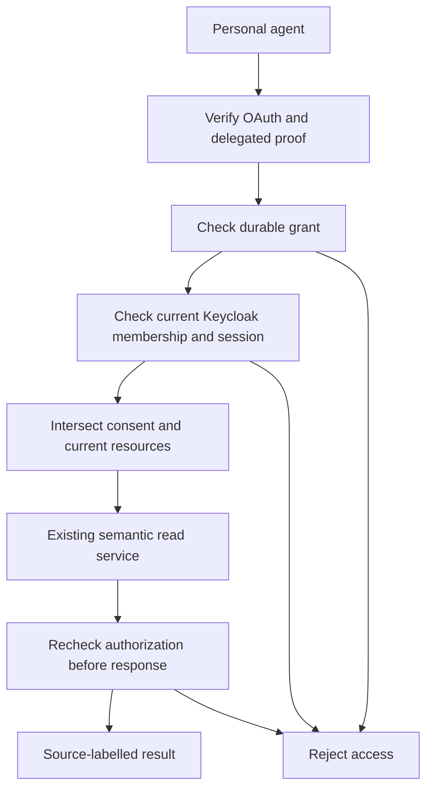
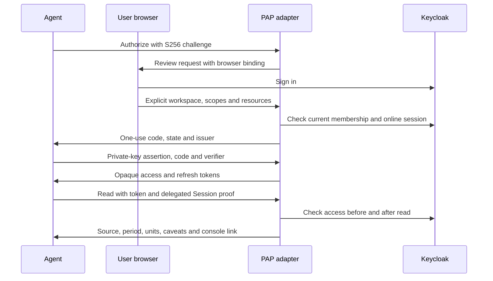

# Personal agents — read-only pilot

Read your authorized GTM Growth workspace data through a compatible personal agent, with visible sources and revocable access. The implementation is **disabled by default**. No named agent/provider, production deployment, or real-world interoperability is certified by this change.

[Functional and technical specification](PAP-SPECIFICATION.md) · [Authorization decision](architecture/PAP-AUTHORIZATION.md) · [Technical runbook](technical/PAP-RUNBOOK.md)

## Marketing: the customer journey

1. The workspace administrator enables the pilot and selects an operator-approved agent.
2. The customer starts the connection in that agent, signs in to GTM using Keycloak and chooses **one workspace**.
3. The consent page identifies the agent and its metadata domain. All requested permissions and resource checkboxes start unchecked.
4. The customer chooses a subset and approves. Consent lasts at most 30 days, ending earlier on Keycloak logout, session expiry, removal from the workspace, administrator suspension or revocation.
5. The agent reads an existing aggregate model. Responses preserve the source, effective period, units, caveats and missing-data state, and link to the relevant console analysis.
6. **Act → Connected agents** shows authorizations, consenting user, scope, sources, dates and last use. Revoke disconnects that user's authorizations for that agent in this workspace; it cannot retrieve data already transmitted.

| Model | Example first question | Interpretation boundary |
| --- | --- | --- |
| Workspace | Which sources are configured in my authorized workspace? | Configuration is not connection health |
| Search | What were our GSC clicks and impressions over 28 days? | One selected property; reporting window ends three days ago; clicks are not conversions |
| Analytics | What were GA4 sessions and key events over seven days? | One selected property; key events do not establish sales |
| Visibility | What does the latest imported AI answer sample show? | Actual observation dates; reviewed/unreviewed mentions stay separate; no market-share claim |
| Operations | What is the recorded collection and alert status? | No new collection; latest recorded run and a maximum 200-alert sample |

Expected benefits are less manual copying, consistent metric definitions across the console and agent, and visible permissions that the customer can withdraw. These are product hypotheses, not measured conversion gains. This pilot requires no LLM subscription, API key, or additional AI execution service. A ChatGPT/Claude/Gemini subscription alone does not establish PAP support.

No publishing, purchases, CRM identity linking, commerce actions, arbitrary MCP tools, conversations, Browser Join or PAP Operations extension is exposed. L2/L3 remain separate future releases.

## Technical: authorization and source boundaries

The facade is mounted before the general JSON parser at `/api/poppy`. It accepts only its strict read schema, with a 16 KB input limit. It never dispatches into the general MCP registry. Metadata and the public catalog contain no tenant data. The Company identity comes from configured public origin and issuer; Host must match, and forwarded headers cannot choose it.

| Control | Implementation |
| --- | --- |
| Company/issuer | One configured GTM origin; a dedicated OAuth adapter using Keycloak for human identity |
| Client | Exact allowlisted HTTPS metadata URL; no redirects; same-host JWKS; public IPv4 DNS pinned to the socket; five-second fetch and 256 KB maximum |
| Authentication | `private_key_jwt`, ES256 and PS384, exact issuer audience, five-minute maximum assertion lifetime, durable replay rejection |
| Authorization code | One use, 60 seconds, exact client/redirect, S256 verifier, browser-bound request, Origin check and explicit consent |
| Access token | Opaque, stored hashed, five minutes, linked to one active grant and resource origin |
| Refresh | Rotating, atomic, scope narrowing only, bounded by grant and live Keycloak session; replay fails; revoking an already-rotated token does not revoke its replacement |
| PAP Session | ES256 delegated key, ES256/PS384 delegation, thumbprint, issuer, method, normalized URL, token hash, freshness and replay checks; account/agent continuity |
| Current permissions | No platform-admin bypass; enabled user, real organization plus group or realm role, online IdP session, active tenant, pilot policy and current properties |
| Revocation | Registry checked before every read and again before emitting; console/admin/token endpoint update the same durable store; Keycloak logout/removal blocks subsequent access |
| Rate and time bounds | 30/minute/grant, 120/minute/workspace; two provider reads concurrently per workspace; 15-second response deadline includes verification; timed-out provider work retains its lease until it settles |
| Audit | Request ID correlates response to a durable event; model, outcome and duration only; no raw tokens, JWTs, result content, CRM contacts or prompt logs |

The existing checker/generator now follows PAP 1.0 canonical fields and RFC 8414 issuer paths. `poppy-check` records time and validator version, and reports authentication, authorization and journey checks as **not tested**. `poppy-generate` produces proposals and prerequisites; it only returns issuer metadata when explicitly supplied, never invented `/token` or `/revoke` endpoints.

## Acceptance status

The implementation includes local cryptographic, OAuth lifecycle, resource-isolation, revocation, discovery and bilingual UI tests. Existing semantic-service tests cover the five read models. These tests are executable in the repository; they are not a claim that the deployed service or any external agent passed acceptance.

Before activation, the operator must complete the [runbook](technical/PAP-RUNBOOK.md): qualify deployed Keycloak 26.4 access and session revocation, run the upstream Company validator against HTTPS staging, perform a real agent journey, measure latency and the 20-scenario customer corpus, and prove backup/restore. The success targets in F12/Q01 remain acceptance targets until that evidence exists.
