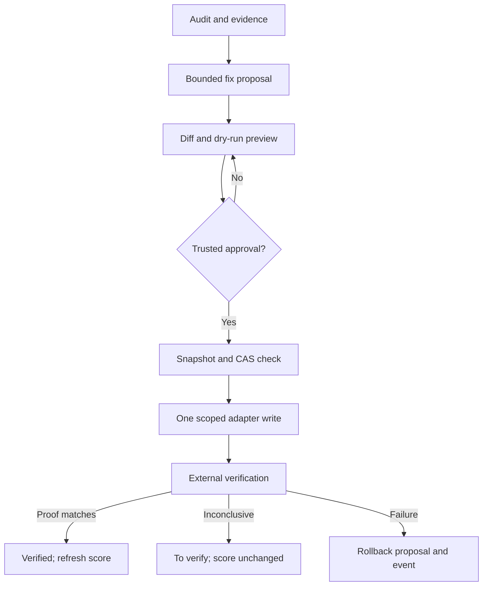

# Apply Mode — architecture and phased delivery (ADR, 2026-11-09)

**Status:** Phases 0.1–0.2 read-only preview and Phase 0.3 encrypted registry foundations implemented; approval APIs and production writers are not connected. **No production-write adapter is enabled.**

This ADR incorporates the [owner-supplied *Cahier des charges — Mode Appliquer v1.0*](../specs/APPLY-MODE-v1-2026-11-09.md) into the GTM Growth roadmap. The core principle is **copilot, never autopilot**: inspect the evidence, show a concrete diff, preview, obtain an authenticated approval, back up, write to one declared target, independently verify, and offer rollback. The approved GEO v2 score rubric and its incomplete-evidence safeguards remain separate.

## 1. Boundaries and ownership

| Component | Responsibility | Trust boundary |
|---|---|---|
| GEO v1 / v2 audits | Measurements, evidence, recoverable points, proposed fixes | No mutations. V2 `score: null` stays null while proof is incomplete. |
| Fix planner | Immutable `before`/`after`, scoped target, validation, content hashes, reviewable diff | No remote credentials or writes. Input resource must be observed and bounded. |
| Approval service | Keycloak identity, tenant, role, exact verified host, approval of a **specific immutable diff**, expiry, idempotency | Must load approval/grant from trusted storage, never trust flags from a JSON request alone. |
| Adapter (WordPress/GTM) | Snapshot, compare-and-swap, one bounded write, idempotency, verification | Explicit per-site write grant; no general filesystem, FTP, arbitrary URL or GTM publish permission. |
| Journal and snapshots | Append-only events, encrypted restore material, verification proofs, rollback event | Tenant-separated storage and scoped access. No passwords/tokens in diff or logs. |



Only the preview stage is enabled in user-facing interfaces. The approval/snapshot registry is available as a server-side library but is not initialized by the API or console. Actual `execute` and `rollback` transport paths are deferred until credentials, roles, connection method, locking and recovery guarantees have been validated.

## 2. v1 product scope

1. **Files:** `robots.txt`, `llms.txt`, `llms-full.txt`; detect missing vs existing resources and conflicting WordPress virtual/physical robots rules. No arbitrary path writing.
2. **Structured data:** Organization, WebSite, Article, FAQPage and Breadcrumb; detect duplicate generation from Yoast, Rank Math and SEOPress before proposing injection.
3. **Page metadata:** title, description and H1 — propose with a preview; do not rewrite arbitrary page bodies.
4. **GTM/GA4:** propose changes in a dedicated **draft workspace**, test preview and consent, and require separate review for any version publication. Do not silently remove existing tags.
5. **WordPress:** minimal tenant/site-scoped connector, draft-only content creation, independent external check and rollback/revert proposal. Preserve the current content-ops workflow until its authorization semantics are reconciled.
6. **Console:** client board, action list, fix detail, diff/preview, approval, verification result, immutable history/rollback. Single fix/target at first; same-scope batches follow later.
7. **Interfaces:** `geo-apply` dry-run first; later CLI `geo-verify`, `geo-rollback`; proposed MCP and REST routes are **not** silently activated.

**Deferred:** automatic Git/FTP/SFTP deployments, Next.js/Shopify/Webflow writers, multilingual CMS editing, body-content rewrites, white-label reporting, batch transactions across systems.

## 3. Minimal persisted model

```text
fix_proposals  (id, tenant_id, domain, target_kind, target_path, base_snapshot_hash,
                proposed_hash, diff_hash, evidence_refs, risk, created_by, expires_at, status)
approvals      (id, tenant_id, fix_id, principal_sub, role, approved_diff_hash,
                explicit_confirmed_at, expires_at, consumed_at)
apply_attempts (id, fix_id, idempotency_key, target_etag, status, created_at,
                started_at, completed_at, verifier_report_id)
snapshots      (id, attempt_id, target_kind, encrypted_before_ref, encrypted_after_ref,
                sha256_before, sha256_after, created_at)
verification   (id, attempt_id, observed_http, evidence_hash, checks, status, checked_at)
audit_events   (id, tenant_id, actor_sub, target, event, correlation_id, timestamp, digest)
```

- **Implemented as a Node-only library:** `ApplyRegistry` stores encrypted preview JSON, a single persisted exact-diff approval per proposal, an encrypted original-content snapshot and HMAC-chained, tenant-scoped events. It requires a trusted `TenantDomainGrantReader` supplied by the server and a 32-byte operator-provided encryption key; neither comes from client JSON. The caller must explicitly instantiate it and provide safe secret management; no API wiring or on-by-default key exists.
- Encrypt previews and snapshots using AES-256-GCM with fresh nonces, associated tenant/proposal context and purpose-separated HKDF key material. Snapshot content is bounded to 64 KiB; proposal JSON to 256 KiB. Database file permissions are `0600`. Cryptographic integrity checks fail closed for corrupted or cross-context payloads. This is a local-at-rest protection, **not a replacement for full-disk encryption, database access control or key rotation**.
- **Implemented but not scheduled:** `pruneExpiredPayloads` removes ciphertext for expired snapshots and previews while retaining audit metadata. The snapshot retention is configurable from 1 to 90 days (default 30); approval TTL is at most five minutes and additionally bounded by the preview expiry. Plan a scheduled purge and a separately validated key rotation/retention policy before deployment; prefer per-tenant encryption keys in later phases. The HMAC chain detects event modification but **not deletion of the terminal event** without external checkpoints.
- Use SQLite transactions on the existing VPS (Phase 0), with unique `(tenant_id, target_kind, target_path, active_attempt)` locks and idempotency keys. Never hold a DB transaction open across an external CMS/GTM network call.
- Capture the exact pre-write content plus version/ETag when possible. Re-fetch and compare the observed SHA-256 **just before** writing; any drift means a fresh proposal and diff are required.
- Attempt states: `proposed → previewed → approved → backed_up → applying → verifying → verified`. Explicit branches: `to_verify`, `failed`, `uncertain` (lost ACK; reconcile **before retry**), `rollback_requested → rolled_back`. A rollback is a *new* event and needs authorization.

## 4. Permission and mutation gates

All of the following must pass **server-side** before any adapter write:

1. Keycloak-authenticated principal and explicit tenant membership; tenant IDs must be derived from the session, not trusted from a client parameter.
2. `approver` or `admin` role on that tenant; the existing `tenant-user`/`tenant-admin` model is insufficient to represent all four proposed roles. **Do not infer `approver` from a client-supplied boolean.**
3. Exact, current, non-revoked verified-domain grant, and a site-bound credential with write capability enabled for *this* target and category. A DNS/HTTPS ownership grant alone does not authorize a CMS write.
4. A stored, unexpired, single-use approval record binding actor, tenant, target, proposal SHA, diff SHA and verification/preflight policy. An API `confirm=true` is necessary but **not sufficient**.
5. Full diff shown to the approver; pre-write snapshot captured and restorable; backend permission verified; no conflicting active attempt; optimistic concurrency precondition satisfied.
6. Feature flags default **off** for all external writers. GTM publication is a separate explicit workflow, never a side effect of creating a draft workspace.

**Retry policy:** only read/verify operations may be retried automatically (`+10`, `+30` minutes with rate bounds). Never blindly retry a write after a network timeout; first reconcile the remote state and idempotency key. The score actually earned stays unchanged until verified.

## 5. Adapter contracts

```ts
interface ApplyAdapter {
  kind: 'wordpress' | 'gtm_workspace';
  inspect(target: ScopedTarget): Promise<ObservedTarget>; // read-only
  preview(fix: ApprovedFix): Promise<PreviewArtifact>;     // no public write
  backup(fix: ApprovedFix): Promise<RestoreHandle>;        // must complete first
  apply(fix: ApprovedFix, precondition: VersionTag): Promise<WriteReceipt>;
  verify(receipt: WriteReceipt): Promise<VerificationReport>;
  rollback(receipt: WriteReceipt, approval: RollbackApproval): Promise<WriteReceipt>;
}
```

This is an architectural contract, **not** a claim that the methods have been wired to live systems.

### WordPress

- Existing `publishToWordPress` sends `status: "draft"` to `/wp-json/wp/v2/posts`; that is useful for content drafts but not a generic files/schema writer.
- A dedicated lightweight connector needs site-scoped revocable authorization, a health/read-only handshake, plugin collision inspection, explicit selection for `robots.txt` virtual vs physical, versioned snapshots and a controlled regeneration hook.
- Never announce an unpublished WordPress draft through IndexNow; postpone any search-engine notification until an independently verified published URL exists.
- Avoid writing `wp-config.php`, theme/plugin files or global rewrite rules in MVP.

### GTM/GA4

- Reuse existing GTM APIs to inspect tags/triggers/variables. A new draft workspace must be isolated, backed up and previewed. GTM publish is *not* part of the default Apply action.
- Preview success and GA4 event receipt are separate proofs; if measurement/consent evidence is missing, return `to_verify`, never report a live score gain.
- Existing console GTM `/gtm/write` and `/gtm/publish` routes must not be represented as compliant with this new approval contract until their authorization, backup, preview and audit trail are reviewed.

## 6. API/UX rollout without production writes

### Owner-spec coverage register

| Requested capability | Current state on this branch | Delivery gate |
|---|---|---|
| GEO v2 audit → prioritized fixes → projected score | Audit/scoring remains in the independent GEO v2 track (#30); no speculative score increase | Evidence/fix-ID mapping after the scorer is integrated |
| `robots.txt` AI crawler correction | **Implemented:** bounded public GET, deterministic diff, SHA-256 preview and manual conflict flags | Read-only; no WordPress filesystem write |
| `llms.txt`, `llms-full.txt` | Existing generators; Apply-specific proposal, preview and site adapter pending | File ownership/source detection and plugin selection |
| Organization, WebSite, Article, FAQPage, Breadcrumb JSON-LD | Existing schema generation primitives; diff/reconciliation pending | Duplicate/plugin conflict detection before injection |
| title, description, H1 | Existing audit evidence; page metadata edits pending | Scoped WordPress page/post versioning |
| WordPress content draft | Existing adapter creates `status: draft`; legacy console now reports **draft created** and never announces it to IndexNow | New connector authorization and rollback before making it an Apply action |
| GTM/GA4 tags, consent, duplicates | Existing inspection and write APIs; Apply draft workspace pending | Staging, tag-diff review, consent evidence and no auto-publish |
| Reader/editor/approver/admin and tenant isolation | **Implemented as a pure policy and trusted Keycloak-claims mapper**, plus tenant-scoped SQLite registry. Not yet wired into authenticated approval API | Enforce trusted role/tenant identity in the API, reject cross-tenant requests |
| Diff, preview, approval, explicit confirmation | **Implemented:** deterministic file preview, tenant-scoped console preview, persistent exact-diff approval with explicit confirmation/expiry; no approval UI/API | API integration, displayed-diff confirmation, one-time consumption and conflict locks |
| Backup, atomicity, verification, rollback | **Implemented:** encrypted bounded original-content snapshot with drift check, retention operation and HMAC audit chain; no live writer | Scheduled purge, one-active-attempt CAS lock, independent checks and rollback rehearsal |
| CLI, REST and MCP interfaces | **Implemented:** `geo-apply --dry-run`, `POST /api/console/apply/preview`; no REST/MCP writers | Each interface must use the same trusted approval service |
| Console board, 3-click path and immutable history | **Implemented:** read-only GEO fixes tab and side-by-side source/diff review; board/history pending | No writes from overview, same-tenant event history |
| Owned/verified domain and private score publication | Existing GEO v2 verification work stays separate; no public score release | Explicit owner consent, exact-domain grant and external rescan |

The owner-approved 42-control Score GEO v2 rubric remains the measurement authority. Apply Mode consumes its evidence and fix recommendations **only after** a scorer result is available; it does not alter weights or award projected points as earned points. Treat PR #30 and this Apply Mode branch as two independently reviewable streams until their contracts can be integrated.

| Phase | Deliverable | Safety gate |
|---|---|---|
| 0.1 | Scoped immutable proposal, line diff, `geo-apply --dry-run`, unit tests, English-first docs | No external write, no stored secrets. |
| 0.2 | **Partially implemented:** authenticated `POST /api/console/apply/preview`, console diff/preview and isolation tests. Next: dynamic fix list and per-tenant audit read view | Read-only API, URL SSRF guard and tenant isolation tests. |
| 0.3 | **Library implemented:** SQLite exact-diff approval registry, four-role Keycloak mapping, AES-GCM preview/snapshot encryption, drift check and tenant HMAC audit chain. **Still pending:** API/console wiring, active-attempt idempotency locks, single-use consumption, purge scheduler and staging recovery. | All negative authorization tests pass; do not enable writes until missing gates are implemented. |
| 0.4 | WordPress draft adapter and read-only plugin conflict probe; then scoped file changes behind flag | Owner selects file management mode and connector strategy; backup and rollback smoke-tested in staging. |
| 0.5 | GTM draft workspace/preview adapter, independent GA4 verification | No publish in MVP; separate release approval required. |
| 0.6 | Pilot for verified owned domains, post-write external rescan and scored delta | Green verification + rollback rehearsal before wider rollout. |

Implemented read-only REST: `POST /api/console/apply/preview` behind the existing Keycloak middleware. The server checks a registered exact tenant hostname (normalizing the common `www` alias) before one DNS-pinned public GET. **Registration is not ownership proof**: DNS TXT/HTTPS verification is still required before any future write. Requests supplying `apply`, `confirm` or an execution mode fail before fetch. The tab is under **Act → GEO fixes** with diff, both versions, hashes and manual-review notices; it has no execution button.

Planned mutation API: `POST /api/apply/:id/approve`, `POST /api/apply/:id/execute`, `GET /api/apply/:id/verify`, `POST /api/apply/:id/rollback`. **None of these endpoints is active.** Every mutation endpoint must consult the trusted registry, check authorization and expiry, atomically consume one-time approval, and enforce target-level idempotency and a version precondition; a request `confirm=true` alone is never sufficient. The frontend must show projected and measured scores distinctly.

## 7. Working architectural defaults — site-specific validation **before enabling writes**

1. **WordPress authentication:** use a plugin-specific scoped and revocable connector token with a read-only handshake; compare with the existing WordPress Application Password only for migration.
2. **GTM publication:** MVP creates previewable draft workspaces only; any future publish is a separately approved action.
3. **Snapshot retention:** append-only audit metadata with finite, configurable retention for encrypted secret-bearing payloads.
4. **WordPress robots source:** detect physical vs virtual/plugin-managed rules and require an explicit site-specific choice before writing.

These are adopted as safe design defaults, **not** authorization to activate any external writer. Credentials, backup restoration, retention periods and site capabilities must be validated before switching a feature flag on.

This ADR does **not authorize a production deployment**. Repository merge/release decisions are made separately by the project owner. Keep the Apply Mode contract independently reviewable from the GEO v2 scorer PR #30 until the integration gates above are satisfied.
