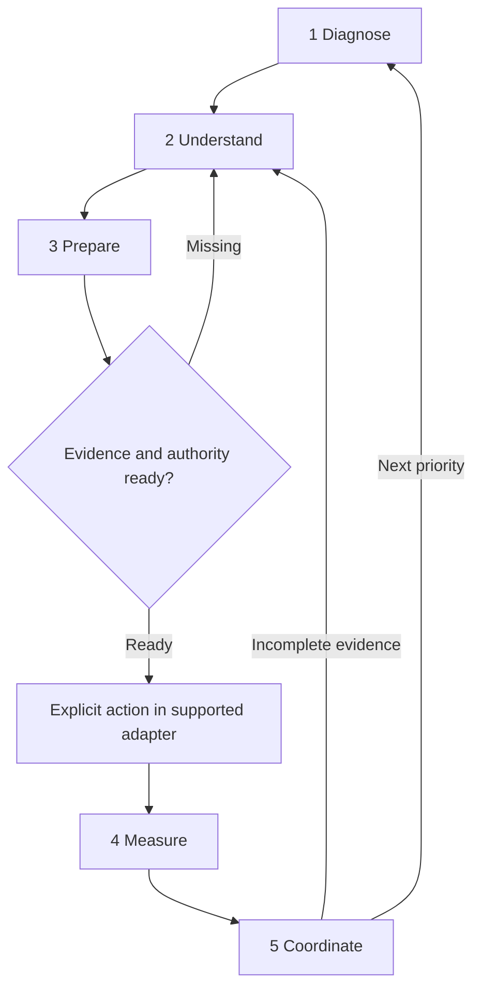
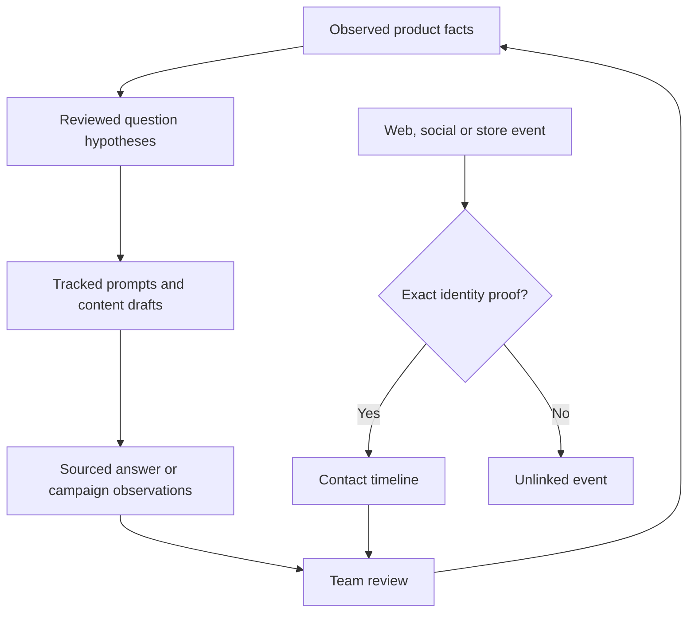

# Shared customer journey

[Documentation hub](../README.md) · [Marketing track](../marketing/README.md) · [Technical track](../technical/README.md)

This blueprint aligns product explanation, onboarding and integration around the
five stages already used by [the website catalog](../../site/journey-content.js).
It describes a working method; it does not introduce a new automated workflow or
persist a customer's completion state.

## Three journeys, three kinds of evidence

| Journey | Question answered | Object and source | What it cannot prove |
| --- | --- | --- | --- |
| **Using GTM Growth** | What should the team do next? | Diagnose → Understand → Prepare → Measure → Coordinate; website/console navigation | Completing a screen does not prove activation or business impact |
| **Planning buyer content** | What might this buyer ask? | Five awareness stages; observed Product/Service facts plus explicitly confirmed context | Hypotheses are not real searches, demand or a contact's history |
| **Observing a contact** | Which documented touchpoints belong to this contact? | CRM contact, exact scoped identity links and sourced web/social/manual/store events | No inferred identity, complete browsing history or causal attribution |

The buyer-awareness stages are **Unaware, Problem aware, Solution aware, Product
aware and Most aware**. They are a content model. A CRM event does not automatically
assign one of those stages to a person.

## The operating loop

An action can be an export, a human task or a permitted external change. The
approval/readback requirements depend on the adapter. Apply Mode currently ends
at preview; the diagram is not a claim that it can execute a remote fix.

## Blueprint: same stages for both teams

| Stage | Marketing decision and owner | User action / console | Technical handoff | Exit evidence |
| --- | --- | --- | --- | --- |
| **Diagnose** | Owner or marketer selects the page and problem | Public read; inspect findings, source and limits | Bounded public fetch → GEO v1/SEO findings; preserve URL for the next screen | A reproducible finding, source URL and one prioritised issue |
| **Understand** | Marketer confirms offer, buyer and need | Select a real Product/Service; confirm context; optionally compare up to two offers | Shared extraction/model → hypotheses; admin may add selected questions to the tenant prompt pool | Reviewed questions with provenance; missing facts remain explicit |
| **Prepare** | Editor chooses a bounded improvement; reviewer checks it | Draft content/assets, inspect robots diff, prepare Social variants | Module-specific drafts, policy checks and approval records | Exact reviewed payload, target, owner and execution conditions |
| **Measure** | Analyst selects the source, scope and comparison | Connect GA4/GSC or store; import/collect answers; read CRM timeline | Source adapters → tenant stores → reports; exact identities required for CRM | Dated observations with source, coverage and limitations |
| **Coordinate** | Client lead assigns the next decision | Review priorities, location responsibilities, reports or guided assistant | Permission-scoped reads; optional worker/Slack integration | Named next action, responsible person and next review period |

## Connect at the point of need

| Decision | Minimum prerequisite | Recovery when missing |
| --- | --- | --- |
| Check a public page | Reachable public URL | Show fetch failure; try a specific accessible product page |
| Save client work / use private sources | Active tenant and valid Keycloak membership | Select or provision the correct workspace; keep language and business role separate from access |
| Understand actual search demand | Authorised GSC property and date range | Use question hypotheses with their label; do not invent query volume |
| Review AI mentions | Sourced answer import, or supported API account with explicit collection | Import saved answers; Gemini collection remains blocked |
| Inspect store observations | Store permissions, sealing key, explicit sync or signed webhook | Resolve connector scope; retain unknown identities/signals |
| Follow one contact | CRM enabled, CRM role, proven source-scoped identity | Keep the event unlinked; administrator reviews the proof |
| Publish a Social post | Allowed account, reviewed exact draft/schedule, separate approver, worker and provider | Keep draft/queued/uncertain states visible; reconcile before any retry |

## How records relate

This is a conceptual relationship map. The prompt handoff and commerce-to-CRM
outbox exist; there is no universal automatic join from drafts, campaigns or
aggregate audience metrics into contacts. [Integration contracts](../technical/INTEGRATION-MAP.md)
identify the real connections and the remaining work.

## Team acceptance scenario

Use one authorised client and one product page. The marketer selects and confirms
the product, audience and need; the administrator saves a relevant prompt; the
analyst imports a dated answer or explicitly runs a configured collector. Compare
only comparable source/model/prompt/period observations. Separately, enable CRM,
create a synthetic contact and prove an exact store or web identity association;
verify a sourced event appears once and an unmatched event stays unlinked.

Pass when both readers can identify the source, scope, actor, next action and
limitation at every handoff. Browser/fixture tests support this scenario; real
customer credentials and live provider acceptance are separate checks.

## Shared vocabulary

| Term | Meaning |
| --- | --- |
| Tenant / workspace | Client boundary enforced by the backend |
| Configured | Required connection/settings exist; not proof of a successful run |
| Observed | Value returned by a stated source at a stated time |
| Declared | Human or source assertion, retained with provenance |
| Hypothesis | Proposed question/interpretation requiring review |
| Preview / draft | Reviewable preparation; no remote publication implied |
| Verified | A specified independent readback/check succeeded; name what was checked |
| Unknown | Evidence is absent, unusable or insufficient; never substitute zero |

Next: [measurement rules](../marketing/MEASUREMENT.md), [capability register](CAPABILITIES.md),
[technical integration map](../technical/INTEGRATION-MAP.md).
