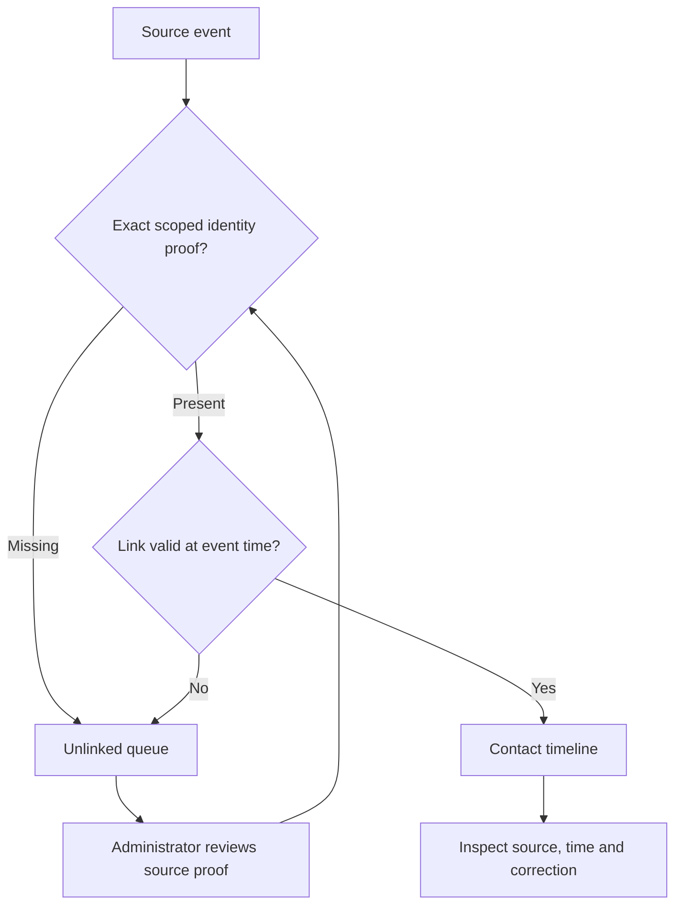

# Measurement and evidence contract

[Marketing track](README.md) · [Journey](../journey/README.md) · [Integration map](../technical/INTEGRATION-MAP.md)

Every business report needs a tenant/site or store, source, date range, timezone,
unit, denominator and coverage statement. Compare equivalent periods and record
configuration changes. Missing data is unknown; a zero is meaningful only when
the source successfully measured the relevant scope.

## Choose a measure that answers the question

The formulas below are review definitions, not a claim that every KPI is already
instrumented or calculated in the console.

| Stage / decision | Measure and denominator | Evidence | Limitation / status |
| --- | --- | --- | --- |
| Diagnose: what blocks readiness? | Passed checks / applicable checks, with unknown coverage; keep the versioned score separately | GEO/SEO check evidence | v1 readiness is not v2 and neither is a citation rate |
| Understand: what should we research? | Reviewed questions with source/context; no fabricated search volume | Product facts and human confirmation | Planner output is hypothetical; GSC is a separate observation source |
| Prepare: is work ready? | Approved exact payloads / submitted payloads for the same workflow and period | Module approval history | Review KPI proposal; no universal cross-module dashboard |
| Search: did clicks change? | Current clicks minus baseline clicks; percentage only if baseline is greater than zero | GSC, same property/query/page filters | Source aggregation and reporting gaps remain visible |
| Conversion: did an event occur? | Defined key events / the stated eligible sessions, if comparable | GA4 with explicit event definition | Sessions and users cannot be interchanged; not an automatic causal claim |
| AI: how often is the brand observed? | Answers mentioning the brand / eligible observed answers | Same prompts, provider/model, source and collection conditions | A bounded sample; missing answers are not negative observations |
| Commerce: which orders have evidence? | Orders with a supported UTM/referrer signal / eligible orders, per currency and period | Per-order method/confidence and raw order status | Analytical definition; current dashboard `attributedShare` is different |
| CRM: how complete is this timeline? | Linked sourced events / eligible events for the declared source/period | Exact identity proof, event IDs and timestamps | Proposed coverage measure; not total customer activity |
| Local: what is verified? | Passed LOC controls / applicable controls, with unknown count separately | Current scoped evidence snapshots | API readback and public ranking are distinct |
| Social: what was observed? | Provider series per account/date/source; GA4 traffic reported separately | Postiz, imports and GA4 provenance | Do not sum unique reach across networks or manufacture ROI |

## Known commerce limitations in this revision

[Attribution implementation](../../src/ecommerce/attribute.ts) and the
[console dashboard](../../src/console/commerce.ts) need particular care:

1. UTM takes precedence over referrer. The `ga4_join` branch labels an available
   session signal but returns `channel: unknown`; it does not query GA4 to resolve
   the channel. The model's `windowDays: 30` and `firstTouch` fields do not establish
   a reconstructed multi-touch history.
2. When both referrer and landing page are absent, the implementation classifies
   the order as `direct`, with low confidence. Do not claim every missing signal
   is preserved as `unknown` or that these orders prove direct acquisition.
3. Revenue is grouped by channel across connected stores without grouping by
   currency. Review a single-currency scope before interpreting totals or AI share.
   The dashboard reads at most 1,000 orders per store; it does not prove exhaustive
   historical coverage.
4. Revenue filters the selected period and excludes cancelled/refunded orders;
   console `attributedShare` counts all loaded orders whose channel is not
   `unknown`, including low-confidence direct orders, without the same date/status
   filter. MCP engine detail also has different status filtering. These denominators
   must be reconciled before an executive attribution report.

These findings are documented integration work, not fixes delivered by this
reorganisation. See the [audit backlog](../maintenance/REPOSITORY-AUDIT.md#prioritised-integration-work).
CRM timelines already keep event amounts/currencies and lifecycle snapshots
separate; do not turn those snapshots into a revenue total either.

## Read an observed contact timeline

A manual call is a human declaration. A plugin interaction is a source assertion.
An order is a store observation. Keep those labels visible. A session link is
bounded to at most 24 hours. Revoking a link changes the derived timeline; it does
not rewrite a person's history. Collection authorisation, source deletion and
GTM-side erasure are separate responsibilities.

## Decision record template

| Field | Record |
| --- | --- |
| Decision | The specific question and action under consideration |
| Scope | Tenant, site/location/store, audience, currency if relevant |
| Baseline | Source, exact dates, timezone, filters and denominator |
| Change | Exact reviewed payload, actor and execution date |
| Follow-up | Same-source observation, date and coverage; unresolved gaps |
| Interpretation | Observation first; hypothesis and alternatives separately |
| Next action | Owner, reviewer and review date; no invented target |

Do not publish a readiness score without the owner's explicit consent. Domain
verification and permission to disclose a score are different decisions.
