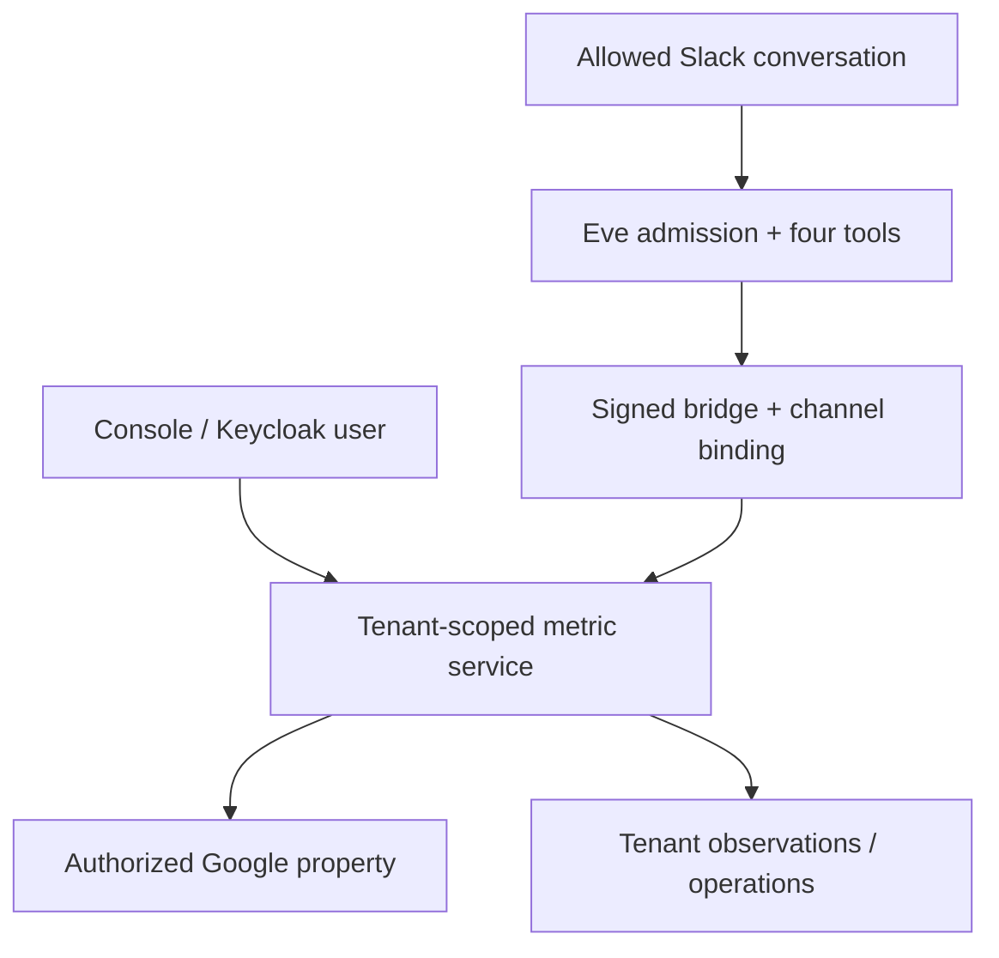

# Data agent across the customer journey

Status: merged in [PR #42](https://github.com/Geoking2104/GTM-Growth/pull/42); core assistant deployed to OVH on 13 November 2026 in
[run #44](https://github.com/Geoking2104/GTM-Growth/actions/runs/43462628681) at `1749446`.
Live Slack activation and real Slack acceptance remain pending. Website: https://gtm.kayroslab.com/. English is the reference;
the implemented public, onboarding and authenticated UI has matching FR/EN copy.

## Product decision

Give users an assistant wherever they are working, with their business objective
and evidence in view. Use a shared semantic read service for console and Slack.
Adapt Vercel's Eve template as an optional conversational channel, while retaining
GTM's existing OVH/Keycloak/SQLite architecture and free self-hosted functionality.

The upstream template supplies useful patterns: discover model definitions before
querying, distinguish source freshness from metadata generation, enforce Slack
admission, and answer in business language. It explicitly is **not** a production
access-control/metrics platform; its shared DuckDB identity and synthetic Jaffle
Shop sample are not appropriate for GTM's customer boundary. GTM replaces its
SQL tools with five curated, tenant-scoped models and an independently authorized
bridge. No warehouse migration, dbt, MotherDuck or Vercel migration is required for
the core product. This is an adaptation, not an unchanged template installation.

Source reviewed: [Eve Data Agent Template at dd47b835](https://github.com/vercel/eve/tree/dd47b8355241fc04b14d2ff00465ac3bd463f165/apps/templates/eve-data-agent-template).

## Journey and user value

| Stage | Entry point and answer | Next action | Success measure to instrument |
|---|---|---|---|
| Discovery | Public scan explains what was measured and what the score means | Review evidence, identify the audience, sign in | Scan-to-meaningful-action rate |
| Activation | Assistant in guided setup; personal role, goal, audience and 28-day target | Connect/verify the relevant source | Time to first successful sourced answer |
| Adoption / growth | Common console surface on every section; relevant question selected for the current view | Open source analysis or prepare journey questions | Answer-to-action click rate and repeat usage |
| Retention | Operations status, actual periods and saved targets | Inspect alerts and prepare a customer review | Share of reviews grounded in current evidence |
| Expansion | Agency role and reports; each client remains a separate workspace | Review results, deliberately switch clients in the console | Active workspaces per agency, without pooled data leakage |
| Team collaboration | Mention Eve in an approved Slack channel; threaded answer | Follow a tenant-specific link back to the console | Useful-answer feedback and completed handoffs |

These are proposed success measures, not already collected telemetry or promised
uplift. The GTM lifecycle above is separate from the five awareness stages of
the visitor buying from a customer's website. The existing **Customer journey**
module still models that visitor's questions as hypotheses.

## Console adaptation

| Business role / goal | Priority |
|---|---|
| Owner | Source readiness, business totals, desired 28-day target |
| Marketer / traffic | Search clicks, audience questions and content handoffs |
| Leads or sales | Sessions and key events, with explicit validation of what a lead/sale means |
| AI visibility | Confirmed mentions and their actual sample dates |
| Local | Existing location registry and local operations |
| Technical | Technical blockers before content work |
| Agency | Customer review and report, within one authorized workspace |

Each authenticated user saves a profile scoped by **tenant + verified issuer +
subject**. The role is a business preference, not an authorization role. No
navigation section is hidden by the profile. Suggested shortcuts are transparent
and editable through the profile. Personal targets are intentions, not forecasts;
only a matching successful 28-day metric displays a measured/target comparison.
The sidebar's distinct existing icons remain unchanged.

The public assistant explains the current single-page scan locally. It never
reads private data. The signed-in assistant provides **guided questions**, not
unrestricted natural-language chat. Eve adds the natural-language Slack channel.
Neither surface schedules or publishes on a user's behalf. No model call or
metric read starts merely because the user navigates to a section.

## Architecture and security boundary

- Console: existing OIDC/tenant membership checks; additional active-tenant and
  authenticated-subject requirement. No service-secret data reaches the browser.
- Eve: Slack webhook principal admission on mention, DM and continuation; recheck
  for every tool. Default runtime tools and root-agent dispatch are disabled.
- Bridge: unique per-binding secret, exact team/channel/user IDs, HMAC of the raw
  body and timestamp/nonce, durable anti-replay, no caller-provided tenant ID.
  Bindings/suspension are reread per request. Replies are visible to all channel
  members, so the operator must approve the channel's full audience.
- Data: aggregate property totals, a single latest AI dataset, prompt inventory,
  bounded alert counts and latest collection outcome. No raw customer rows,
  prompts/answers, alert text, drafts, leads, credentials or arbitrary SQL.
- Source selection: when multiple Google properties are authorized, ask which
  one; do not silently choose or aggregate them. Query scope is a property or
  workspace, not necessarily the console's currently selected web page.
- Freshness: show actual periods, state missing/error separately and disclose
  import times versus observation times. Key events are not necessarily sales.
  GEO readiness and measured AI visibility are distinct.

API: POST `/api/console/data-agent/context`, `/profile`, `/query` under existing
OIDC. Optional Eve bridge: POST `/api/internal/data-agent/read`, mounted before
JSON parsing. The template package has independent dependencies/Node 26 build;
the core app keeps its existing Node 20 deployment. See the
[operator runbook](../../integrations/eve-data-agent/README.md).

## Value optimization and next increments

1. **Deliver first value without a paid model:** public explanation, saved goals,
   context-specific guided questions, sourced metrics and direct actions are in
   this increment. Avoid introducing a separate chatbot destination that users
   must discover.
2. **Pilot Slack with a small approved group:** use the same definitions and
   evidence as the console; validate helpfulness, delay, source correctness,
   permission denials and provider cost before expanding access.
3. **Measure usefulness before automation:** add opt-in answer feedback and
   privacy-reviewed events for question, source state, latency and handoff. Do
   not log question text, private results or credentials into broad analytics.
4. **Then add durable tasks:** scheduled briefings, saved investigations and
   approved action proposals can build on the existing operations/Apply Mode.
   They need explicit delivery destinations, budgets, audit history, idempotent
   queues and consent. None are silently enabled here.
5. **Expand evidence coverage deliberately:** page-specific local/GEO snapshots,
   date comparisons, revenue with known currency and customer-approved event
   definitions, then row-level warehouse tools only when a reviewed requirement
   justifies them. No generalized SQL access is needed for the initial value.
6. **Keep commercial promises accurate:** the console stays usable in open source.
   Managed Slack onboarding, hosting and support could add Cloud value, but no
   new price, Mollie entitlement, quota or paid feature gate is implemented here.

## Validation and release gates

Automated checks cover SSO/tenant/source isolation, private preference scope,
missing/error data, reviewed/sample metric semantics, raw-data exclusion,
signature freshness/tampering/replays, changed bindings and suspension, bilingual
UI behavior, stable navigation and adapter transport bounds. Core CI passed 556 tests;
Eve CI passed two adapter tests and its build. The production release passed health,
asset parity, public analysis and unauthenticated API boundary checks. Real Google
reads and live Slack replies require their configured accounts and were not
validated by those checks; fixtures do not establish those outcomes. The normal CI and deployment controls,
including OVH SSH pinning, remain in force.

## Résumé français

Un assistant commun accompagne la lecture publique, le démarrage guidé et toutes
les rubriques de la console. Le rôle métier, l'objectif, l'audience et la cible
personnelle adaptent les prochaines actions sans élargir les droits. La console
propose des questions guidées gratuites ; Eve apporte les questions en langage
naturel et les réponses dans les fils Slack autorisés. Les deux utilisent les
mêmes mesures documentées et limitées au client concerné. La connexion Slack et
la validation réelle restent à effectuer avec les comptes autorisés.
