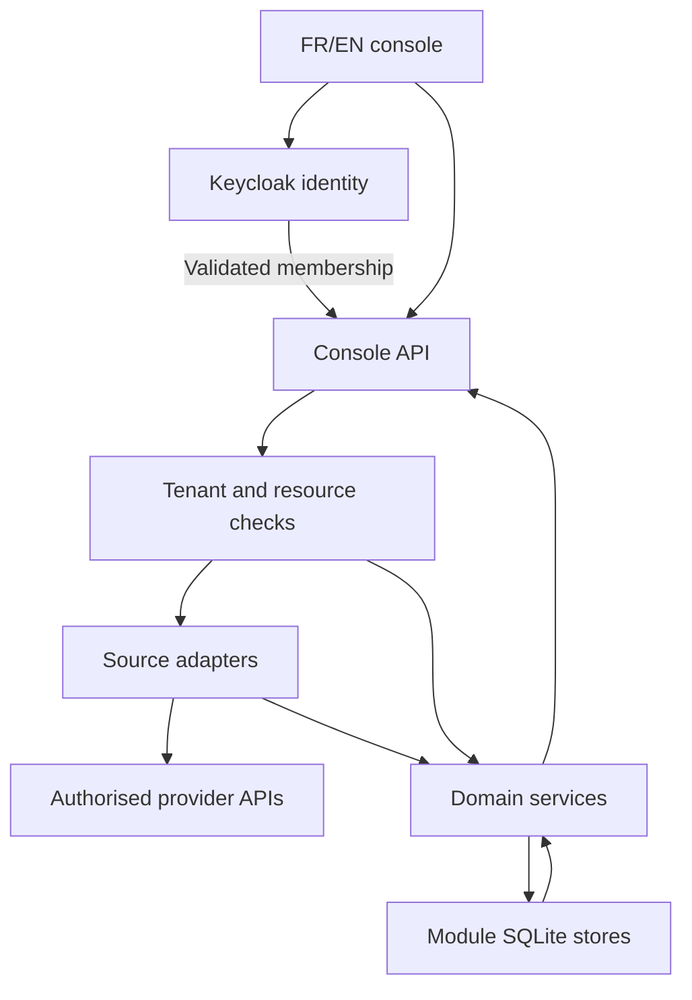
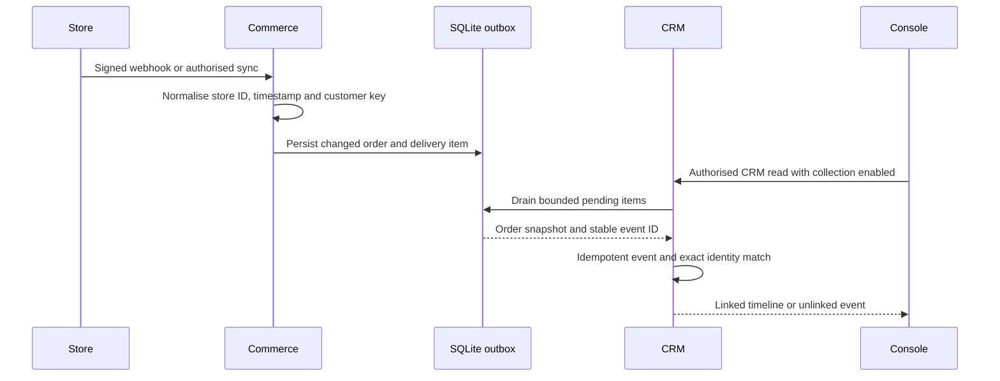
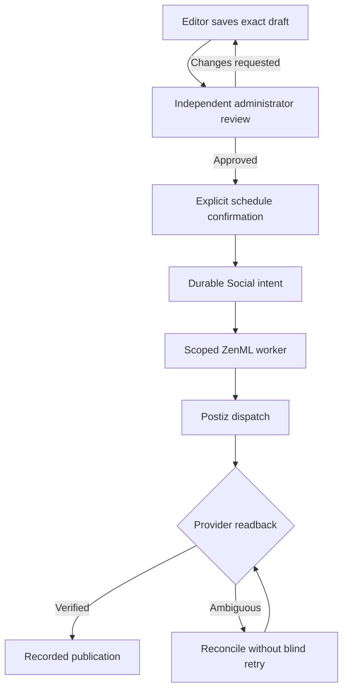

# Integration map

[Technical track](README.md) · [Journey](../journey/README.md) · [Capability register](../journey/CAPABILITIES.md)

The core remains the existing Node/Express/Keycloak/SQLite application. Optional
workers use narrow internal APIs. There is no new warehouse, universal customer
identity service, or automatic cross-source revenue join introduced by this documentation.

## Console and source boundaries

The public free-read route is outside this authenticated diagram and fetches only
bounded public evidence. General MCP/CLI is a separate operator trust boundary;
see [access boundaries](README.md#access-boundaries).

## Integration contracts

| Entry / purpose | Code and storage | Required scope / setup | Output and failure behavior |
| --- | --- | --- | --- |
| Public read: `POST /api/free-read` | [Public API](../../src/http/public-api.ts), `src/freeread`, `src/geo` | Public URL; fetch guards, rate limits and cache | Observed page evidence and labelled sample/private-data boundaries; explicit fetch failures |
| Buyer questions: `POST /api/console/journey/read` | [Journey route](../../src/console/journey.ts), shared [model](../../site/console/customer-journey-model.js) | Own page restricted to tenant including final redirect; competitor flag reads public evidence only | Product/Service context and user-confirmed hypotheses; empty unsupported stages |
| Google analytics/search/tagging | [Google modules](../../src/google/), console adapters | Service account, enabled APIs and exact property/container permissions | Source/period-specific reports; access failures remain failures |
| AI answers | [Connections](../../src/console/ai-connections.ts), [collectors](../../src/console/ai-visibility-providers.ts), SQLite datasets | Tenant admin; import or selected encrypted API account; explicit potentially paid run | Bounded saved observations; Gemini collection blocked; consumer chat login is not API access |
| Store connection/sync | [Commerce routes](../../src/console/commerce.ts), [providers](../../src/ecommerce/providers/), commerce SQLite | Tenant admin, store permissions, `ECOMMERCE_DATA_KEY_B64` | Normalised products/orders, source timestamps and store-scoped identity |
| Store webhook | [Webhook router](../../src/console/ecommerce-webhooks.ts) before JSON parser | Raw-body signature, configured store secret; provider/store resolves tenant | Idempotent ingestion and durable CRM outbox; use `/api/integrations/commerce/webhooks/shopify` or `/prestashop` through OVH |
| Native CRM | [CRM routes](../../src/console/crm.ts), [service](../../src/crm/service.ts), CRM SQLite | Explicit collection enablement; CRM roles; admin identity links | Contacts and clickable events; unknown/conflicting identities are not guessed |
| Client CRM plugin | [Plugin API](../../src/crm/plugins.ts), [reference client](../../integrations/crm-plugin/README.md) | Server-only hashed token configuration; fixed tenant/source/operations/kinds/hosts | Contact upsert, identity assertion, atomic event batch, exact-contact timeline |
| GBP/local jobs | [Local modules](../../src/local-seo/), local SQLite | Exact location grants; Google API approval/manager OAuth; scoped worker configuration | Transient dashboard reads; durable queued jobs; scheduled performance collection still absent |
| Social/Postiz | [Social modules](../../src/social/), social SQLite | Roles, allowlisted accounts, provider credentials and separate [ZenML runtime](../../deploy/social/README.md) | Draft/review/queue/dispatch/readback; no automatic outreach send |
| Console data assistant | [Data-agent service](../../src/data-agent/service.ts) | Current tenant identity and authorised underlying sources | Guided read-only metrics with missing-data states; no model key needed |
| Slack/Eve | [Signed bridge](../../src/data-agent/bridge.ts), [Eve service](../../integrations/eve-data-agent/README.md) | Exact team/channel/user binding, HMAC secret and separate model/runtime setup | Curated tenant reads; no arbitrary SQL/MCP or publication |

The Node server also mounts `/webhooks/*` as a legacy alias. For the current
OVH proxy use the `/api/integrations/commerce/webhooks/*` route. Source route
existence alone does not confirm external provider registration or live delivery.

## Commerce to CRM: durable delivery

Source: [commerce store/outbox](../../src/ecommerce/store.ts),
[CRM bridge](../../src/crm/commerce.ts), [CRM console routes](../../src/console/crm.ts).
The bridge is recoverable after a process interruption. A timeline read can drain
bounded local work; it does not call an external store API. Web/social/manual plugin
events use the CRM contract directly. No campaign, email similarity or aggregate
Postiz/GA4 record substitutes for an exact identity proof.

## Optional workers and human approval

This diagram describes Social only. GBP has its own approval/execution/readback
contract and Node-RED pollers. Apply Mode has no connected production writer.
ZenML stores execution metadata; business approvals remain in GTM's durable store.

## What integration still needs

| Gap | Existing foundation | Next independently testable outcome |
| --- | --- | --- |
| Unified editorial backlog | Questions, prompt pool, module drafts/actions | Versioned multi-page plan with owners and evidence links |
| Consistent commerce KPIs | Normalised orders and per-order attribution | Currency/period/status/coverage-aligned console and MCP reports |
| Complete client CRM adapters | Scoped plugin API and reference client | One vendor adapter with real-source acceptance, replay and revocation tests |
| GEO v2 live audit | Scoring/ownership primitives and offline replay | Reviewed 42-control integration plus isolated network enforcement and live qualification |
| Apply Mode execution | Diff preview and encrypted registry primitives | Wired authorisation, exclusive attempt, backup, verification and tested rollback |
| Release observability | CI and manual OVH workflow | One deployed revision record with live asset/source verification |

These are backlog outcomes. They are not activated by adding keys or by this
repository reorganisation. [Priorities and evidence](../maintenance/REPOSITORY-AUDIT.md#prioritised-integration-work).
